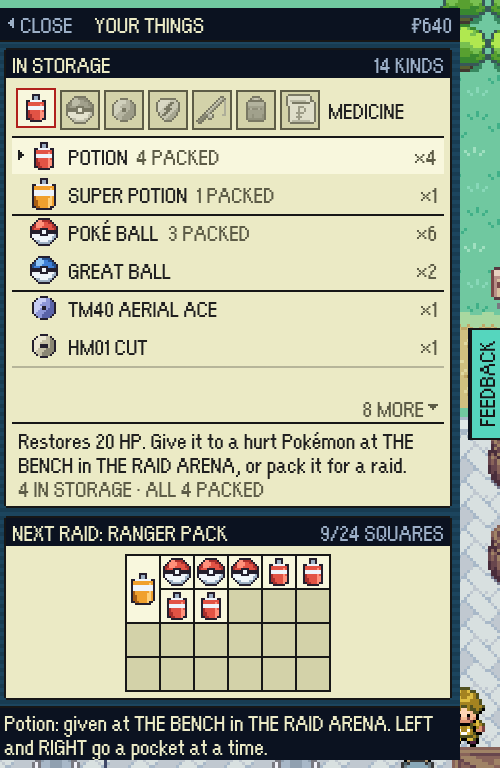

# YOUR THINGS says where a Potion is given at base

With a Pokémon on 2 HP and three Potions, YOUR THINGS said
`Potion: nothing to use it on here.`, so the 22 Nov AI playtest's newcomers
paid Nurse Joy raid time for what a Potion they owned would have done, and
found THE BENCH's medicine only later. Medicine now says it is given at THE
BENCH in THE RAID ARENA, in its help line and its detail. The detail's count
also says the packed ones are some of those in storage (`4 in storage · all 4
packed`, `10 in storage · 3 of them packed`): '3 in storage · 3 packed' read as
six.

| before (main) | after |
|---|---|
|  |  |

Made with `tools/playtest/yourThings.mjs` against a test-mode build at
`PIXEL_WINDOW` (its first picture, the yard), cropped to the panel, 22 Nov 2026.
