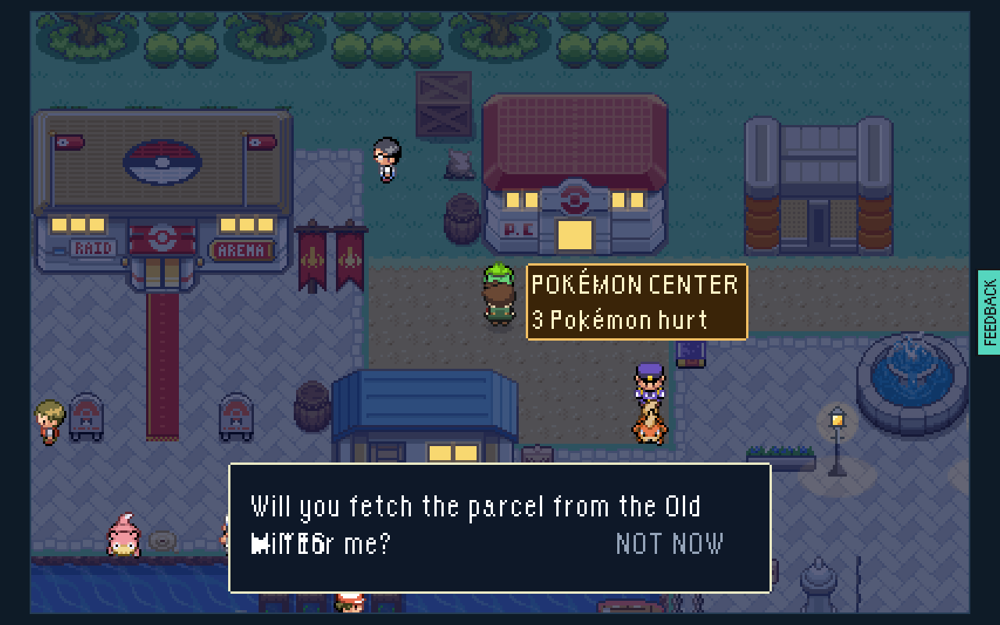
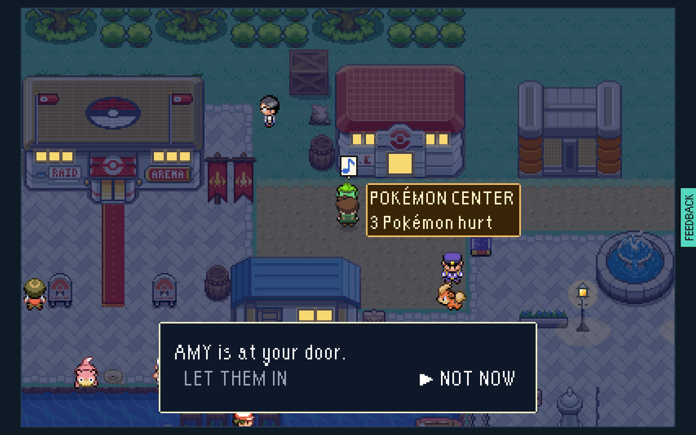
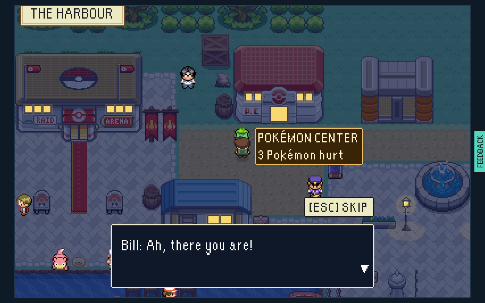
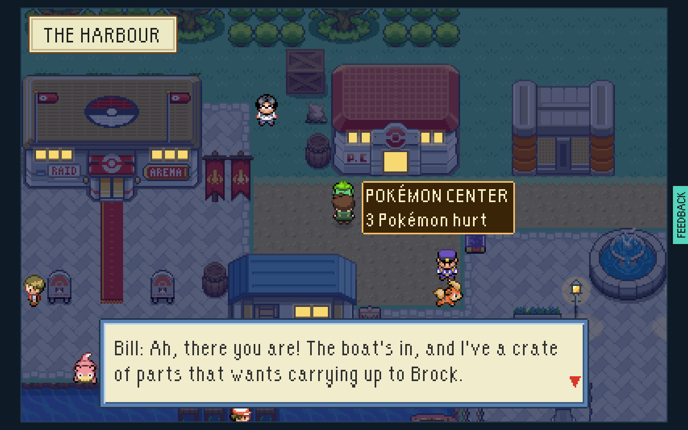
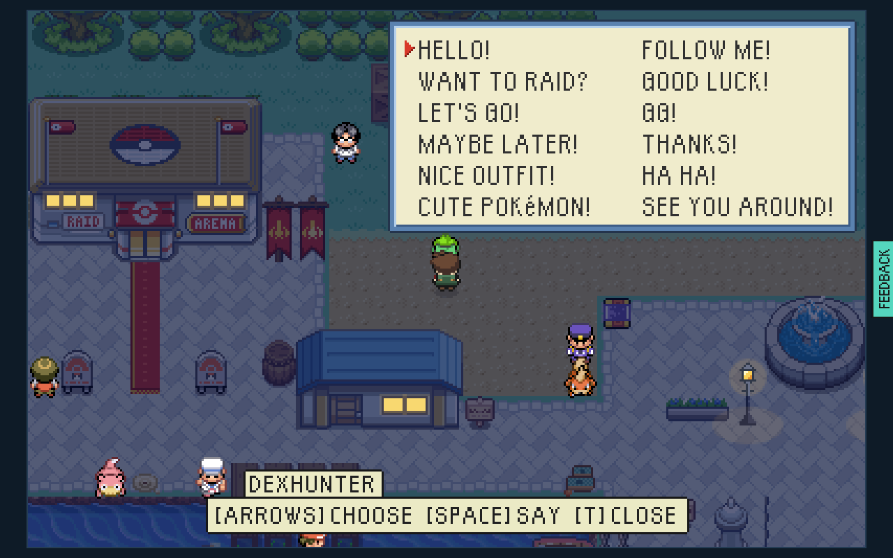

# The menu system: one window, FireRed's

The captain, 25 Nov 2026, on every menu and pop-up: "shite colours, shite
design". This folder is the record of the redraw, one pull request at a time.

## 1. The pop-ups over the world

The dialogue box, every question asked in it (a favour, a knock at the door,
a trainer's challenge, a lift, a boat) and the phrase list. They were a dark
navy box with a cream line, white words, slate answers and a typed arrow,
under GBA art and beside cream windows everywhere else. Now they are one
window: cream paper (`UI.paper`) in a blue-rimmed frame (`drawFramedWindow`),
ink words and a drawn red cursor, the palette named by role in
`src/game/ui/uiPalette.ts`.

A question asks FireRed's way: the answers stand in a window of their own on
the right end of the question's box, one under another. They used to sit on
the box's last line, so a question that wrapped had YES printed over it.
And the harbour's box is the raid's width: at 232 it held 38 letters a row, so
Nurse Joy's hello was cut mid-sentence over ten presses.

| | Before | After |
|---|---|---|
| A favour |  |  |
| Somebody at the door |  |  |
| Dialogue |  |  |
| The phrase list |  |  |

In a raid, and at phone size (the whole game at the phone's own pixels):

 

Made by `tools/playtest/popupShots.mjs <test-mode build url> <dir> --window=1280x800 --raid`
against a test-mode build (`tools/playtest/README.md`, 'Memory'). Judged by two
rounds of a fresh critic who did not write the change; what was taken and what
was not is in the pull request.
