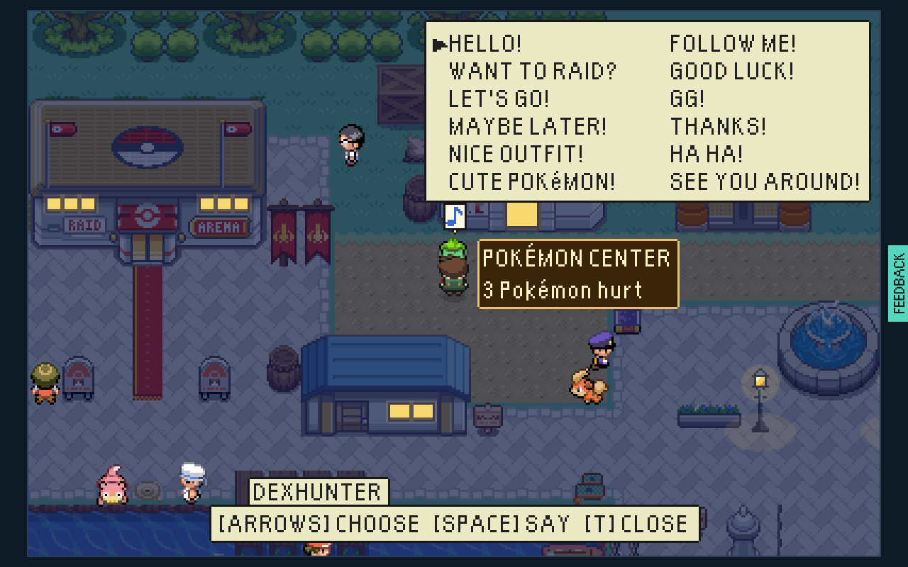
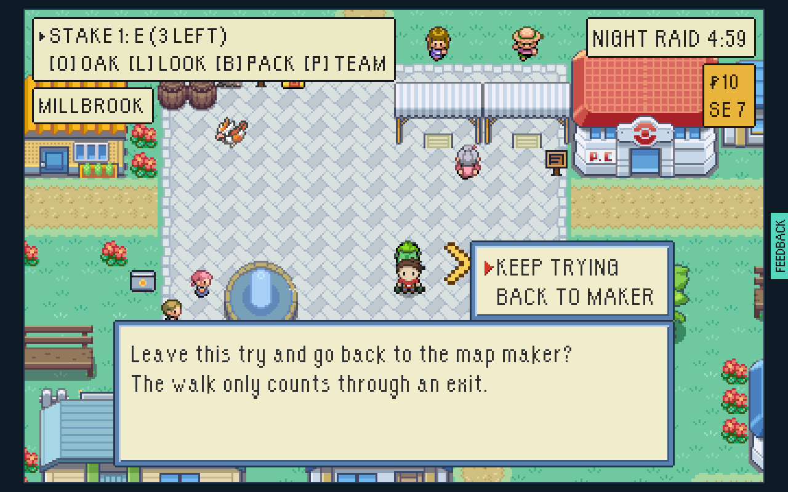
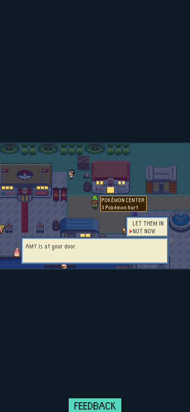
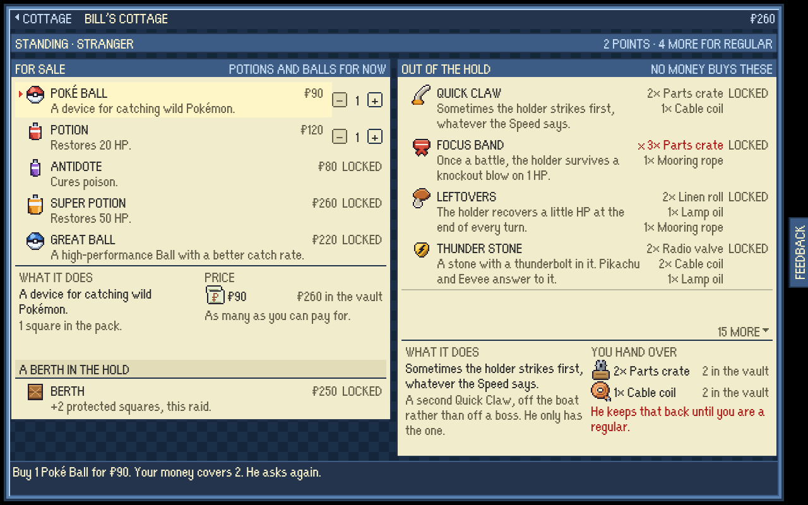
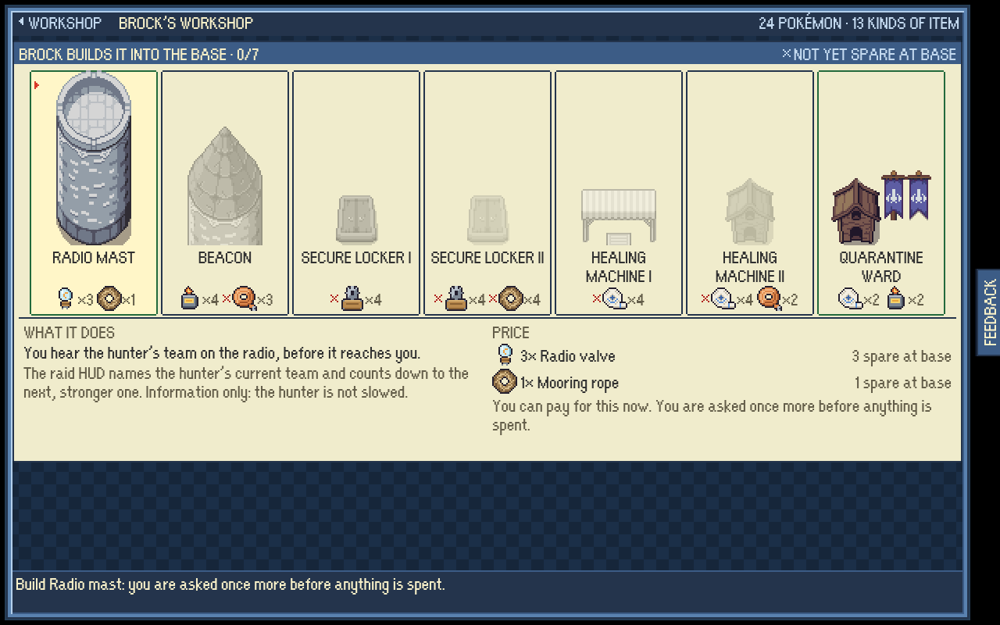
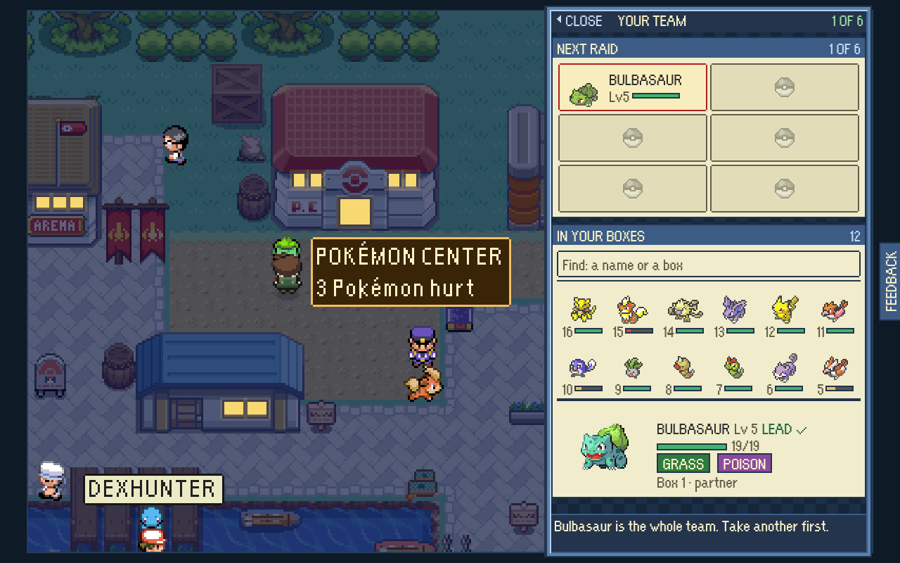
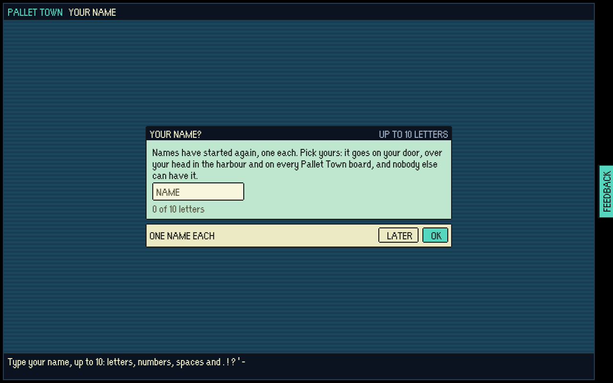
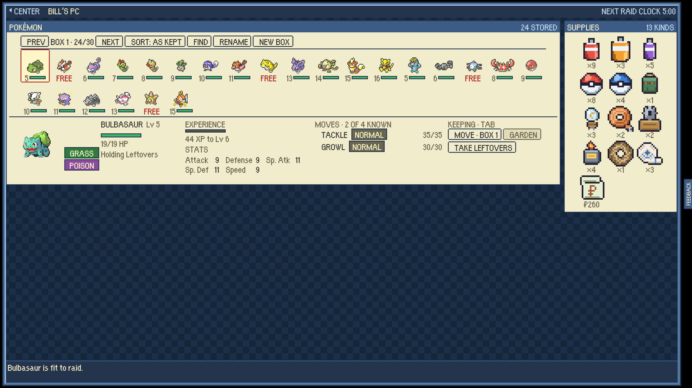
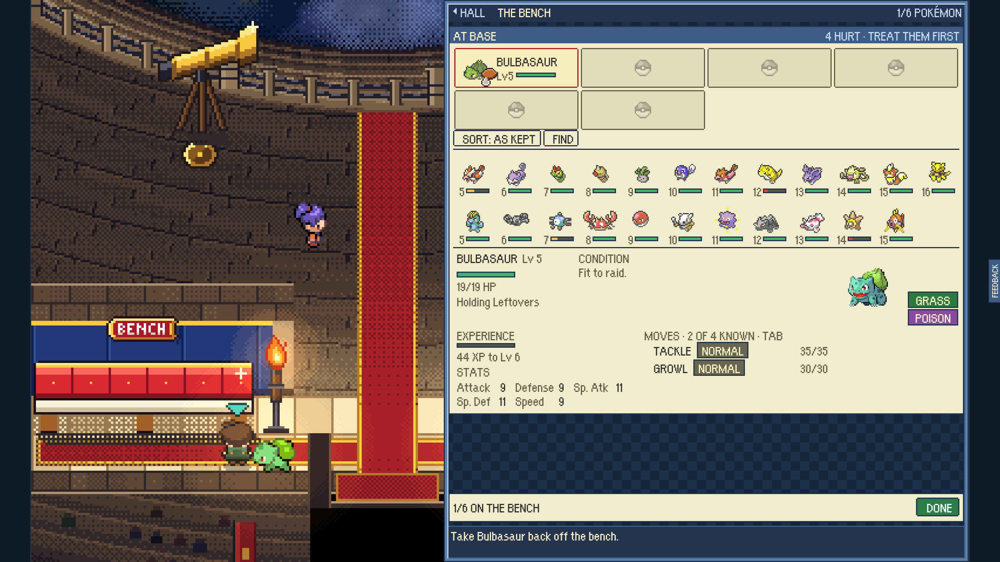

# The menu system: one window, FireRed's

The captain, 25 Nov 2026, on every menu and pop-up: "shite colours, shite
design". This folder is the record of the redraw, one pull request at a time.

## 1. The pop-ups over the world

The dialogue box, every question asked in it (a favour, a knock at the door,
a trainer's challenge, a lift, a boat) and the phrase list. They were a dark
navy box with a cream line, white words, slate answers and a typed arrow,
under GBA art and beside cream windows everywhere else. Now they are one
window: cream paper (`UI.paper`) in a blue-rimmed frame (`drawFramedWindow`),
ink words and a drawn red cursor, the palette named by role in
`src/game/ui/uiPalette.ts`.

A question asks FireRed's way: the answers stand in a window of their own on
the right end of the question's box, one under another. They used to sit on
the box's last line, so a question that wrapped had YES printed over it.
And the harbour's box is the raid's width: at 232 it held 38 letters a row, so
Nurse Joy's hello was cut mid-sentence over ten presses.

| | Before | After |
|---|---|---|
| A favour |  |  |
| Somebody at the door |  |  |
| Dialogue |  |  |
| The phrase list |  |  |

In a raid, and at phone size (the whole game at the phone's own pixels):

 

Made by `tools/playtest/popupShots.mjs <test-mode build url> <dir> --window=1280x800 --raid`
against a test-mode build (`tools/playtest/README.md`, 'Memory'). Judged by two
rounds of a fresh critic who did not write the change; what was taken and what
was not is in the pull request.

## 2. Every menu screen, in the same colours

The DOM screens - Bill's PC, the shops, the workshop, the bench, the raid's
pack and party, YOUR TEAM, the name screen and the rest - were olive-cream on
navy scan-line stripes under near-black bars, with a mint accent no Kanto screen
uses. Now they wear the pop-ups' palette (the Pixel UI tokens are
`uiPalette.ts`'s, and `uiPalette.test.ts` holds them so): the same paper and ink,
navy title and help bars, panel headings in the rim's blue, a checker of two
blues behind, a red cursor, a green confirm button - and each whole screen in
the pop-ups' blue-rimmed frame, painted over its own edge so a full column
stays full.

| | Before | After |
|---|---|---|
| Bill's PC |  |  |
| Bill's cottage |  |  |
| Brock's Workshop |  |  |
| The bench, beside the hall |  |  |
| YOUR TEAM, beside the yard |  |  |
| Your name |  |  |

Made by `tools/playtest/menuShots.mjs <build url> <dir> --window=1280x800 --raid`
and `popupShots.mjs`. How the screens sit in a big window is the next step.

## 3. A menu stands in the game's own box

The captain: menus "look stretched full screen on a big screen while the game
itself sits in a smaller window". They were laid out against the whole window
(up to 1120 game pixels across, at 2x-4x); now a menu stands in exactly the
canvas's box, drawn as fine as keeps the room it was laid out for
(`menuScaleFor` in `display/menuStage.ts`): 1280x800 the world 3x and the menu
2x, 1920x1080 4x and 2x, 2560x1440 6x and 3x. A touch screen keeps the pad's
layout.

| 2560x1440 | Before: across the glass | After: in the game's box |
|---|---|---|
| Bill's PC |  |  |

The bench at 2560x1440 and Bill's PC at 1920x1080:

 
