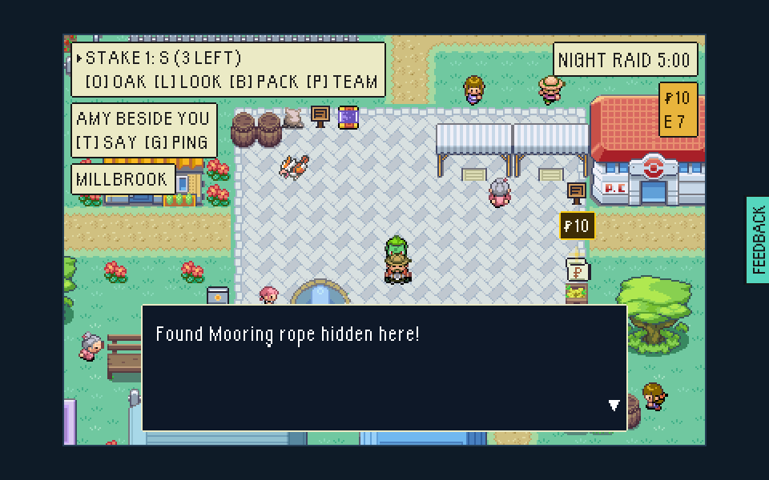
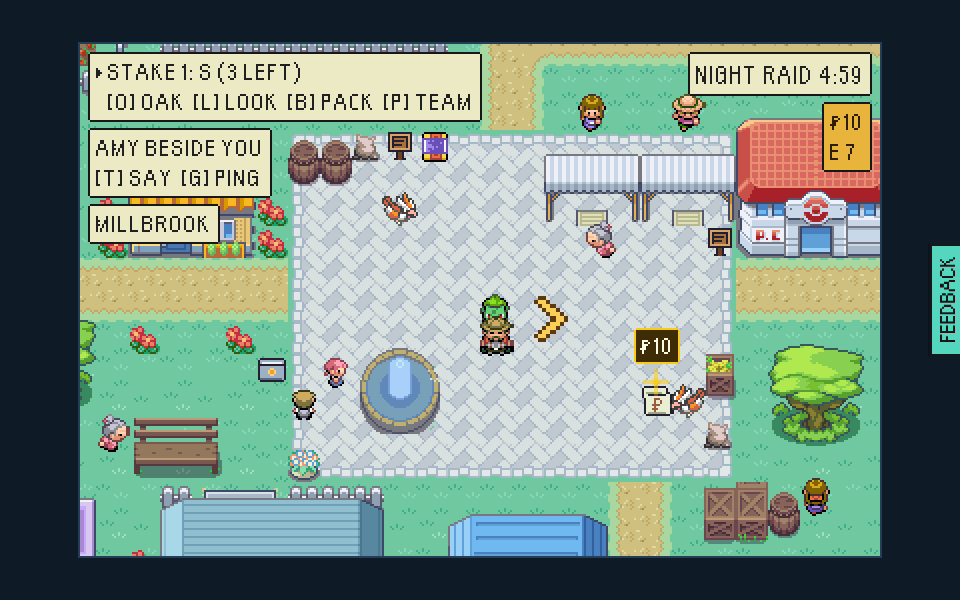
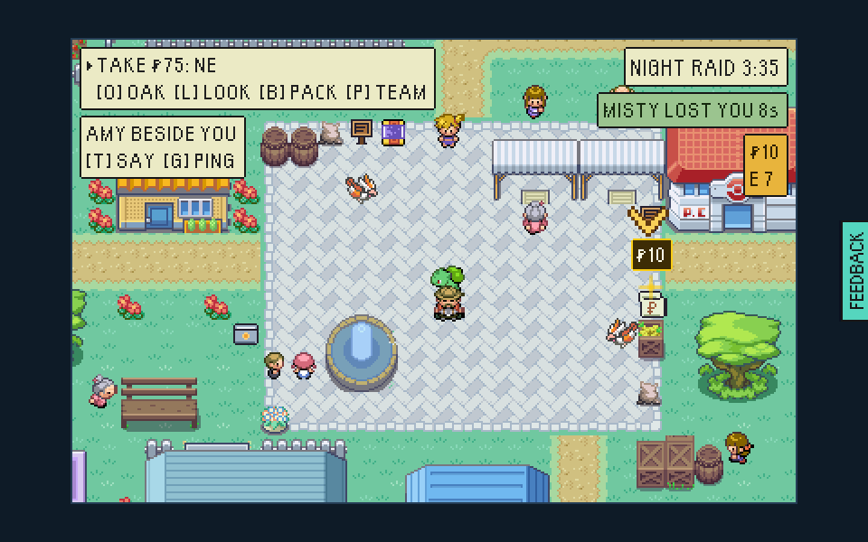
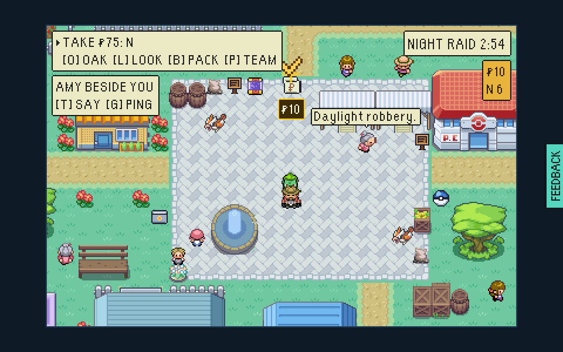
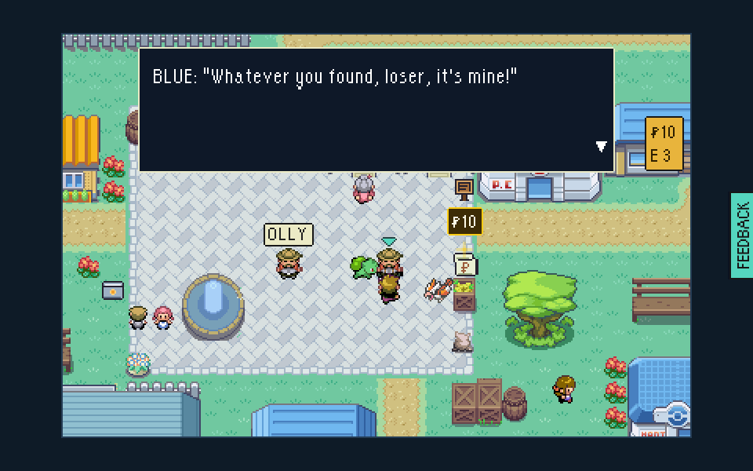
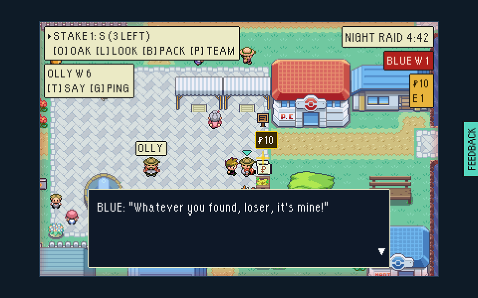
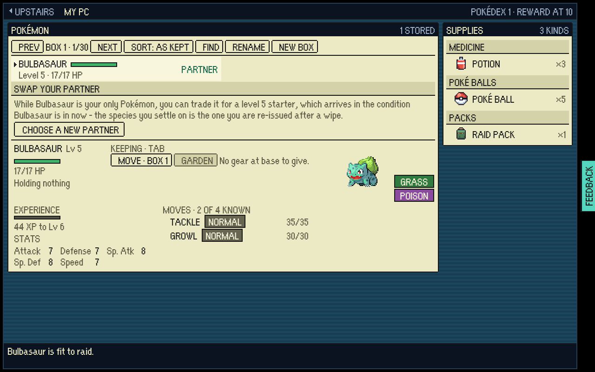
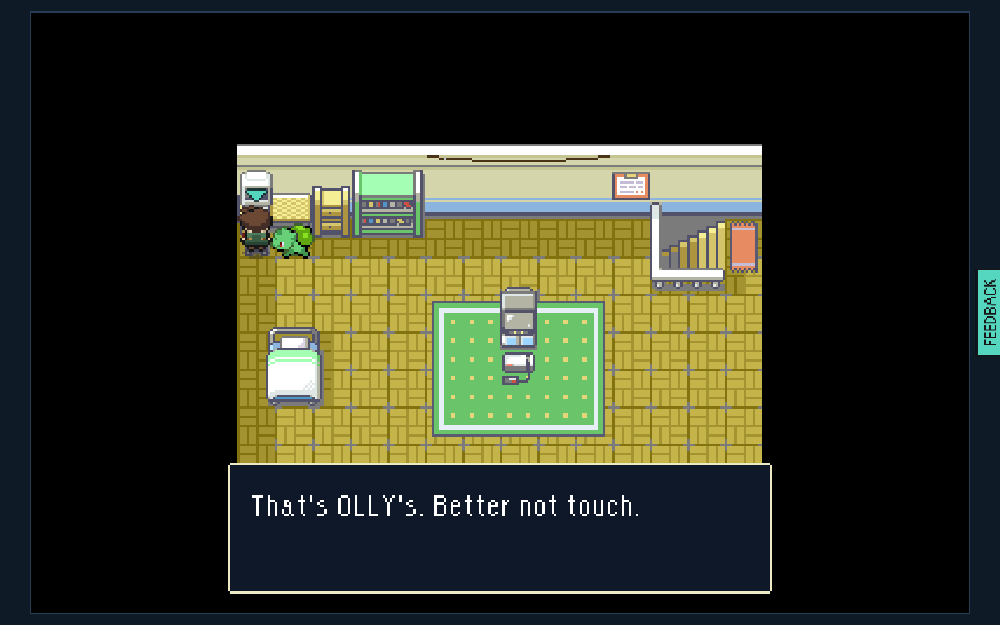

# Raid with a friend and visiting: what the multiplayer bug hunt of 12 Nov found, before and after

Two windows of one headless Chromium as two friends, OLLY and AMY, on the
local stand-in (`?testmode=pixels&harbour=local`), against two test-mode builds
(`VITE_EPTW_TEST_MODE=1 npx vite build`, served under
`/escape-from-pallet-town-web/`): `main` at `f4bc5145` (before, taken by the
bug hunt) and this branch (after). The drivers are the hunt's own scratch
scripts, run unchanged on both builds: `mpLoot.mjs <url> <dir> extract`,
`WIN_THEN_FLEE=1 mpHunt.mjs <url> <dir> bothstill`, `mpHunt.mjs <url> <dir>
pausekeeper` and `VISIT_PC=1 knocking.mjs <url> <dir>`. They sit beside the
friend drivers in `tools/playtest/` and attach to an already running browser,
so they were not committed; folding their checks into `friendLoot.mjs` and
`friendHunter.mjs` as regression legs is the follow-up.

| | Before | After |
|---|---|---|
| 1. OLLY took two room pieces, walked out and banked them, then joined the same code again while AMY was still in it. Before, both were handed back on the landing ("Found Mooring rope hidden here!"). After, nothing is said and the pack is what he packed. |  |  |
| 2. Both caught by the room's hunter at once; OLLY beat it and AMY fled hers. Before, BLUE stood back up at the top of the square and hunted OLLY again. After, it is beaten on both screens and OLLY walks off 16 tiles uncaught. |  |  |
| 3. The player keeping the hunter opened FEEDBACK. Before, the hunter stood frozen beside AMY for 20 s and more. After, AMY's browser takes the keeping and BLUE walks up and catches her. |  |  |
| 4. AMY visiting OLLY's house pressed SPACE at his PC. Before, her own boxes opened, and closing them put her in her own house. After, "That's OLLY's. Better not touch." and she is still in his. |  |  |
