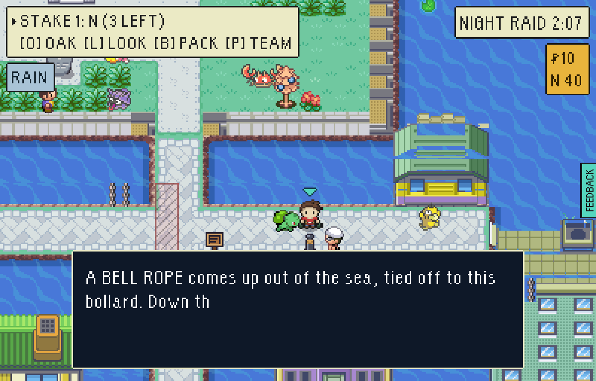
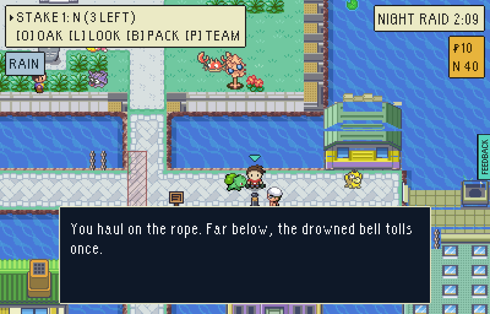
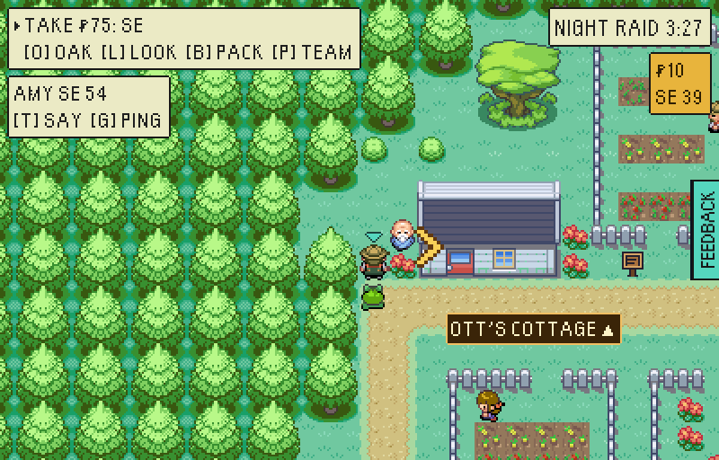
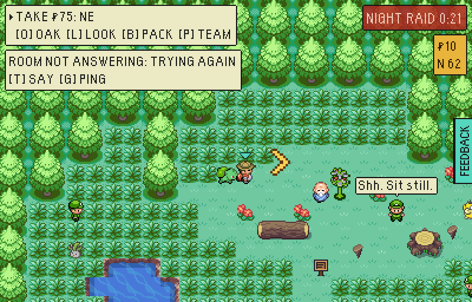
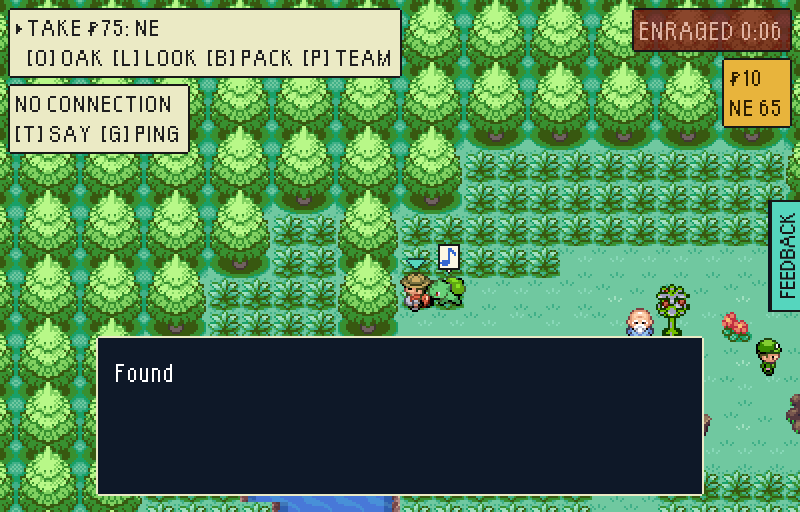

# The new-content bug hunt of 10 Nov: the drowned bell after a heal, and a friend raid that loses its connection

Two test-mode builds (`VITE_EPTW_TEST_MODE=1`, served under the Pages path as
`tools/playtest/README.md` says): `main` at `757d3351` with only the stand-in's
offline switch added (before), and this branch (after).

## THE DROWNED BELL after a heal at Nurse Joy

The same save both times: MISTY and Boatswain Cragg beaten, 100 seconds of
healing owed, so the raid runs 3:20.

```bash
node tools/playtest/raid.mjs <url> --pixels --window=pixel --seed=7 \
  --insertion=greystone-vale-old-quay --beaten=vale-gym-misty,vale-quay-keeper \
  --debt=100000 --steps=read:164:302:down,clock:71,read:164:302:down --shot=<dir>/x.png
```

`clock:S` waits on the raid's own clock; `tide:S` (the tide, as a boat reads
it) would have reached 71 seconds before the raid had begun.

| Before | After |
| --- | --- |
|  |  |
| 2:07 left of 3:20, so 1:13 in: "a minute in, until two", by the rope's own words, and it only reads its clue. The bell was read against the tide, which runs 100 seconds ahead after this heal, so it rang only in the raid's first 20 seconds, and with 2:00 or more owed never. | 2:09 left, 1:11 in: the bell tolls and Kabutops comes up. A secret's stretch of the clock is now time gone by, as every clue, rumour and the library's book says. |

The tide itself is unchanged: a boat and a timed exit are still read against
it, so the islands' last boats sail before a short raid ends. What changed is
how the vale says it. Three people gave a tide as time gone by ("A minute in,
say"), which is untrue after any heal; they now give it as the HUD's own
clock, time left, which is what a tide is:

- the Skiffman, Smugglers' Cove: "When your clock is down to four minutes, say."
- the Stair Keeper, the Sunken Quarter: "When your clock is down to three and a half minutes, it starts to show."
- THE ICE RUN sign, the Wreck: "It sails while your clock reads from 3:00 down to 1:00."

## A friend raid that loses its connection

```bash
node tools/playtest/friendLoot.mjs <url> <dir> --keep-going
```

The local stand-in cannot lose its connection, so the driver sets
`LOCAL_ROOMS_OFFLINE_KEY` in OLLY's tab: `down` fails every claim as a fetch
with no network does, `hang` never answers. Its faults on `main`, word for word:

```
OLLY's connection dropped and his chip said nothing: "AMY SE 54 / [T] SAY  [G] PING"
the connection came back and greystone-vale/spot-7 was never picked up: "AMY SE 54 / [T] SAY  [G] PING"
with the room never answering, greystone-vale/spot-7 was never picked up: "AMY SE 54 / [T] SAY  [G] PING"
OLLY's chip never said the connection was lost: "AMY SE 54 / [T] SAY  [G] PING"
```

| Before | After |
| --- | --- |
|  |  |
| Standing on the great ball with the connection gone: nothing happens, and the chip says nothing. | The chip says so: ROOM NOT ANSWERING: TRYING AGAIN. The piece is asked about again every 3 seconds, and when the connection came back it was OLLY's without his stepping back on it. |
| |  |
| | A room that never answers (a hung request counts as no answer after 8 seconds) is given up on after 15 seconds, as a closed room is: NO CONNECTION: WHAT YOU FIND IS YOURS, and the mooring rope he stood on is his. |
