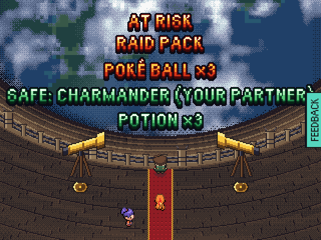
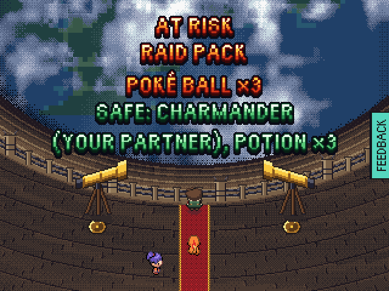
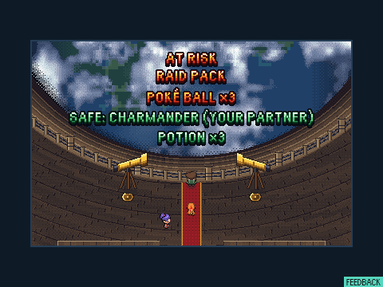
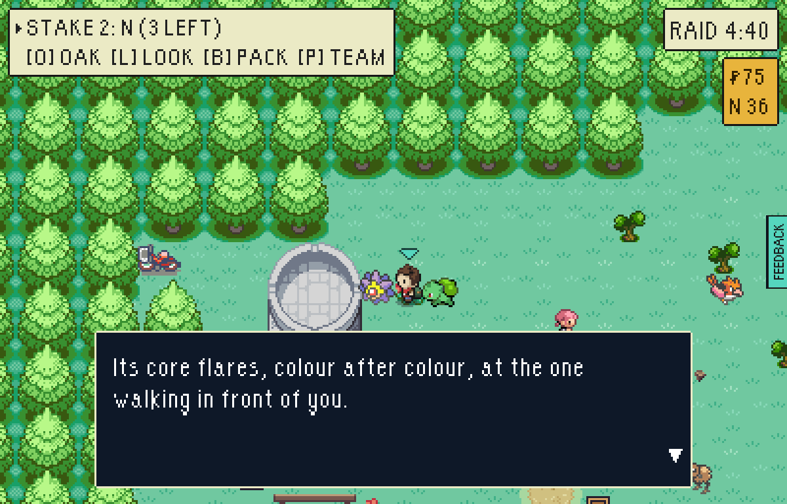
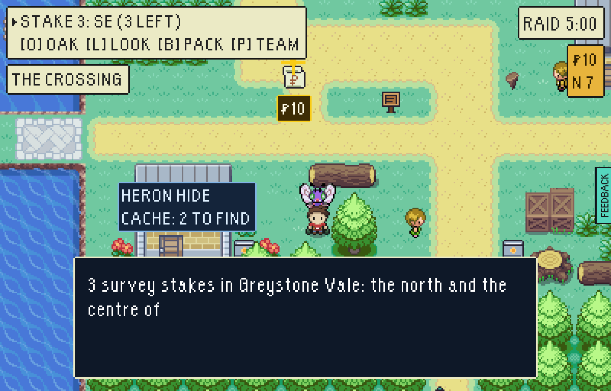
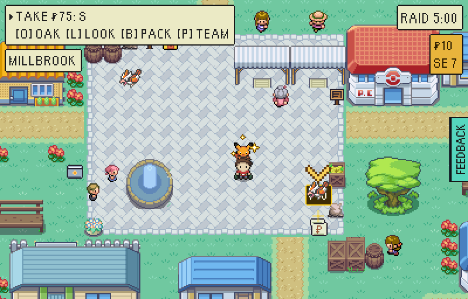
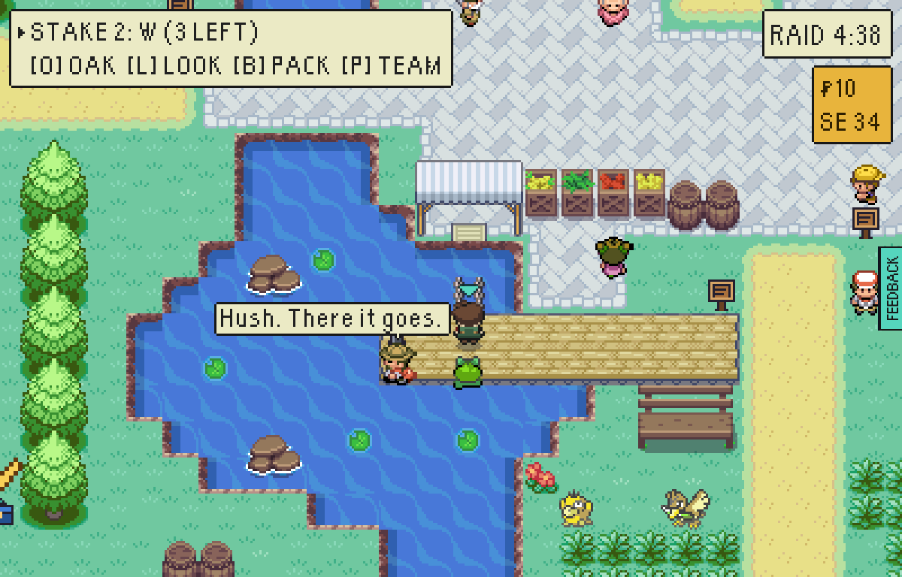
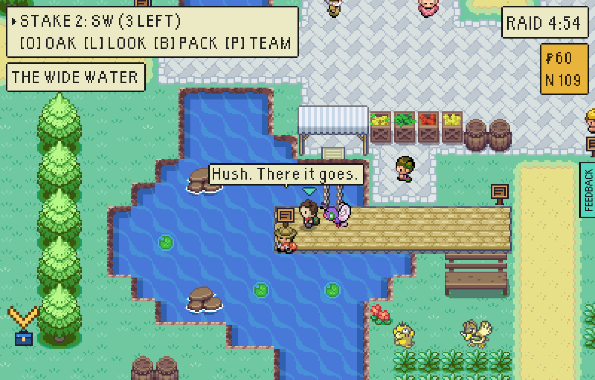
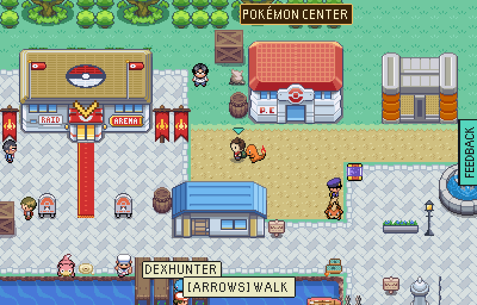
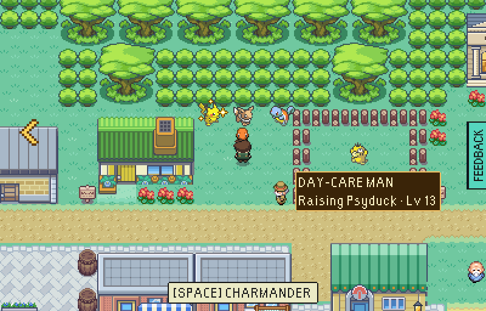

# The second-round finds of 14 Nov 2026, fixed

Every "before" is the playtest's own picture. Every "after" is the same moment on a
`VITE_EPTW_TEST_MODE=pixels` build of this branch, played in one headless browser.

## 1. The rim's SAFE line clears the FEEDBACK tab

| Before, 640x480 | After, 640x480 |
|---|---|
|  |  |

| After, 960x720 | After, 480x360 (the smallest window: the tab is in the corner, off the game) |
|---|---|
|  |  |

`node tools/playtest/firstRaid.mjs "<url>?testmode=pixels" <dir> --port=<cdp> --window=WxH --shots`,
frame `14-jump-breath.png`.

## 2. Whoever leads walks at heel, in its shiny colours when it is shiny

| Before: a shiny Butterfree leads, a Bulbasaur walks | After: the shiny Butterfree walks |
|---|---|
|  |  |

After, from `shinyAtBase.mjs`: a shiny Pikachu leads a raid.

The Butterfree picture is a deploy to `greystone-vale-stepping-stones` with
`--team=butterfree:28::shiny --lead=Butterfree`.

## 3. The Heron Man's call keeps off the notice

| Before | After |
|---|---|
|  |  |

Stood at (157,166), the end of the boards, until he called.

## 4. `shinyAtBase.mjs` photographs the garden

| Before: the arrival square | After: the garden and the pen |
|---|---|
|  |  |

`node tools/playtest/shinyAtBase.mjs "<url>?testmode=pixels" <dir> --port=<cdp>`, `yard-garden.png`.
