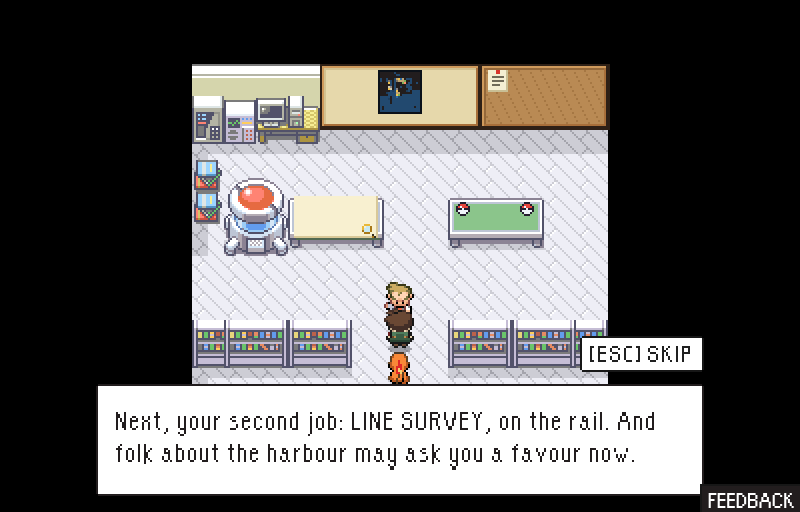

# Oak counts the next job

The gyms playtest of 26 Nov 2026 heard Professor Oak say "Next, a new LINE
SURVEY is on the rail." on every visit after the first job was banked, including
after three raids in a row that banked nothing. "A new" reads as if a job had
just been done. It was added so a job with the same name as the one just banked
reads as counted (the first-hour playtest, the same day). Counting the job keeps
that, and stays true until the job is done: "Next, your second job: LINE SURVEY,
on the rail." The same line is the next step on the raid's result card
(`hub/nextStep.ts`).

The same save both times: four raids, one job banked. The player walks into
OAK'S LAB, talks to Oak and says NOT NOW to his favour.

Before (main):

After:

Made with the AI playtester's hands (`tools/playtest/ai-player/act`) on a
test-mode build, one headless browser, the canvas shot at 2x.
