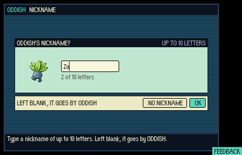
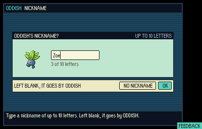

# A nickname typed with an accent keeps the letter

Typing "Zoë" into the naming screen after a catch gave "Zo": the ë was dropped as it was typed, with nothing said, because a nickname holds printable ASCII only. The accent is now dropped and the letter kept, so "Zoë" is "Zoe" and "José" is "Jose".

| Before | After |
|---|---|
|  |  |

Made on a test-mode build (`?testmode=1`, 400x256) with `tools/playtest/ai-player/act`. Catch the Oddish in Hazel's garden in MILLBROOK, answer YES to a nickname, and type Z, o, ë one at a time (CDP `Input.insertText` per letter).
