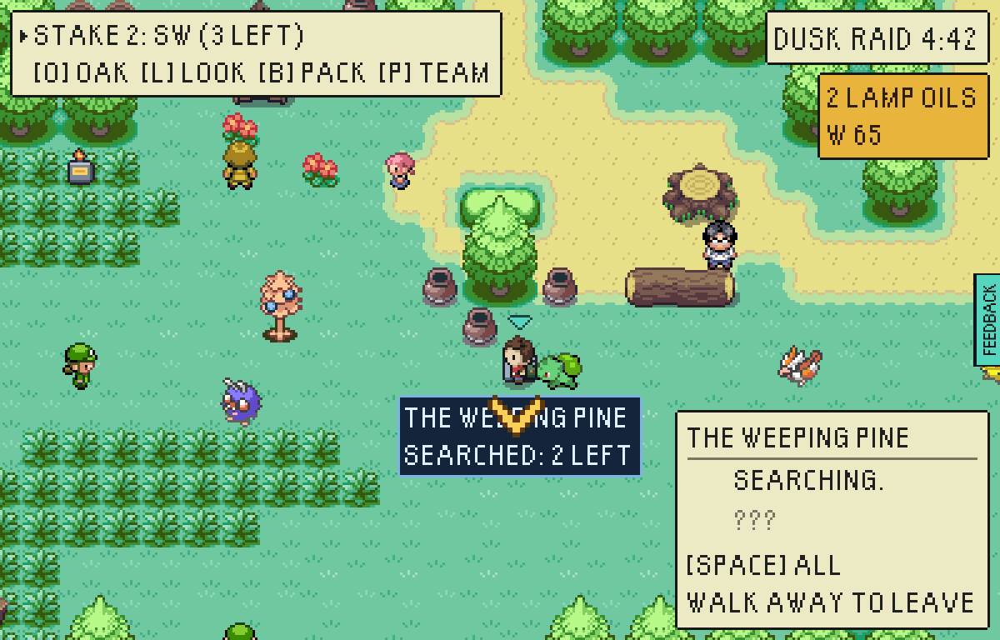
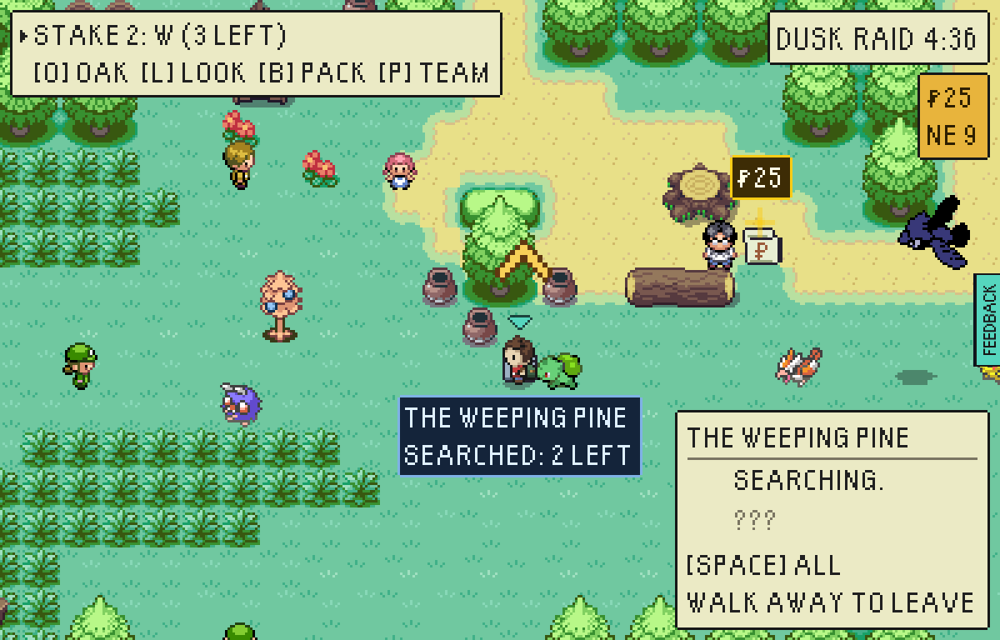
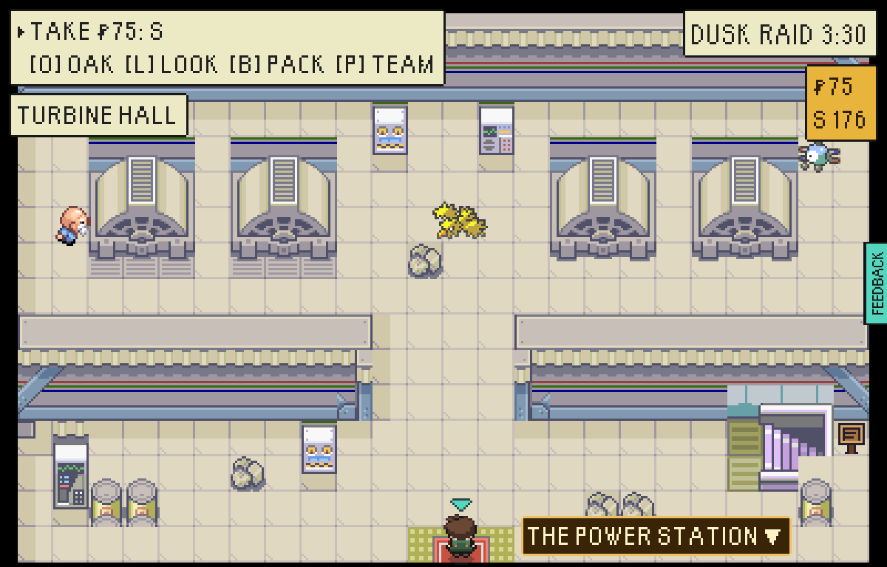
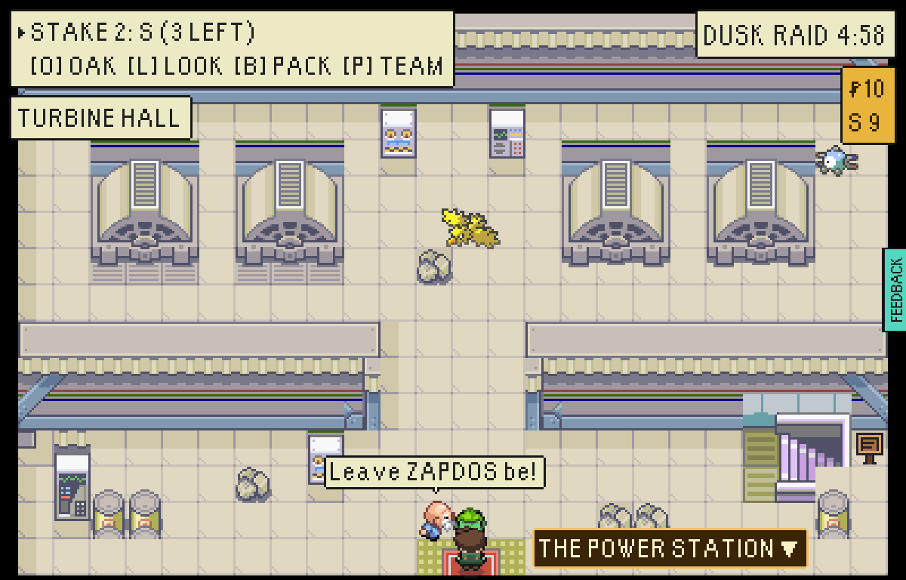
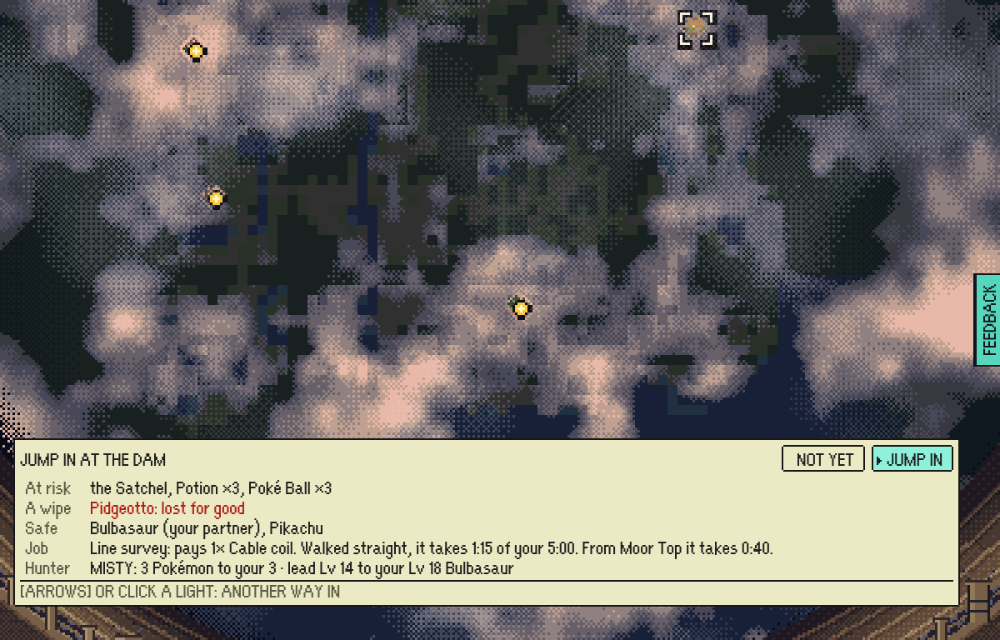

# Fixes from the north bug hunt (11 Nov 2026)

The bug hunt covered Pine Hollow, Tanglewood, the Safari Marsh and the Power Station. Its "before" pictures are its own, taken on `main` at `a7cf8722`. The "after" pictures come from this branch.

**How they were made:**

- **Build and browser:** a test-mode build (`VITE_EPTW_TEST_MODE=1 npx vite build`) served with `vite preview`, and one headless Chromium at 1200x768.
- **Driving:** the loop stepped by the driver, and a save set up the way `tools/playtest/deploy.mjs` sets one up: `--insertion=greystone-vale-the-dam --level=18 --team=pidgeotto:18,pikachu:17`, with the same walk as the hunt.
- **The rim picture:** taken after that raid ended. Moor Top was added to the save's reached landings before the hall was opened.

## The way mark no longer sits on a caption

The gold chevron used to sit on THE WEEPING PINE's caption ("THE WE▼PING PINE"). It also touched CONTROL ROOM's caption.

The way mark now rises clear of any caption on show, and still points down at what it marks (`chevronTowards`/`riseClear` in `src/game/base/wayMark.ts`).

| Before | After |
|---|---|
|  |  |

## The Turbine Hall warns about its Zapdos

The hall is open from a new save's first raid. Its Zapdos fights at level 50. Before this fix, nothing said so, and the watchman stood in a far corner of the hall.

Now he stands beside the walk in from the door:

- He calls "Mind the bird! Level 50!" or "Leave ZAPDOS be!" unasked.
- When spoken to, his first line is: "That is ZAPDOS up by the dead turbines, and it is level 50. Unless your team is very strong, leave it be."

| Before | After |
|---|---|
|  |  |

## The rim names a quicker way in for the job

This is the hunt's own case: a Line survey taken from The Dam. Its stakes lie in the west of the vale.

- **Before:** the Job line said only "Walked straight, it takes 1:15 of your 5:00."
- **After:** when another way in on offer walks the job at least half a minute quicker, the line names it: "From Moor Top it takes 0:40."

