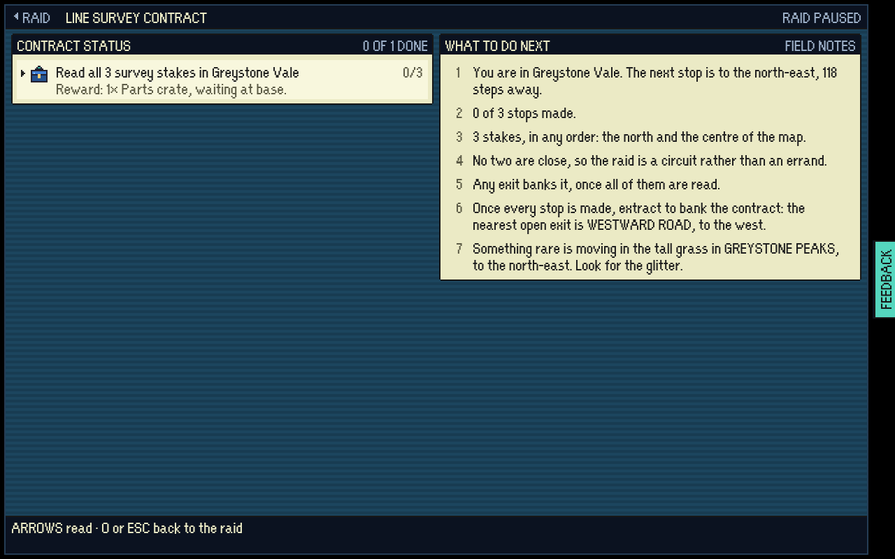
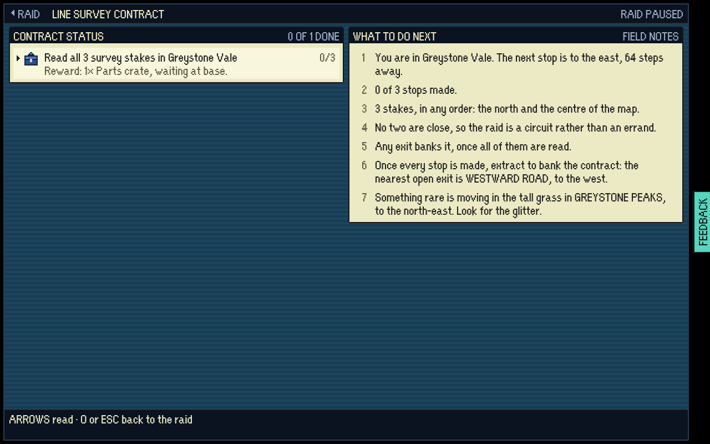

# Oak names the stop the gold arrow is after

A LINE SURVEY raid from Mill Square (96,161). The gold arrow says `STAKE 3: E` (142,175,
the nearest by the walk). Before, Oak's field guide (O) said "The next stop is to the
north-east, 118 steps away", which is stake 1, the first in the job's list. After, it
says "to the east, 64 steps away", which is the stake the arrow is after.

| before | after |
|---|---|
|  |  |

Made on 22 Nov 2026 against the dev server in `?testmode=pixels`, deploying with
`tools/playtest/deploy.mjs` (`banked: 1`) and pressing O on landing.
