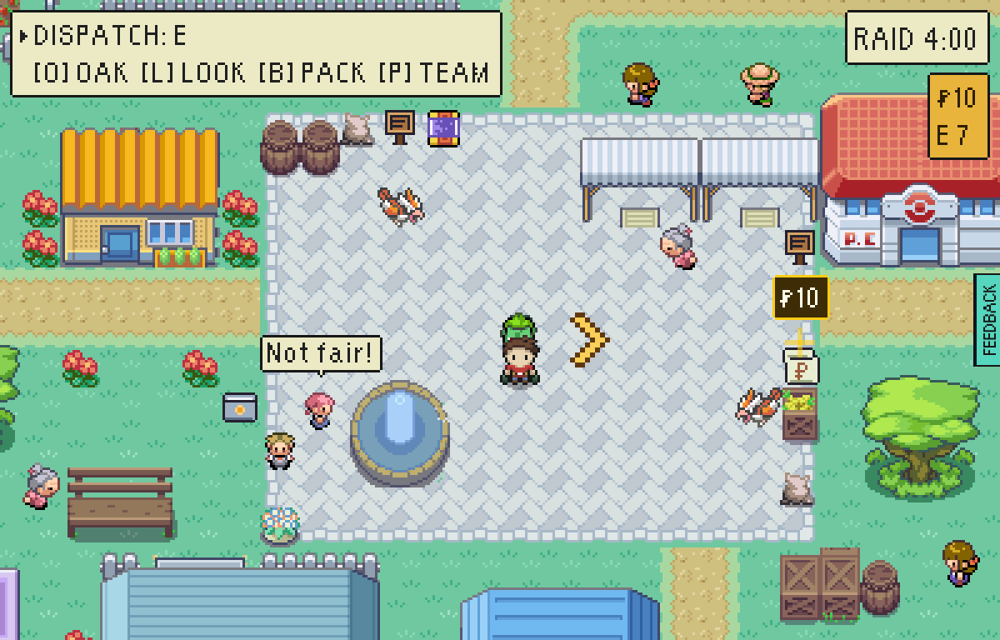
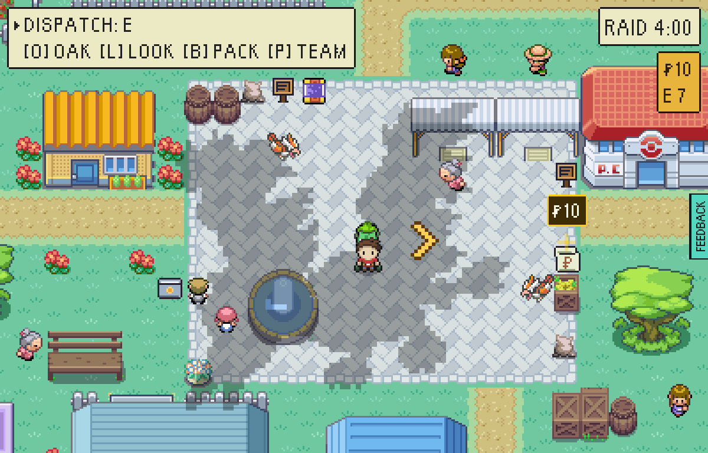

# Omens

One raid in three, while one of FireRed's three birds is still uncaught, its
shadow crosses the sky some way into the raid with its cry, flying for home.
From then on Oak's full list (O, then O again) says which way it went, what it
was and where they say it roosts. `src/game/world/omens.ts` is the rule.

| Bird | Where they say it roosts |
| --- | --- |
| Articuno | THE FROZEN LAGOON on FROSTREEF |
| Zapdos | the TURBINE HALL at THE POWER STATION |
| Moltres | THE CRATER on EMBER ISLE |

Nothing else changes. The bird is not there to be fought on the way, its fight
is no easier, and its roost is as hard to reach as it was. An omen is the map
saying where its best things are to somebody who has not been: until now a
save learned a legend was on the vale only by getting to it.

It crosses 20 to 90 seconds into the raid, out of doors, and waits while the
player is under a roof. There is none on a new save's first raid, and a bird
the Pokédex owns has come home and is not seen again. A player who has asked
for less motion hears the cry and is told, with no shadow.

## Played

A test-mode build (`VITE_EPTW_TEST_MODE=pixels`), `tools/playtest/raid.mjs
--pixels --stepped --window=pixel --clock=day --insertion=greystone-vale
--banked=2 --steps=omen,shot:shadow`, trying `--seed=` values until the raid
dealt had an omen (the driver prints it; `--seed=10` was the fourth tried). The "before" picture is the same raid
at the same second on a build of the commit before.

| | |
| --- | --- |
|  | Before: Mill Square, the same raid at the same second. |
|  | After: 58 seconds in, a great shadow half way across the square, with Moltres's cry. It lies on the ground under everybody, as the vale's own bird's shadow does, and is the bird's own battle picture three times over. Oak's full list then reads: "A great shadow crossed the vale, heading south. That cry was MOLTRES. They say it roosts in THE CRATER on EMBER ISLE." |
