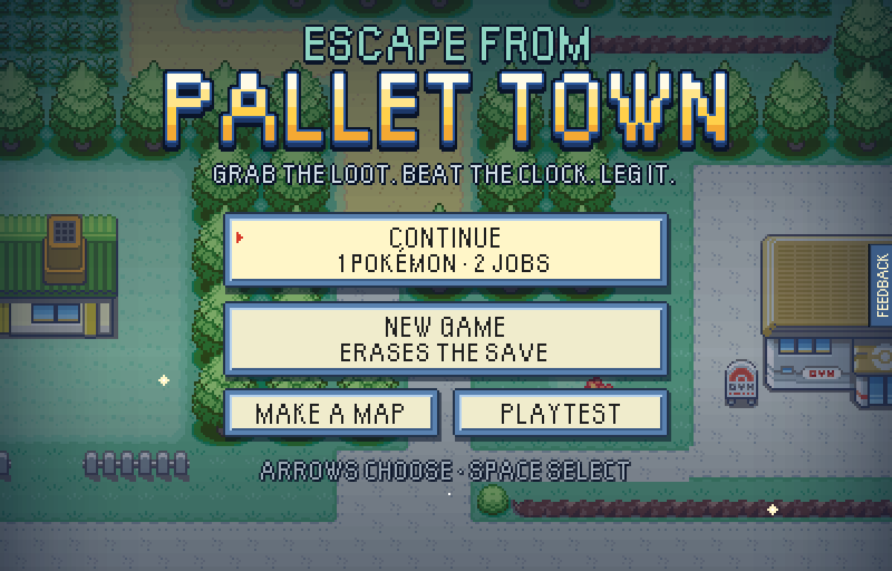
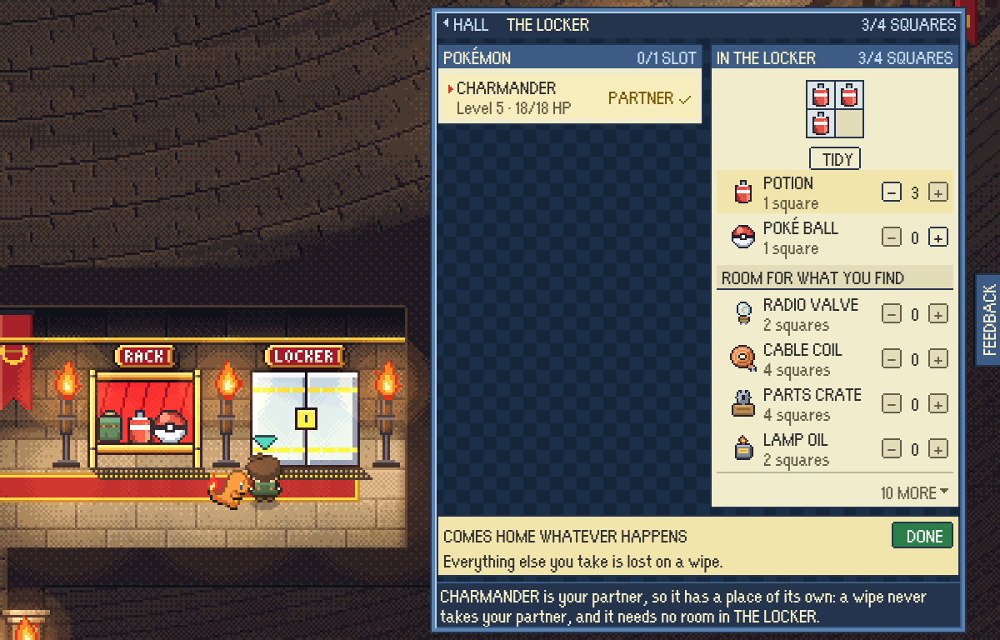

# One name each: job, favour, THE LOCKER, jump in

Each of these had two or three names on screen. Each now has the one on the
button, the key or the plate the player can see: a contract is a **job** (Oak,
Bill and the jump card already said so), an errand is a **favour** (the O screen
is FAVOURS), the secure slot and the secure container are **THE LOCKER** (the
station in the Arena's hall), and drop in and deploy are **jump in** (the button
says JUMP IN). "Extract" became "get out" where a raid tells a new player what
to do. YOUR THINGS for the vault is in #870.

Made against a test-mode build (`VITE_EPTW_TEST_MODE=1 npx vite build`, served
under the Pages subpath, `?testmode=pixels`, 1200 by 768): a new save with two
jobs banked, read on the title, then THE LOCKER opened in the Arena's hall with
`openHallPanel(page, 'locker')` from `tools/playtest/deploy.mjs`.

The title, which said 1 POKÉMON · 2 CONTRACTS: 

THE LOCKER, whose inner window was headed CONTAINER: 
