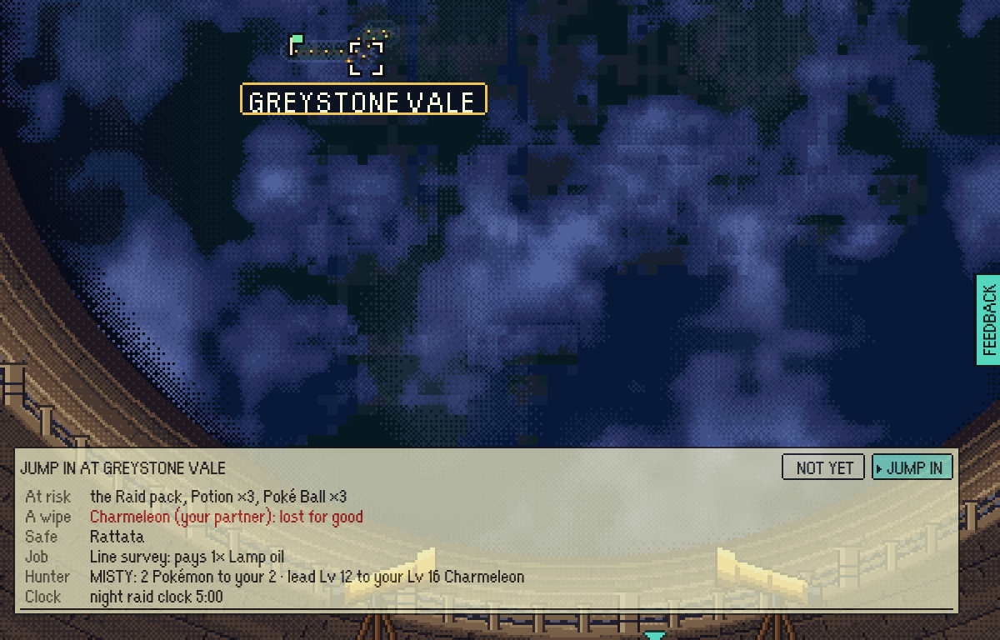
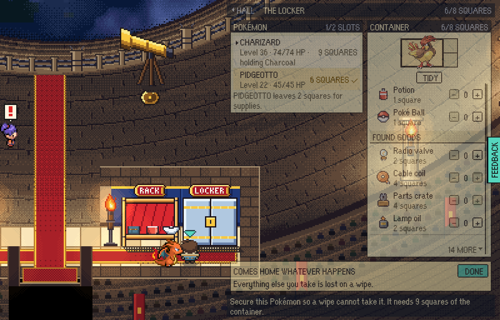
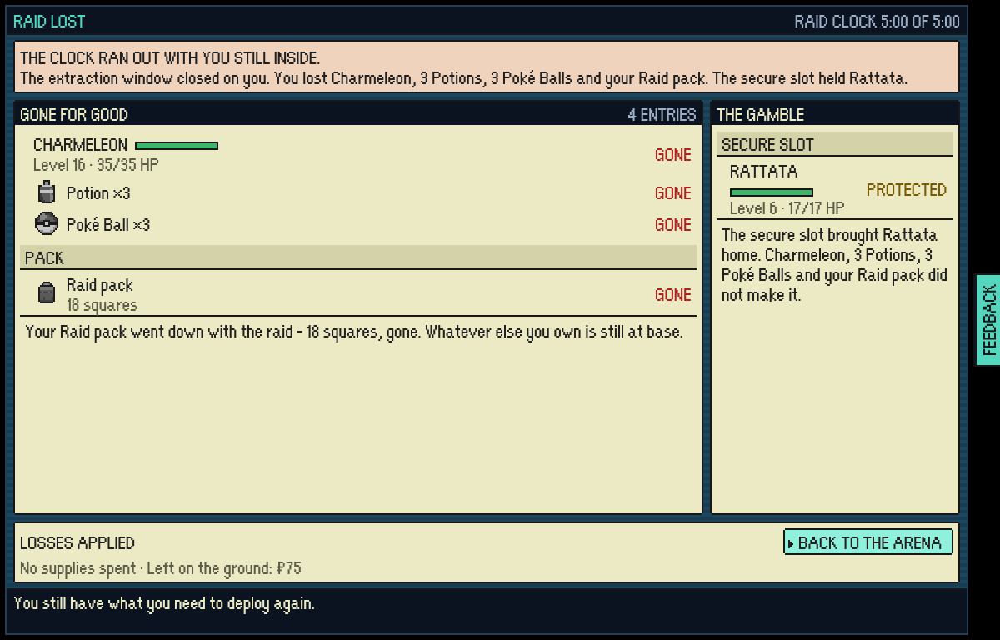
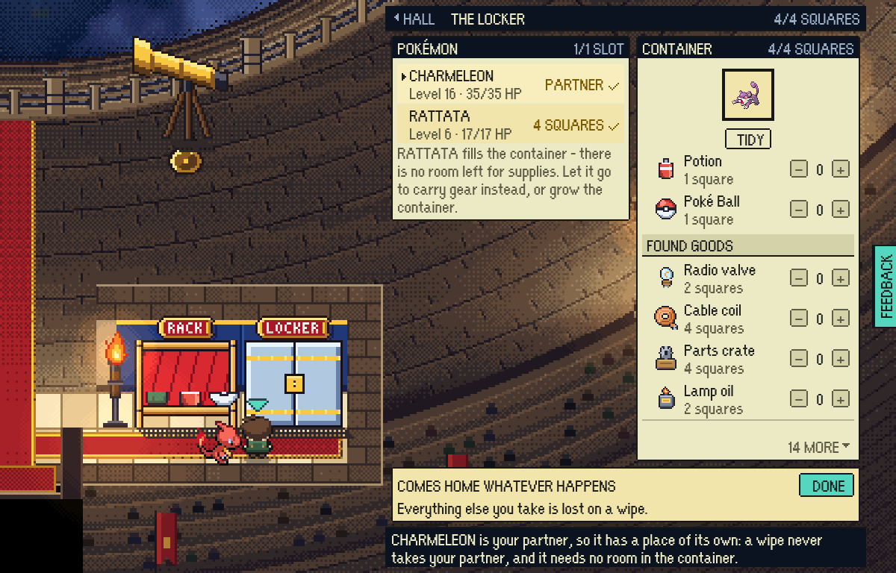
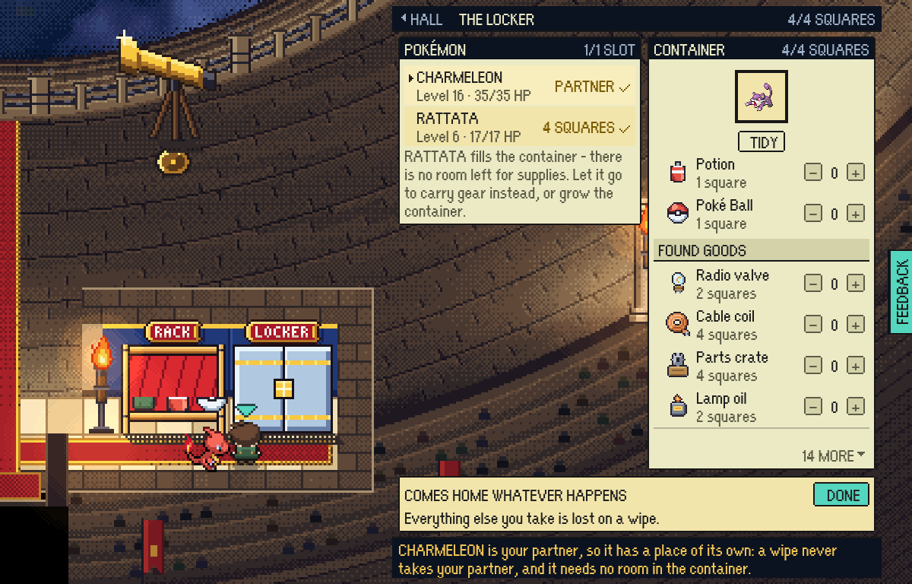
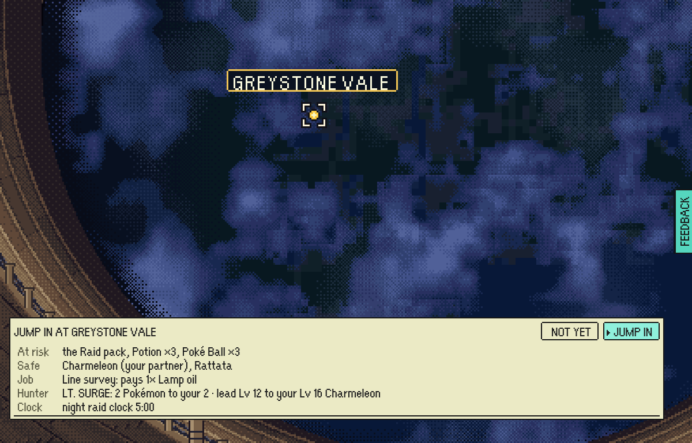
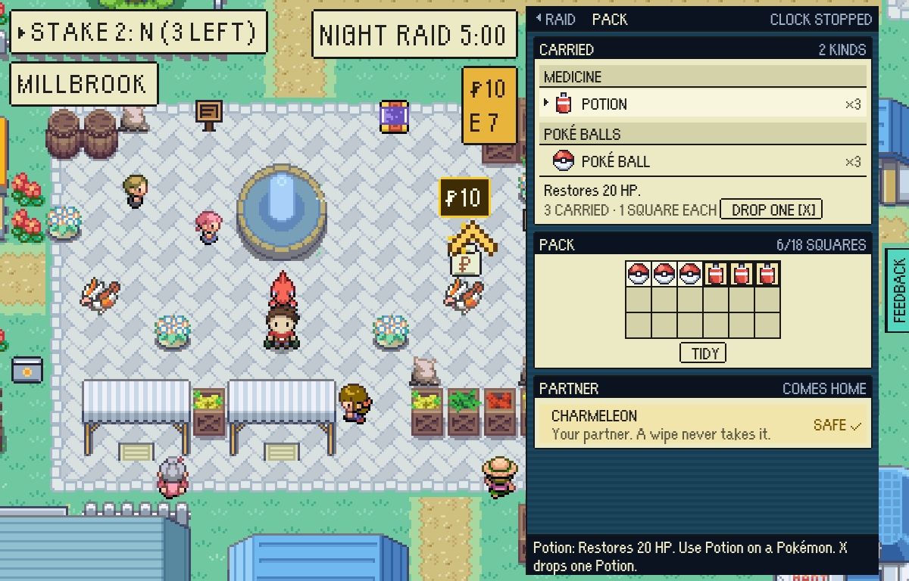
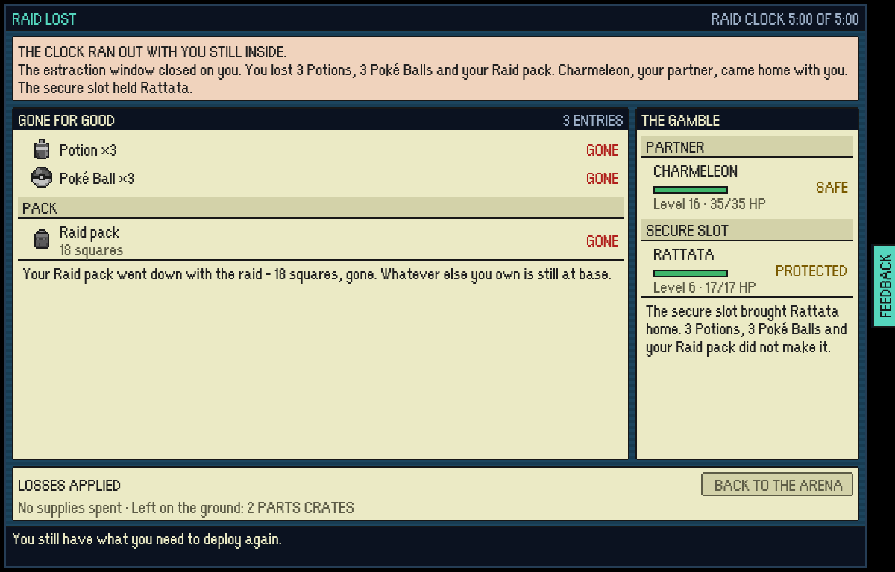

# The partner's own place

The captain's call of 11 Nov 2026 (option B): the partner - the starter, at any
stage of its line - has a protected place of its own beside the secure
container. It takes none of the container's squares or slots, and no wipe takes
it. Every other Pokémon's risk is what the container makes it, as before.

The hunt of that day (finding 1) found the fault on the normal path of play: a
starter evolves at level 16, a Charmeleon is six squares against the 2x2
container every save starts with, the container filled itself with a level-6
Rattata, and a raid lost to the clock deleted the partner. A Charizard is nine
squares, and the container only ever grows columns, so nothing could ever
protect one.

## Before (the hunt's own pictures, `main` at `757d3351`)

| | |
|---|---|
|  |  |
|  | |

## After

| | |
|---|---|
|  |  |
|  |  |
|  | |

## How they were made

`tools/playtest/partnerPlace.mjs` against a test-mode build
(`VITE_EPTW_TEST_MODE=pixels npx vite build`, served under the Pages subpath as
`tools/playtest/README.md` says), on stepped frames in one headless Chromium at
`PIXEL_WINDOW`. It starts a new game with a Charmander, edits the save to a
level-16 Charmeleon partner and a level-6 Rattata with no locker built, puts
both on the bench, opens the locker and the rim, jumps, opens the pack, runs the
raid clock out, photographs the result and reads the save: the partner is still
in the vault and still marked, and the Rattata the container held came home too.
