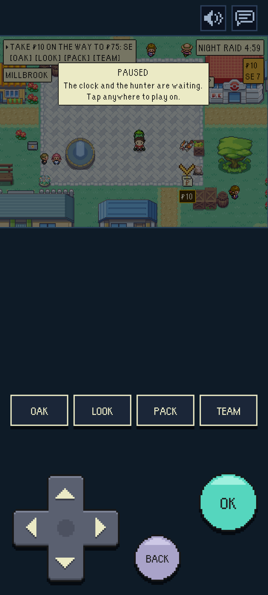
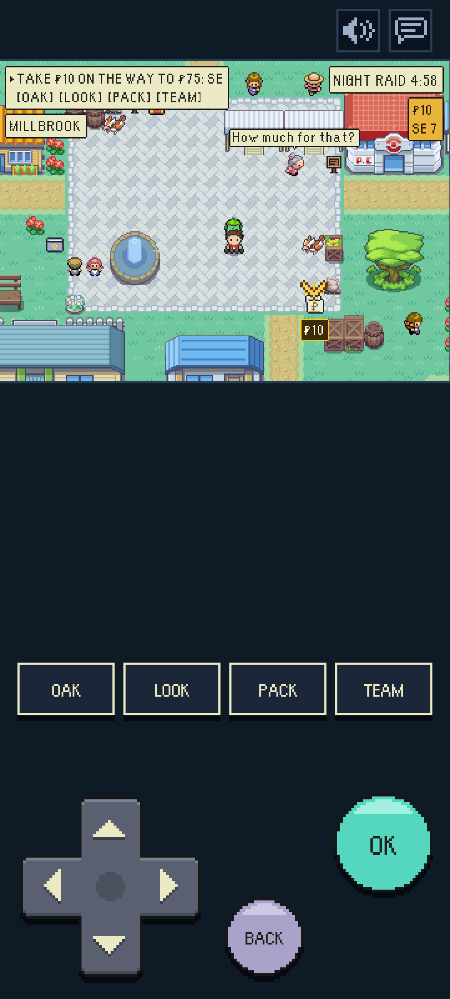

# A raid put away on a phone

A phone going to another app, or locking, hides the page and may never blur the window, so the raid came back running under a thumb that had not looked yet. Now a hidden page pauses it, the plate says to tap, and the tap that plays on (OK on the touch pad here) is spent on the plate: the plate comes down and nothing else happens.

| paused after the page was hidden | OK tapped |
|---|---|
|  |  |

Made with `node tools/playtest/phonePause.mjs <plain build url> <dir>` against a build that is not in test mode.
