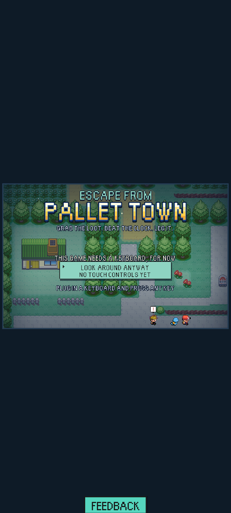
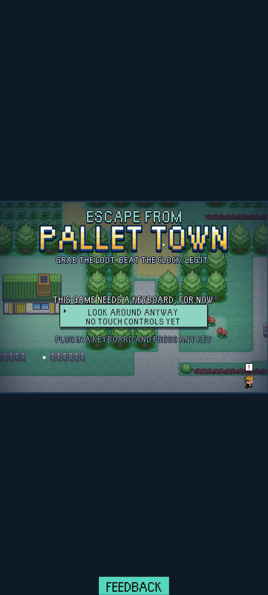
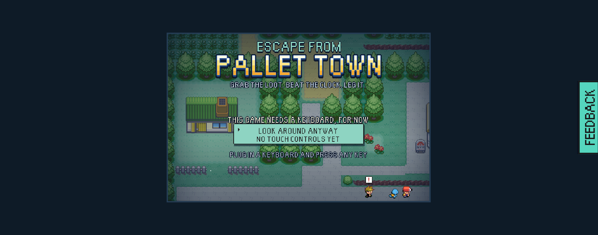
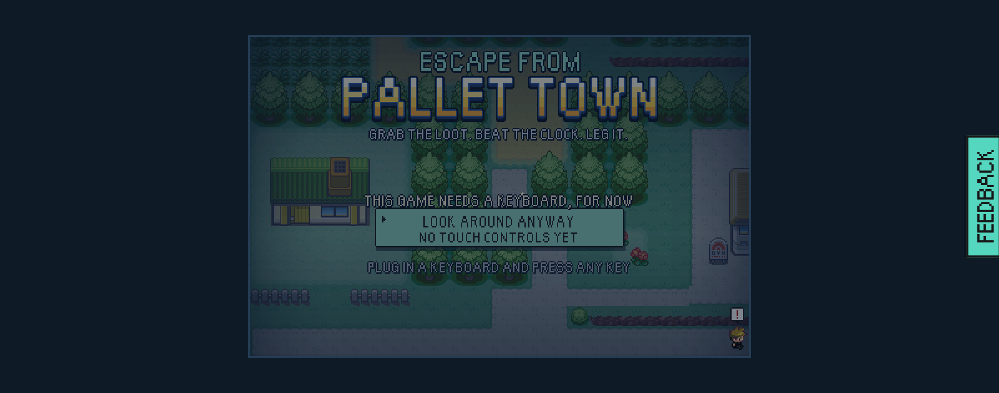

# A phone draws the game in its own pixels

Before, a phone got the game at 1 CSS pixel a game pixel. On a phone of pixel
ratio 2.625 that is two and five-eighths screen pixels each, so the art came out
in uneven columns, and smaller than the screen could hold. After, a game pixel
is the most whole screen pixels that still fit the smallest screen: 3 upright
on a 412x915 phone, 4 on its side.

| | before | after |
|---|---|---|
| upright |  |  |
| on its side |  |  |

Made with `tools/playtest/phone.mjs <test-mode build url> <dir> --device=portrait`
(and `--device=landscape`), waiting five seconds on the title.
