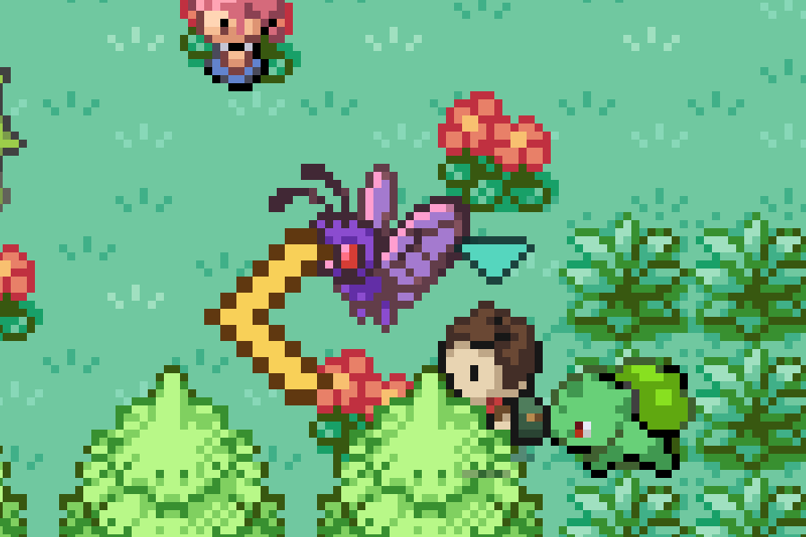
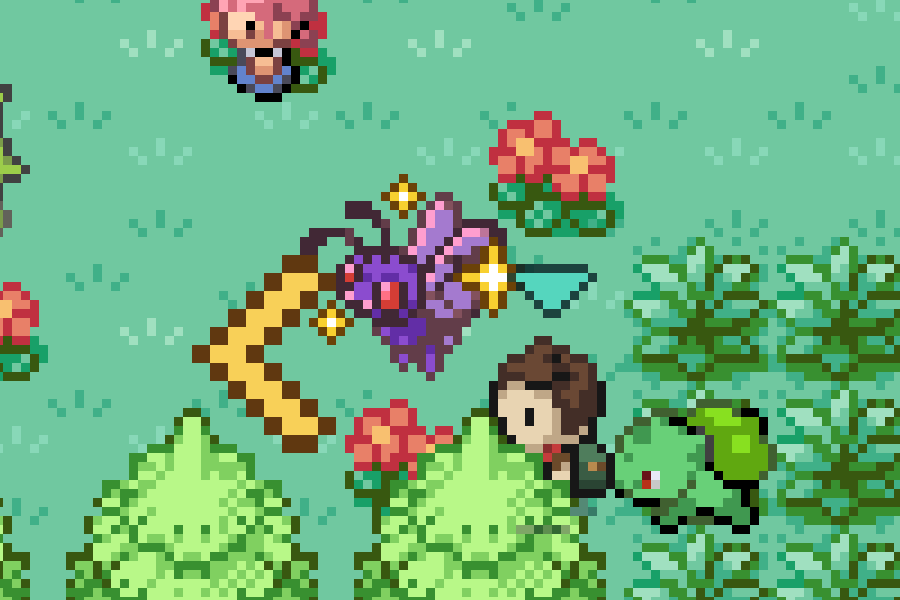

# The pink one glints where it stands

THE PINK ONE is a Butterfree that is always shiny, on THE BUTTERFLY RIDE in
Tanglewood while a Bug type leads the raid. It stood there tinted pink, and
that was the only thing that said so. A shiny in the garden at home gives off
gold stars (`src/game/base/shinyGlint.ts`), and now the pink one does the same
where it stands, so it is known for what it is from across the ride.

| Before | After |
| --- | --- |
|  |  |

Any standing Pokémon that is about to be met shiny gets them
(`WorldScene.standsShiny`). Today that is this one. A secret's Pokémon in its
ordinary colours gives off none, and neither does the pink one once it has
been had.

## How to see it

Put a Bug type first on the bench, drop in at the Farmhouse, and walk north
up into Tanglewood to the long ride with the butterflies on it. It is at the
east end, by Nell.

## How these were made

`tools/playtest/raid.mjs` against a test-mode build of `main` and of this
branch:

```sh
node tools/playtest/raid.mjs <url> --pixels --stepped --window=pixel --seed=7 --fresh --skip-contract --clock=day \
  --insertion=greystone-vale-farmhouse --level=30 --avoid-watch --team=caterpie:12 --lead=Caterpie \
  --steps=walk:227:181,glint:ride
```

`glint:name` is a new step: it stands until a standing Pokémon about to be met
shiny has all three of its stars out, and photographs that frame. The
pictures are crops of the 1200x768 screenshots.
