# THE POKéDEX

The captain, 12 Nov 2026: "I forgot about the Pokédex in Pallet Town - have we
implemented a Pokédex?" The game counted which kinds a save had owned and
Professor Oak paid seven milestones for them, and since #525 all 151 could be
owned - but there was nothing to open and look through. This is the screen.

`src/game/ui/pokedexView.ts` (what it draws), `src/game/scenes/PokedexScene.ts`
(the keys), `src/game/hub/pokedexSources.ts` (where each kind is found),
`src/game/pokemon/generated/pokedexEntries.ts` (FireRed's own entries), and the
`THE POKéDEX` block at the end of `src/style.css`.

## Before

There was no screen. The count was one line in the title bar of MY PC, upstairs
at home - the one place a player read it - and Oak's computers said nothing.

| MY PC's title bar: "POKÉDEX 37 · REWARD AT 50" | Oak's lab: the computers are furniture |
|---|---|
| 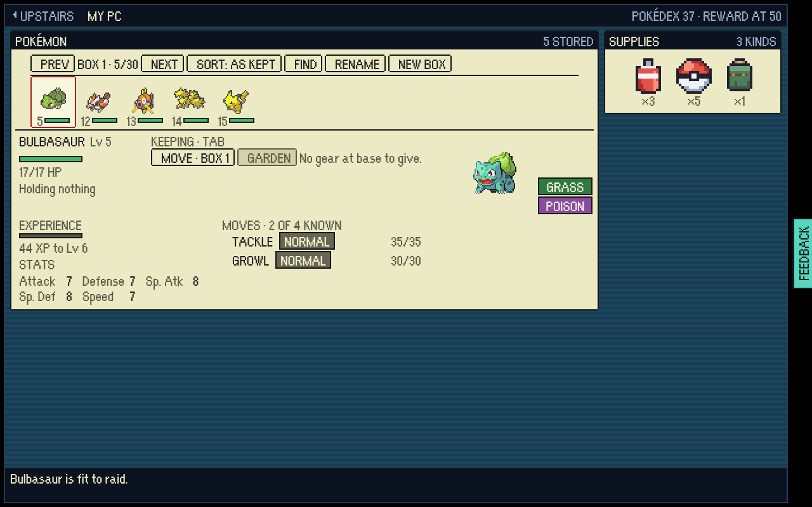 | 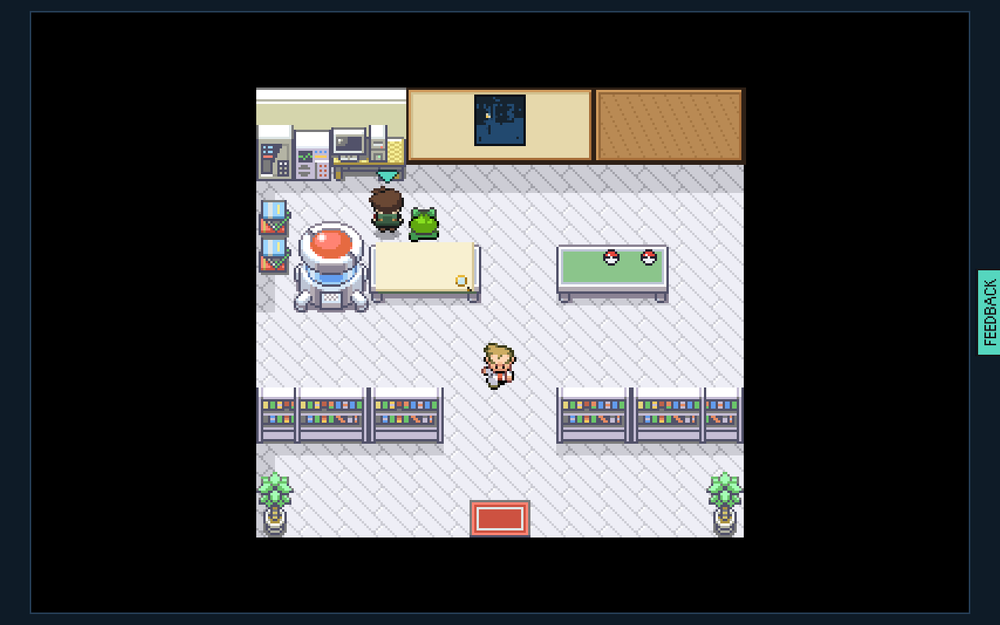 |

## After

X anywhere in the harbour, or Oak's PC along the back wall of his lab. All 151
in Kanto order across the whole window: a kind owned is its FireRed party icon
in colour, one only met in a fight is its shape, one never met is an empty
ball. A shiny that has been owned carries FireRed's star; a legend owned stands
on gold. Over the grid the count is drawn large beside a rail of Oak's seven
milestones - ticked once paid, the next one ringed in red - with the next
reward standing at the end as the things themselves.

| 1280x800: all 151 in view | 1920x950: the tiles take the room, and the card stands beside them | 800x600: the pane scrolls |
|---|---|---|
| 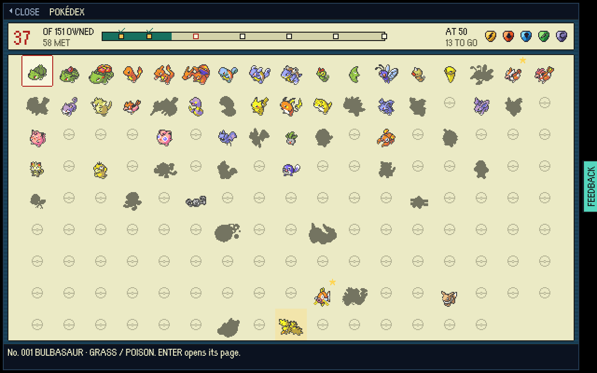 | 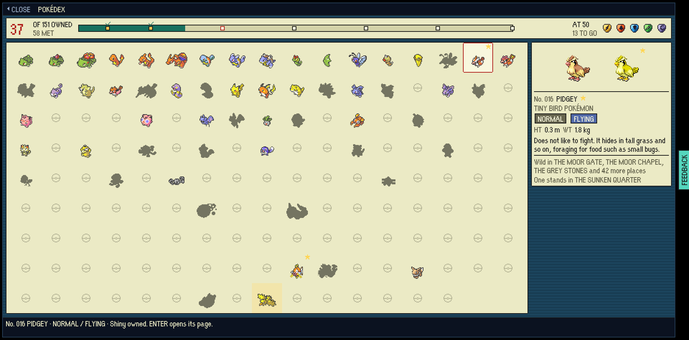 | 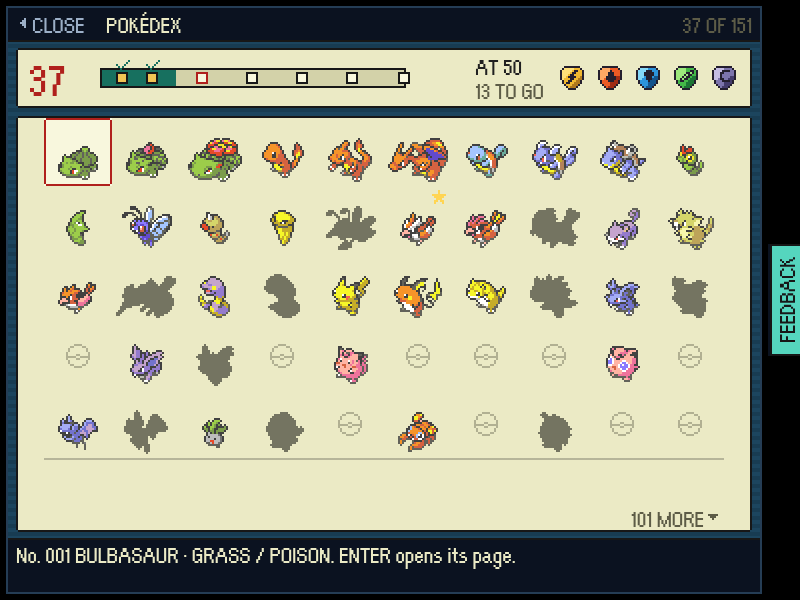 |

The cursor on one only met (the help bar names it), on an empty ball (ENTER
opens nothing and says why), and a brand new save:

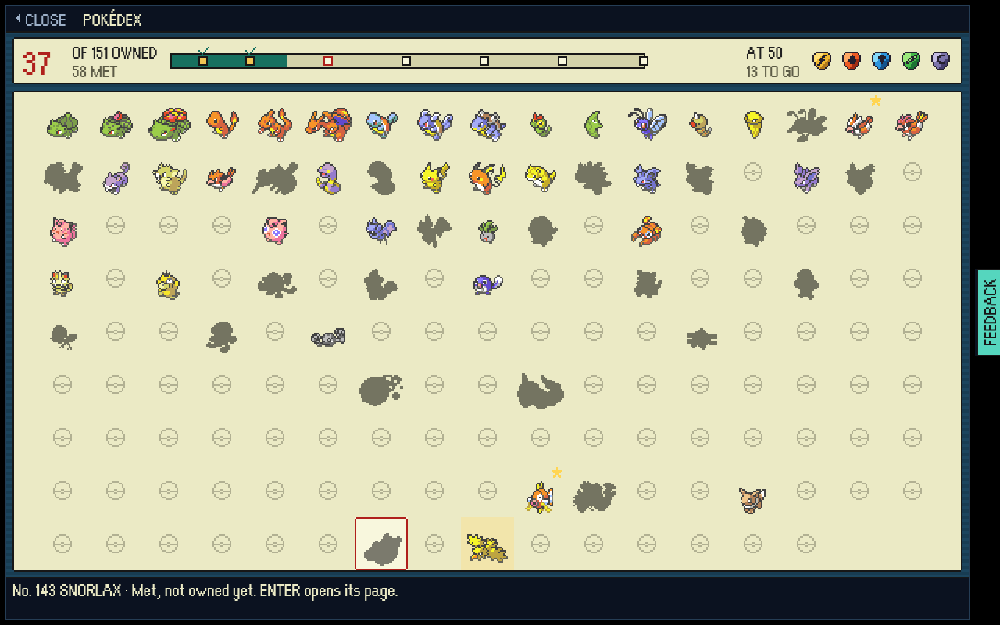 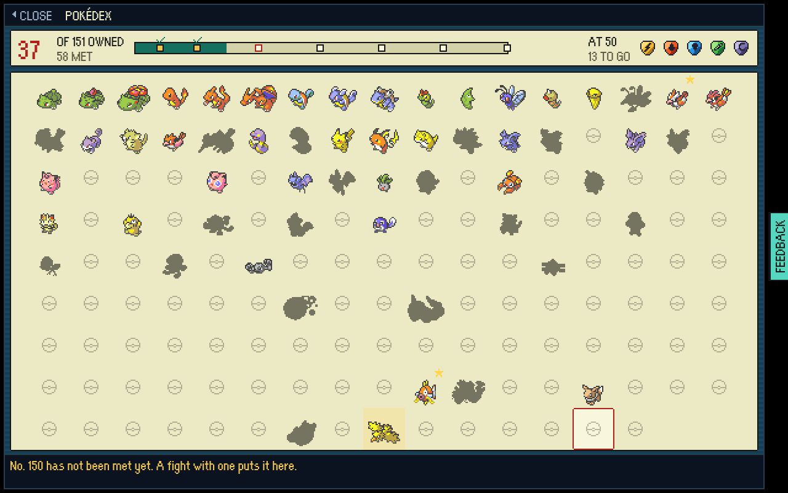 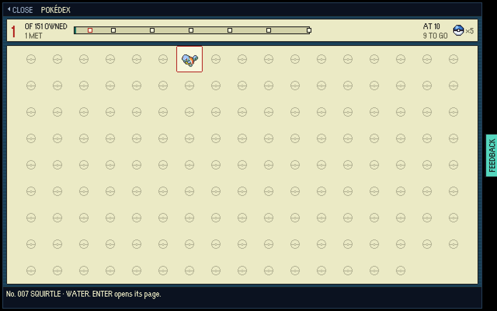

ENTER opens a kind's page: the front sprite large, its number and name, what it
is a kind of, its types, its size, FireRed's own entry, the line it belongs to,
and where it is found in this game. LEFT and RIGHT turn to the next kind met,
ENTER sounds its cry, ESC goes back to the tile it left.

| Owned | A shiny owned: both, side by side | Only met: its shape, its name and where it lives | A legend |
|---|---|---|---|
| 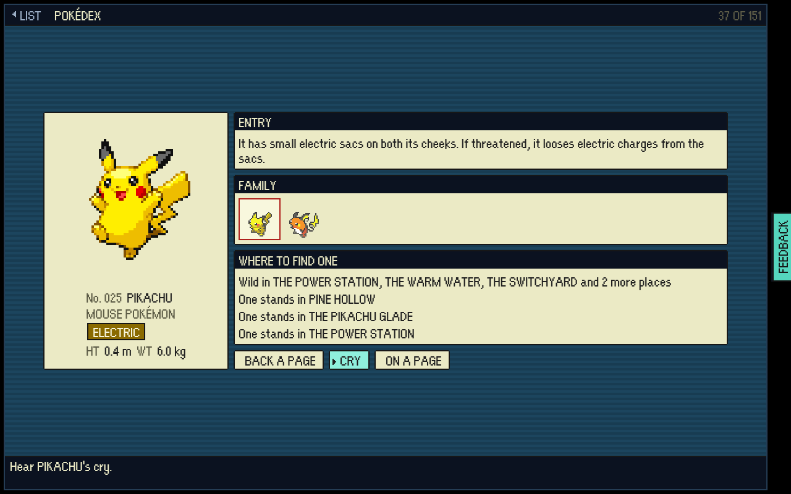 | 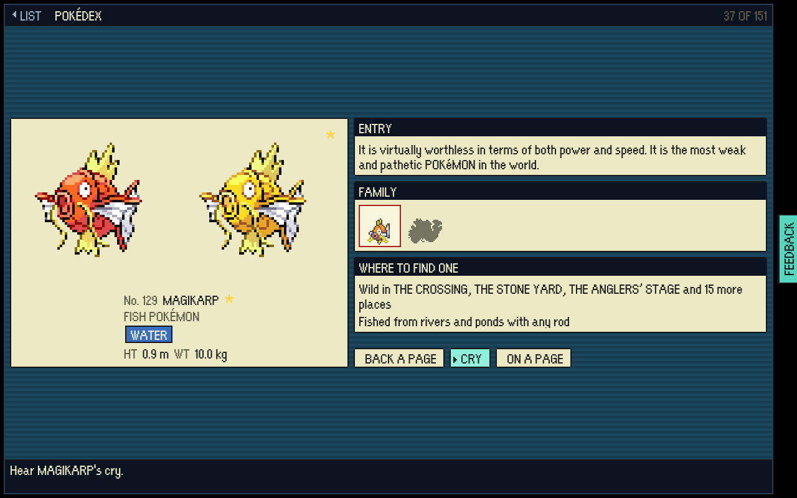 | 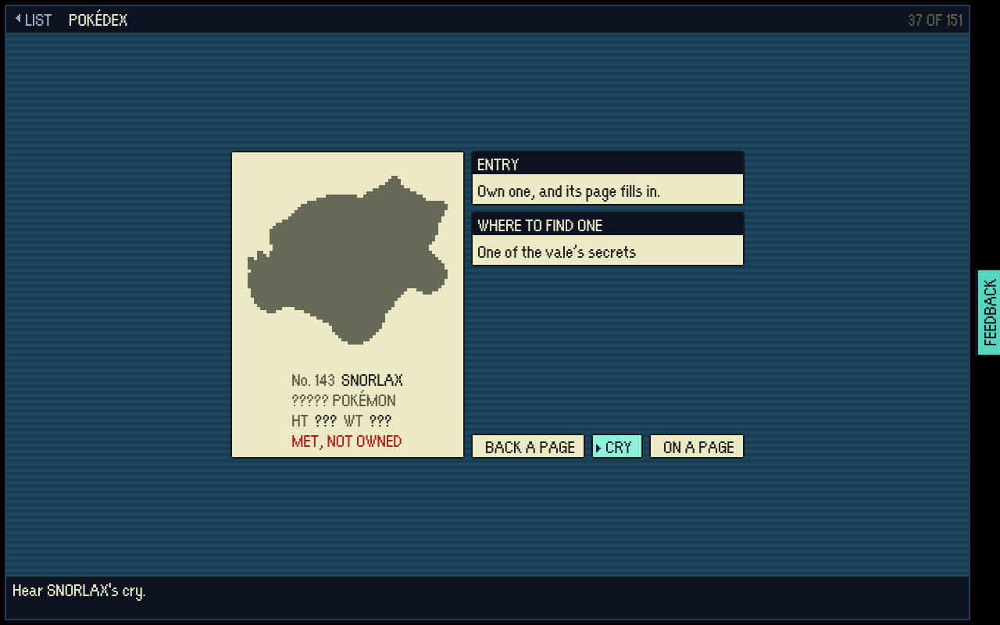 | 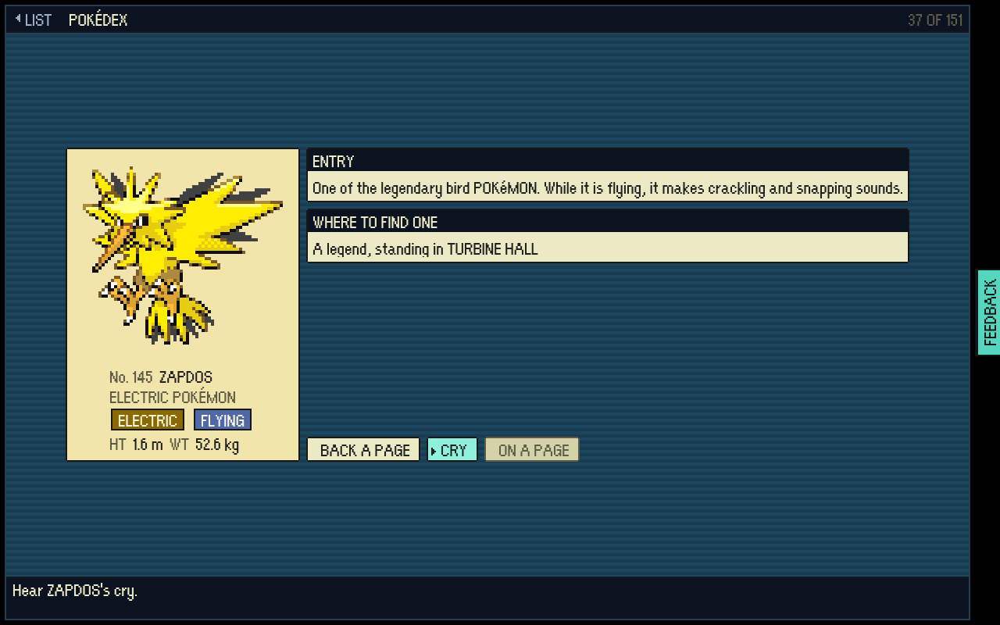 |

The page at 1920x950 (the sprite three times its size) and at 800x600:

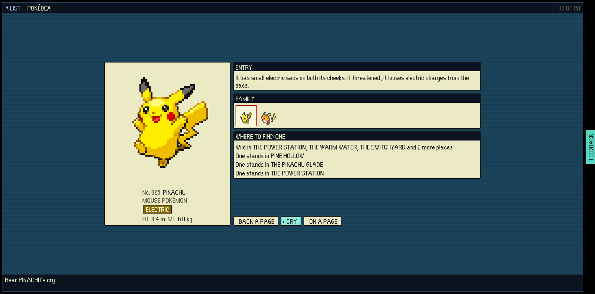 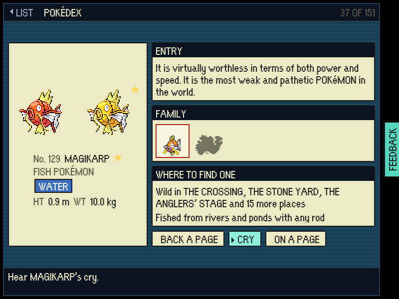

Oak's PC, faced from the one tile that reaches it, and a Snorlax met in a fight
on a raid that was then lost - still met, a shape among 149 balls:

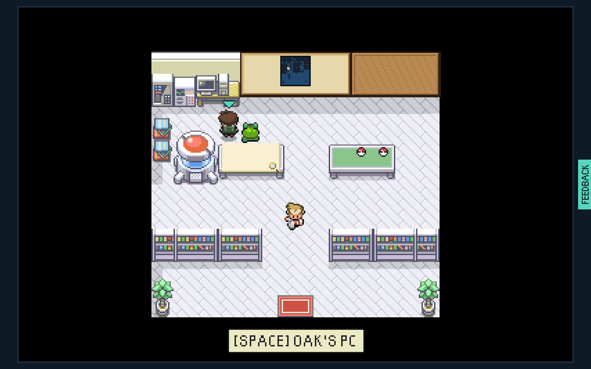 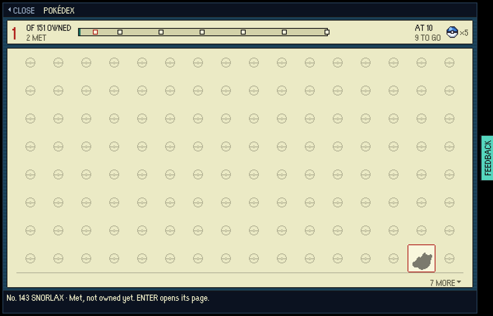

## What it knows, and where that comes from

- **Owned** is exactly what it was (`hub/pokedex.ts`): a kind is owned once a
  Pokémon of it has been in the vault. Nothing about owning changed.
- **Met** is new (`raidProgress.pokedexSeen`): `BattleScene` registers every
  kind that stands opposite - a wild one appearing, each one a trainer sends
  out - through `SaveManager.registerSeen`, written at once, so a raid that ends
  in a wipe has still met what it met. A kind owned is met. A bout for show
  registers nothing, as it writes nothing but its result.
- **Shiny** is new (`raidProgress.pokedexShiny`): registered by the same write
  that registers a kind as owned, and kept after the Pokémon is gone.
- **The entries** are FireRed's own, read out of the disassembly by
  `tools/pokedex/harvest.mjs` into a committed snapshot and generated from it
  (`public/assets/ASSET_PROVENANCE.md` records them).
- **Where to find one** is asked of the game's own data
  (`hub/pokedexSources.ts`): the tables of every place with ground that rolls,
  by day and by night, the waters a rod reaches, the Pokémon standing on the
  map, the secrets, the fossils, the prizes, the errands, the dojo, THE TRADER
  and evolution. `hub/pokedexComplete.test.ts` asks the same walk whether all
  151 can be owned, so a page cannot name a place the game does not have.

## How the pictures were made

Against a test-mode build (`tools/playtest/README.md`, "Memory"):

```bash
node tools/playtest/pokedexShots.mjs "<build url>/?testmode=pixels" <dir> --window=1280x800
node tools/playtest/pokedexShots.mjs "<build url>/?testmode=pixels" <dir> --window=1920x950
node tools/playtest/pokedexShots.mjs "<build url>/?testmode=pixels" <dir> --window=800x600
node tools/playtest/pokedexShots.mjs "<build of main>/?testmode=pixels" <dir> --window=1280x800 --before
node tools/playtest/pokedexMet.mjs "<build url>/" <dir>
```

`pokedexShots.mjs` plays the screen on a save 37 kinds in (21 more only met, a
shiny Pidgey and Magikarp, Zapdos, Oak's first two rewards paid) and fails if
any of the 151 tiles cannot be reached by arrow key, if ENTER, LEFT, RIGHT,
ESC, BACKSPACE or X do anything but what they say, or if an empty ball opens a
page. `pokedexMet.mjs` plays the save rule: a wild Snorlax appears, the save
holds it as met before a move is chosen, and it is still met after the raid is
abandoned.

## Scorecard

Measured by `pokedexShots.mjs` on the screen as drawn (the menu overhaul's own
glance measure, `docs/screens/menu-overhaul/`):

| Measure | 1280x800 | 1920x950 | 800x600 |
|---|---|---|---|
| Kinds in view (of 151) | **151** | **151** | 60 |
| Words in view on the grid | 13 | 64 (the card's among them) | 11 |
| Screen that is picture | 31% | 18% | 67% |
| Words in view on a page | 59 | 59 | 59 |

Against FireRed's own Pokédex, out of 5:

| FireRed's Pokédex | Score | Why |
|---|---|---|
| The list: every kind in its own order | 5 | FireRed scrolls names seven at a time beside one small picture; here all 151 are on screen at once at 1280x800 and up, and the picture is the list |
| Seen and owned told apart | 5 | FireRed puts a Poké Ball beside a kind owned and dashes for one unseen; here colour, shape and an empty ball, read without a word |
| The counts on its opening page | 5 | owned drawn large, met beside it, and a rail that fills |
| The page: sprite, number, name, category, size, entry | 4 | all of them, the entry the cartridge's own words; sizes are in metres and kilograms rather than feet and pounds, and there is no footprint (none is shipped, and no new art was brought in) |
| A kind only seen gives up less | 5 | as FireRed: its name, its cry and where it lives; category, size and entry are filled in by owning one |
| AREA: where it lives | 3 | FireRed lights its nests on the town map; here the places are named in words, commonest first - true to this game's data, but words, not a map |
| CRY | 4 | the kind's own FireRed sample on ENTER; no waveform is drawn |
| SIZE: beside the trainer | 1 | not built: it needs the scale table and a trainer silhouette |
| Search and sort (A to Z, type, lightest, smallest) | 1 | not built: the grid is in Kanto order only |
| Oak's rating | 4 | his next reward is on the rail as its own icons and how many kinds off it is; his words are still his to say in the lab |
| Every key path | 5 | X opens and closes, arrows reach all 151, ENTER opens a page, LEFT and RIGHT turn it, ENTER cries, ESC and BACKSPACE go back (`pokedexShots.mjs`, `PokedexScene.test.ts`) |

And past FireRed's: a shiny owned is marked on its tile and shown beside the
plain one on its page; a kind's line is drawn on its page as the grid draws
each of them; and a legend owned stands on gold.

## Not in this change

- **Not in a raid.** A screen a raid opens stands at the side with the map
  still there (`docs/agents/ui-and-screens.md`), and 151 tiles in a 232-pixel
  column is a scroll of six across; the raid chip's key row is also full. What
  a raid does do is register every kind it meets, at once. A side-panel
  Pokédex for the raid is a follow-up if it is wanted.
- **The SIZE page, the search modes and a map for AREA**, as the scorecard says.
