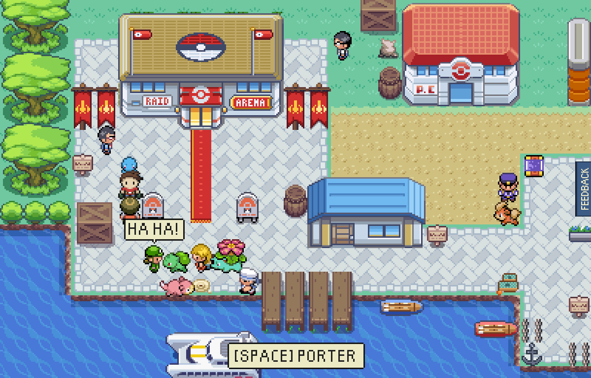
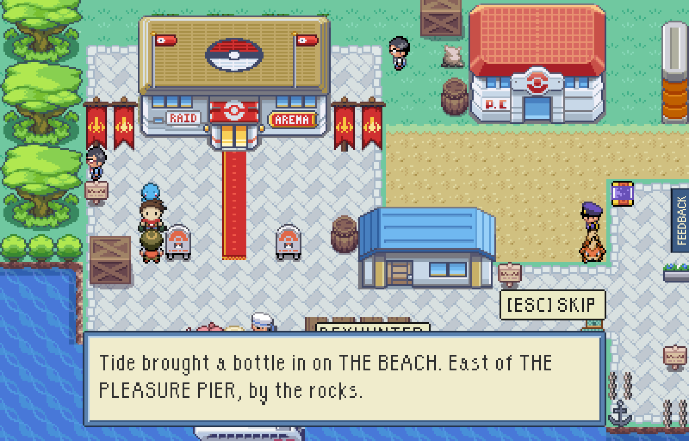
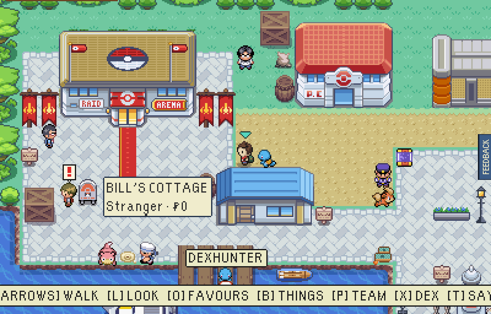

# The porter tells of the bottle on THE BEACH

The bottle on THE BEACH starts the harbour's treasure map, and the only thing
that ever named it was MARLOW's line inside THE GREAT LIBRARY. The PORTER on
the quay stands on the way to THE RAID ARENA; while the bottle lies there, and
once a raid has been gone on, he says first where it is:

> Tide brought a bottle in on THE BEACH. East of THE PLEASURE PIER, by the rocks.
> Corked and sealed with wax, and nobody's picked it up. Not my crate, not my business.

and then his crates. Before a first raid and once the bottle is picked up he
keeps to his crates (`porterLines` in `src/game/base/harbourLife.ts`).

While he has the news he wears the harbour's "!" over his head, as a person with
a favour does, so it can be seen from across the yard; it goes once his first
line is up. Any of those marks now steps aside while the player stands where
it would be drawn, which is on their own head when they speak from the tile
above (`placeHarbourMarks` in `BaseScene`).

| before | after |
|---|---|
|  |  |

| seen from across the yard |
|---|
|  |

Made on 25 Nov 2026 at 1200x768 in `?testmode=pixels` against test-mode builds
of `main` and of this branch: a new save given two raids' record, walked up to
the porter and spoken to.
