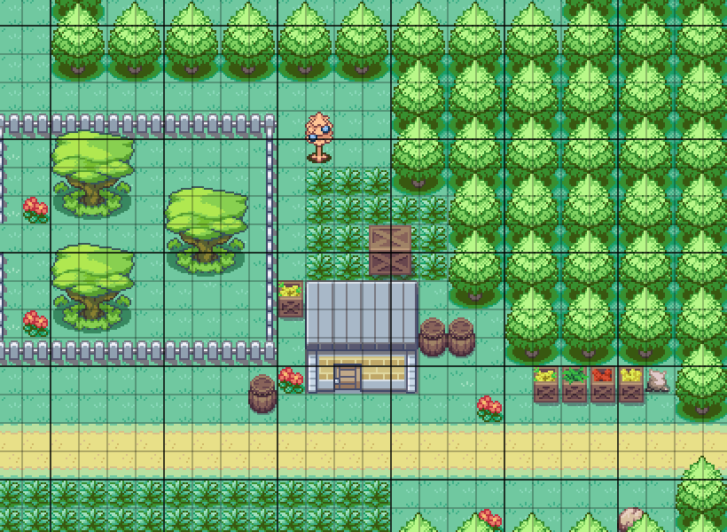
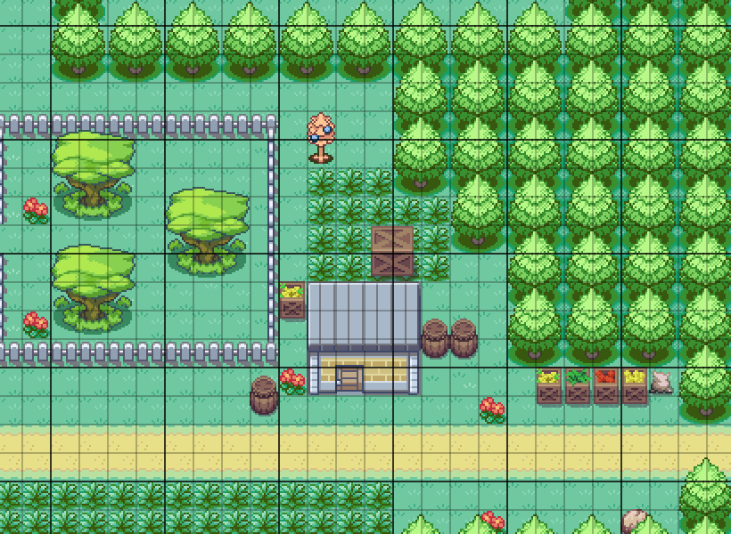

# The lone tree beside the cider press

Orchard Terraces, the cider press on the lane (the shed at 49,25). One tree of the wood stood out on its own at 54-55, 24-25, right beside the player walking past the press, reading as a stray rather than as the wood's edge. It is meadow now, and the wood steps back a tree at a time down to the lane.

Both pictures are `tools/mapcraft/look.mts`'s gridded picture of the district, cropped to tiles 40-64 by 17-35 and doubled with ffmpeg (`crop=410:300:640:270,scale=820:600:flags=neighbor`).

| Before | After |
| --- | --- |
|  |  |
