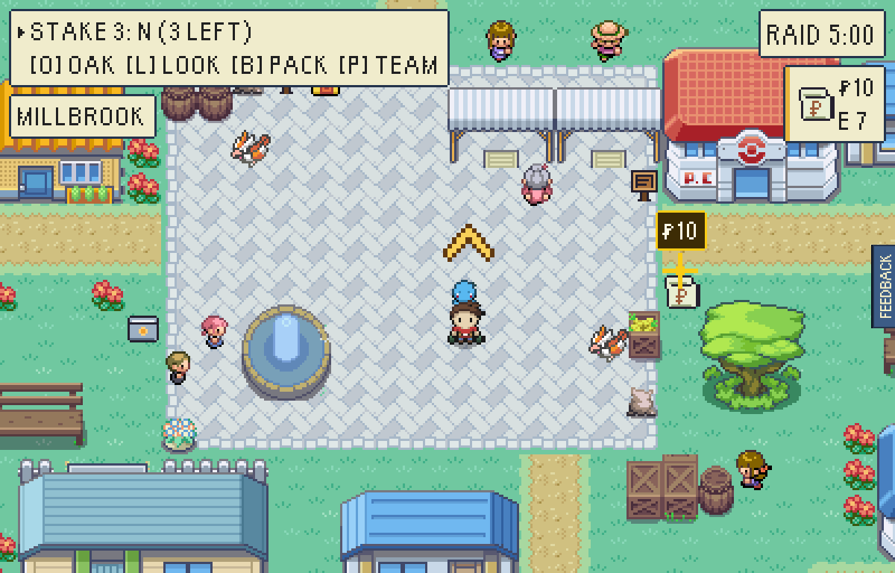
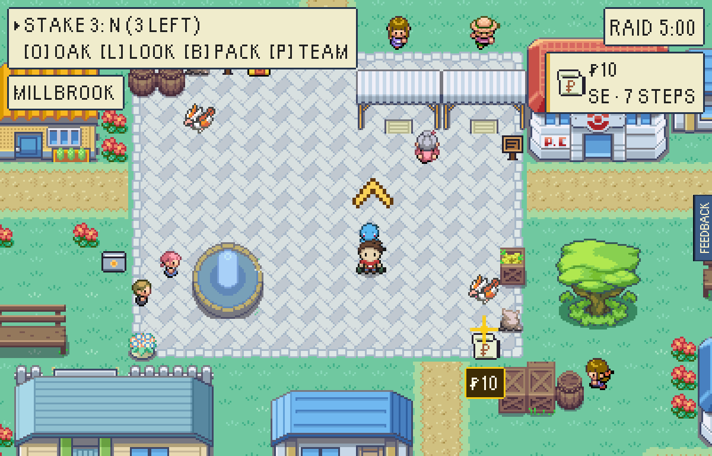
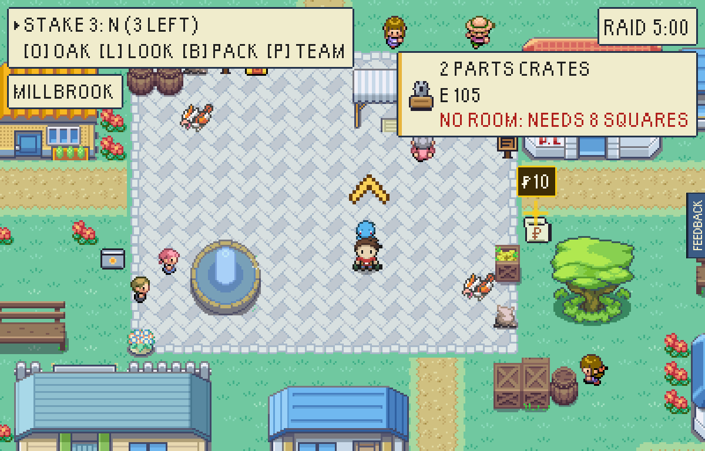
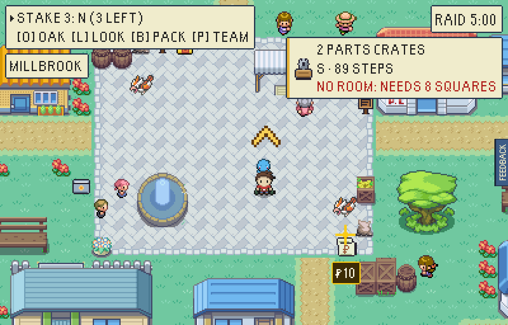

# The prize chip says steps

The prize chip's second line was a compass point and a bare number, `E 105`,
which read as a grid reference. It now leads with the way, as the
objective chip does (`STAKE 3: N`), and gives the distance its unit:
`E · 105 STEPS`, and `W · 1 STEP` for one (`prizeChipView` in
`src/game/scenes/raidHud.ts`).

| before | after |
|---|---|
|  |  |
|  |  |

Made on 25 Nov 2026 at 1200x768 in `?testmode=pixels` against test-mode builds
of `main` and of this branch, with the stake check of
`tools/playtest/characters2Fixes.mjs` on a save that has been on raids before
(a new save's first raid is the Pidgey). The stake and its distance differ
between the two because each build laid its own raid.
