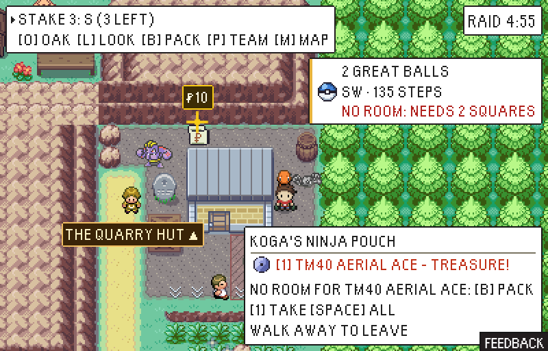
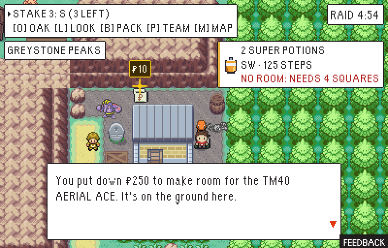

# A prize never blocks a reward

In the gyms playtest of 26 Nov 2026, beating Koga paid ₽1800 into the pack and
filled it. His ninja pouch then held the TM40 AERIAL ACE, and the search said
NO ROOM FOR TM40 AERIAL ACE. The gym's best reward was the one thing the
player could not carry.

Now, when a bag's rare or treasure find has no room, the search puts down
just enough money to take it (`Bag.leastToMakeRoom`,
`WorldScene.makeRoomWithMoney`). The money lies on the tile the player is
standing on, to pick back up. While the search is still open, its panel says
`PUT DOWN ₽250 TO MAKE ROOM`. When the find was the last thing in the bag,
a box says it instead. An everyday piece is still refused as before.

The same set-up both times: a save lands at THE QUARRY and the pack is filled
with money, ₽3000 in twelve squares. A pouch like Koga's is opened, holding the
TM40 as a treasure, and the player presses 1 to take it.

Before (main), the TM is refused:

After, ₽250 is put down beside the player and the TM is in the pack:

Made with the AI playtester's hands (`tools/playtest/ai-player/act`) on a
test-mode build, one headless browser. The pouch was opened by script, because
reaching Koga takes a full gym run. The canvas is shot at 2x.
