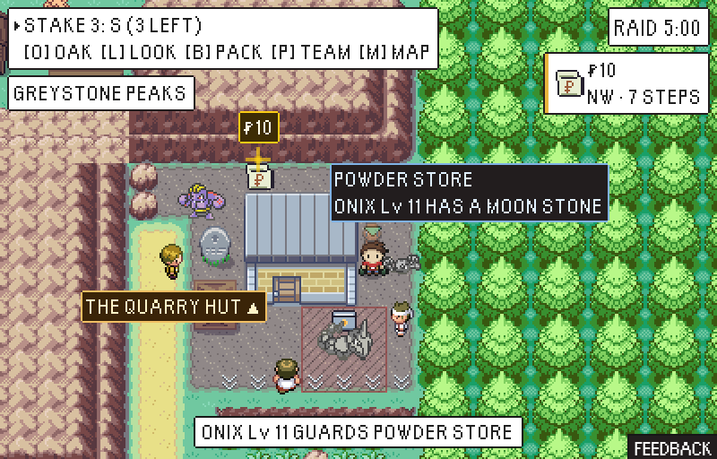
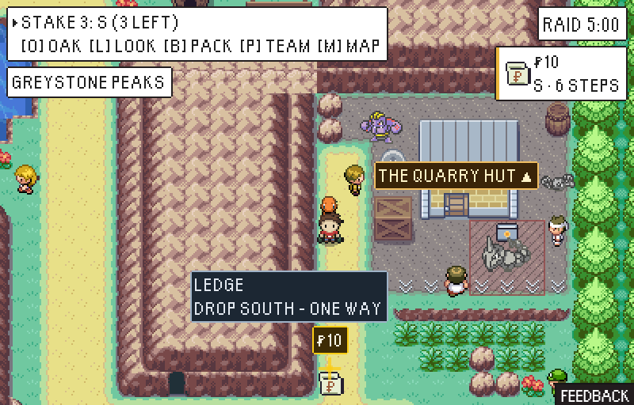

# THE QUARRY's landing, clear of the Onix

In the gyms playtest of 26 Nov 2026, the player landed at THE QUARRY in the
narrow cut beside the Powder Store. Every way south from there runs through
the reach of the Onix that guards the store. Two steps off the landing came a
guard fight. Running left the player still in its reach, so the next step
brought it back: three forced fights in the first ten seconds of the raid.

The guard has to stand where it is. It must be beside the landmark it names
and reach every side the landmark is worked from (`guardsPlaced.test.ts`).
The Powder Store sits at the mouth of the cut, so the landing moved instead.
It is now on the sand path west of the Quarry Hut (176,79 rather than
184,77), seven steps from the Onix's reach. From there the walk south drops a
ledge toward the cave mouth without going near the guard. The Powder Store is
still a few steps away for anyone who wants its Moon Stone.

`guardsPlaced.test.ts` now holds every landing at least six steps from any
guard's reach. The Quarry was the only landing under that. The next nearest
is the farmhouse, at eight.

The same save both times lands at THE QUARRY and walks toward the cave mouth
at (170,86).

Before (main): the landing, in the Onix's cut. Two steps on, "ONIX: Onix onix!"

After: the new landing on the sand path. Six steps south, no fight.

Made with the AI playtester's hands (`tools/playtest/ai-player/act`) on a
test-mode build, one headless browser, the canvas shot at 2x.
