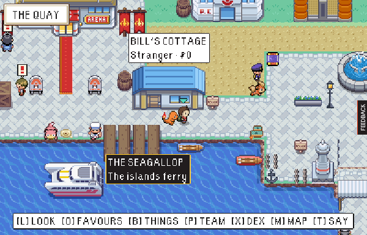
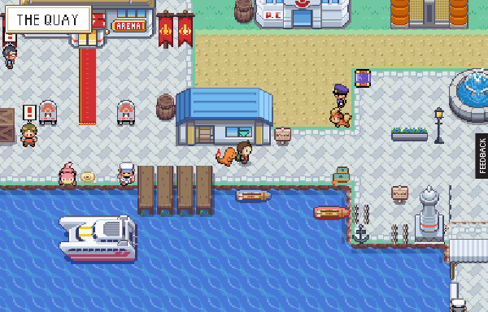
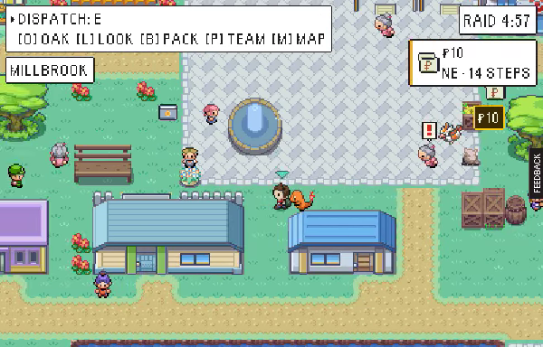
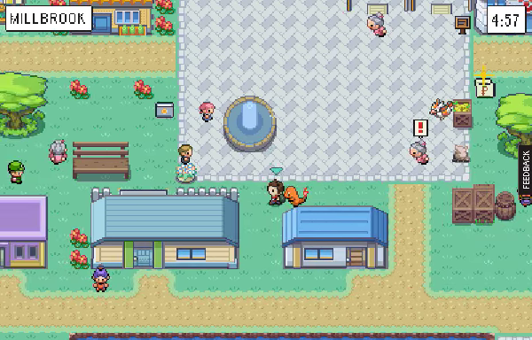
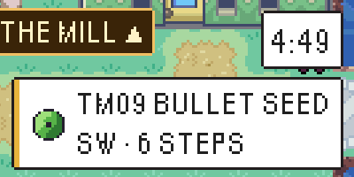
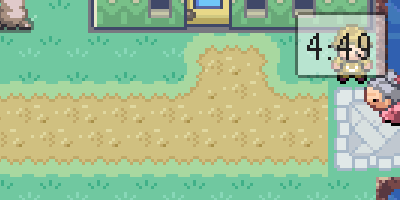

# A quiet overworld: FireRed's screen

Contest quiet-1 (27 Nov 2026) asked three designers for a harbour and a raid
with far fewer words on them. Olly picked A, "the FireRed screen": a place's
name when you arrive and one small clock on a raid, and nothing else until L is
held. The keys are offered on the controls bar beside the game, never written
on the map.

| | Before | After |
|---|---|---|
| The harbour, a save one raid in |  |  |
| A raid's first steps in Millbrook |  |  |
| A townsperson behind the raid clock (L held) |  |  |

The first two rows are the contest's own clips at 1200x768, shown at half size
(`tools/playtest/quietClip.mjs`, the last frame of each raid clip and the
harbour poster). The partner coming through a door behind the player rather
than in front of them is in both "after" clips.

The third row is the fix that came with the pick. A figure standing behind the
clock showed only its feet below the box. Now any chip with a figure, a find or
a landmark behind it draws its paper and line see-through, and its words stay
solid (`RaidHudState.behind`). These are crops of a test-mode build at
1200x768: a new save with the first job banked deploys at Millbrook at midday,
walks a dozen steps east and north, and holds L. In the "after" shot a
townsperson was set under the clock so the crop shows the case.
