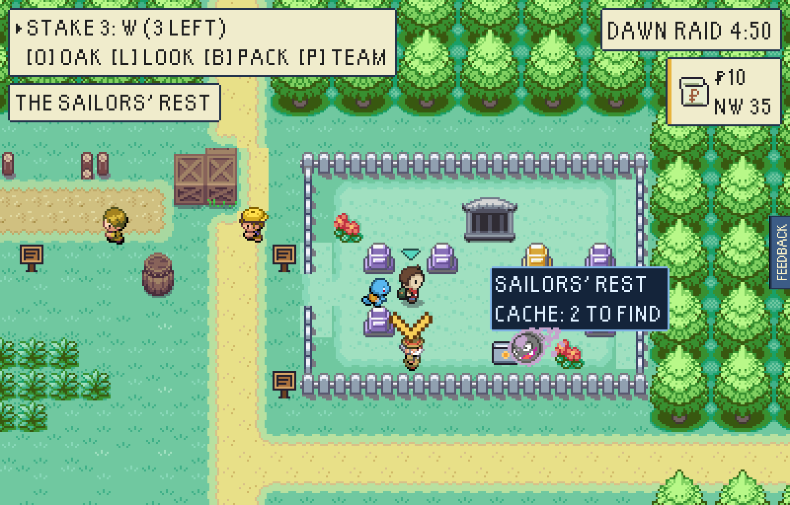
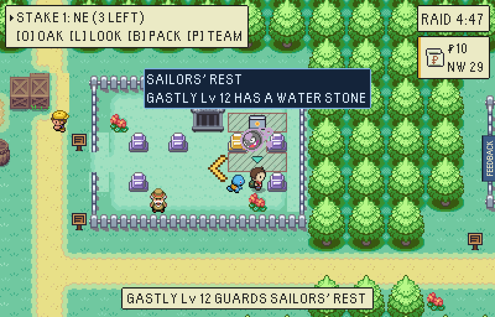
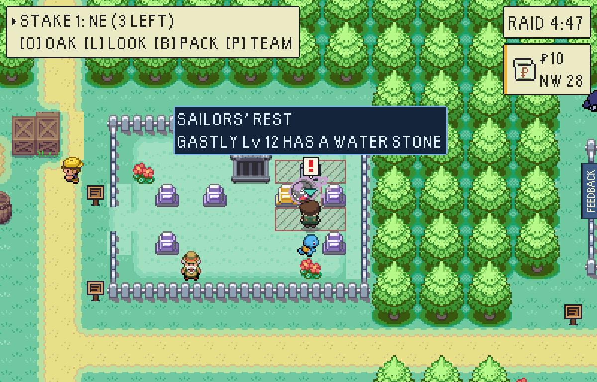
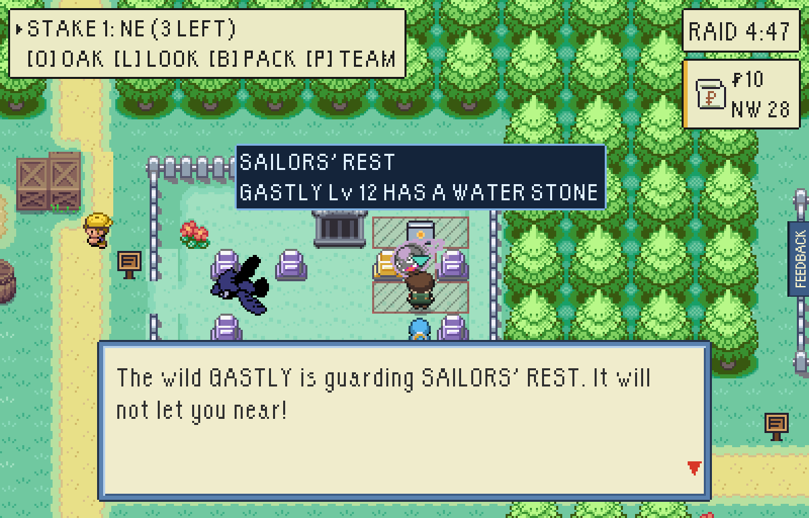
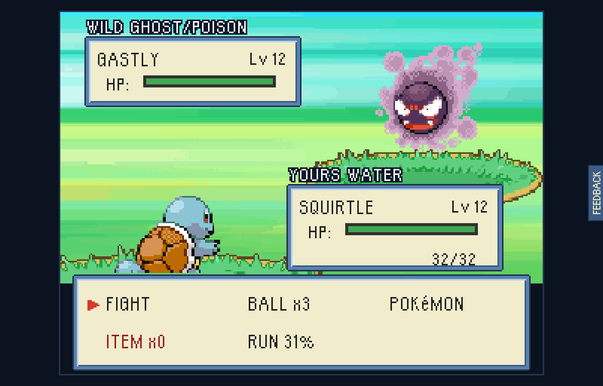
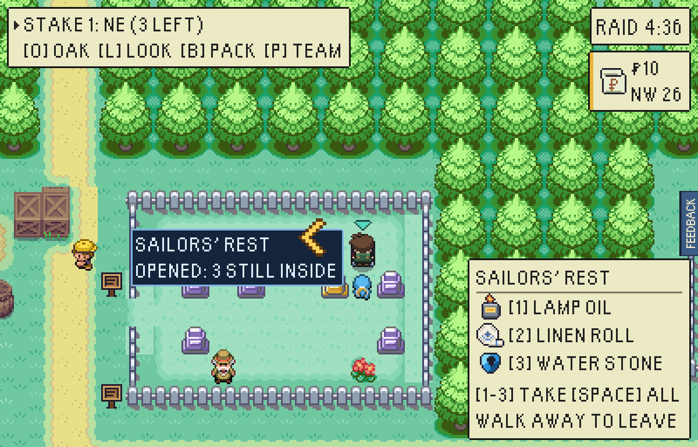

# Raid guards

A wild Pokémon sat on a cache comes at you the step you move beside it (`src/game/world/guards.ts`).

**Before** (`origin/main`, the same spot): a Gastly paced beside the Sailors' Rest grave in Gull Strand with no level. It looked as if it would go for you, and it never fought. Nothing marked the grave as anything but an ordinary cache.

**After:**

| | |
|---|---|
|  | A step short of it: the Gastly sits in the one gap into the back of the yard, its square hatched red like a trainer's sight, the grave's caption says `GASTLY Lv 12 HAS A WATER STONE`, the hint line names it, and it hops while it watches. |
|  | The step beside it: the player turns, the "!" goes up on the Gastly's head, it lunges. |
|  | Its line: what it guards. Then the fight. |
|  | A wild fight. RUN works, but it stays put; SPACE or a step within its reach brings it on again. |
|  | Beaten: it is gone, the gap is open, and the grave behind it gives up its lamp oil, its linen and the Water Stone. |

Made with `node tools/playtest/guards.mjs <url> <out dir>` against a test-mode build, as `tools/playtest/README.md`'s "Memory" section asks for a screenshot session (a Lv 12 Squirtle deployed at the Stepping Stones, `?testmode=pixels`, 1200x768).
