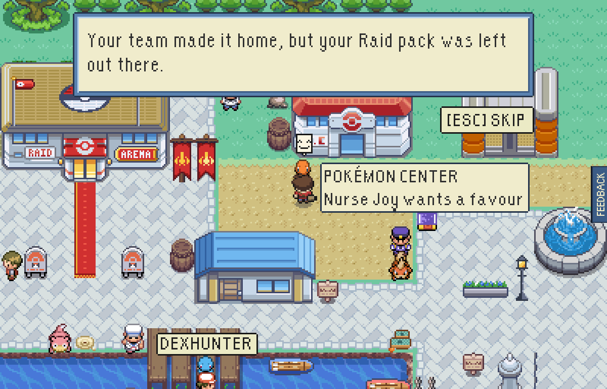
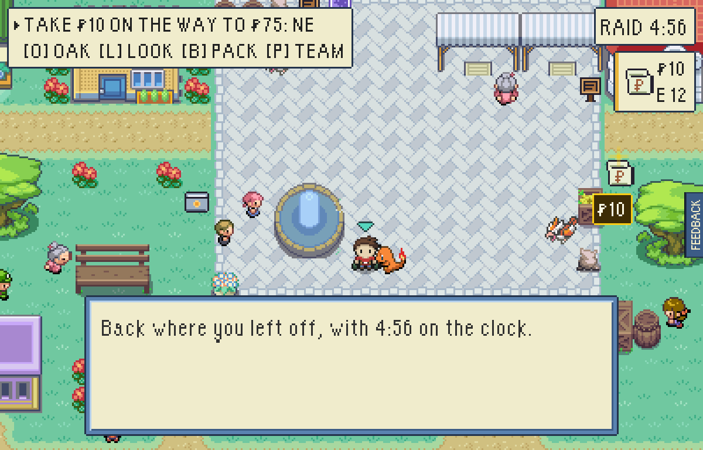

# A raid survives the page it is played in

A reload, a crash or a tab the browser threw away used to settle the raid as
abandoned and take the pack - and the same gap was a way out of a losing fight
for anybody who pressed F5. The raid is now written down as it is played and
taken up where it stood (`src/game/run/raidResume.ts`).

| Before | After |
|---|---|
|  |  |

- `resume-walk.png` - reloaded mid-walk: the same tile, the same clock, the same pack.
- `resume-fight.png` - reloaded after a turn of a fight: the same fight, the Caterpie on the HP that turn left it.
- `frozen-window-wakes.png` - a window that was frozen while another took its raid up wakes and walks out: nothing banked, and it says the raid is still out in the other window.

Made against a test-mode build (`VITE_EPTW_TEST_MODE=1`, `tools/playtest/README.md`, "Memory") at 1200x768:

```bash
node tools/playtest/raidResume.mjs <build url> --shot=docs/screens/raid-survives-reload
node tools/playtest/twoTabRaid.mjs <build url> <dir> --frozen        # frozen-window-wakes.png
node tools/playtest/abandonRaid.mjs <build url> --shot=<dir>          # before: abandon-reload-2.png
```

`abandonRaid.mjs` refuses the raid's record (`NO_RAID_RESUME` in `deploy.mjs`), which is what every reload did before.
