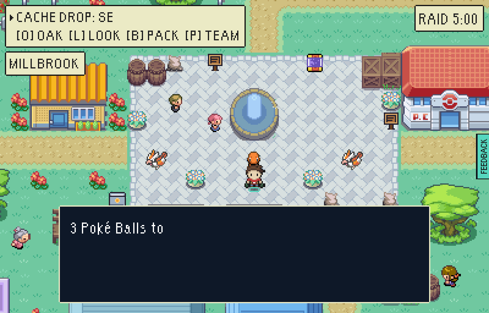
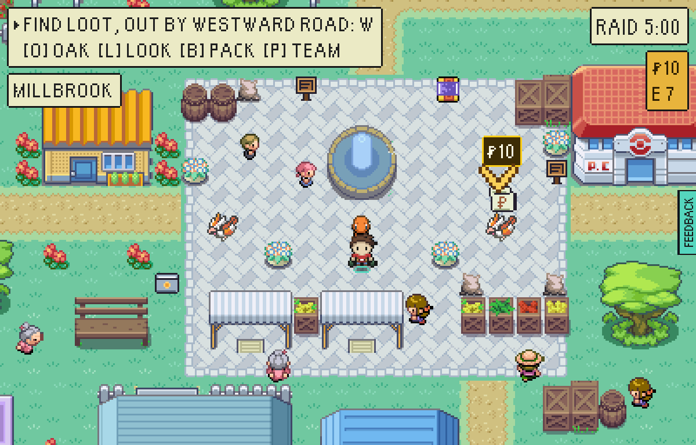
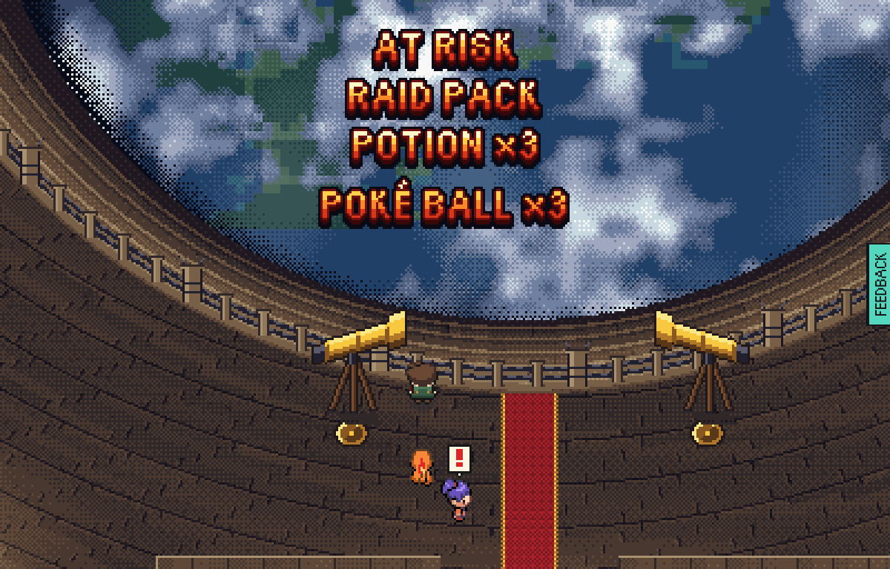
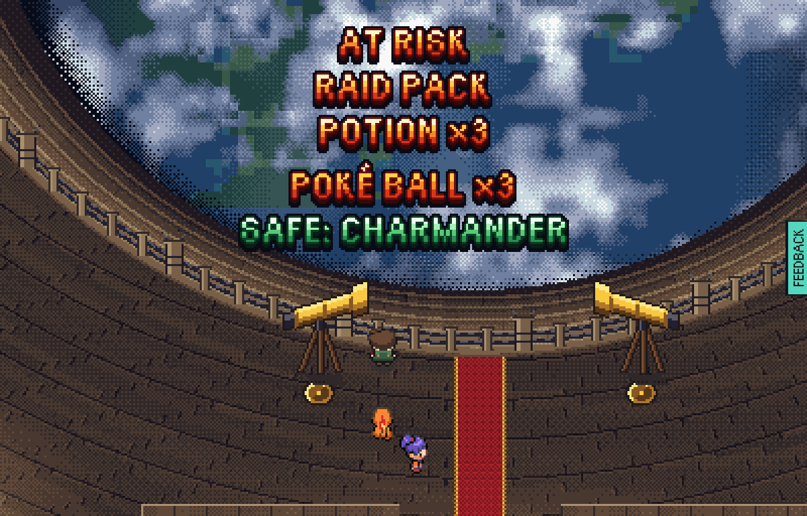
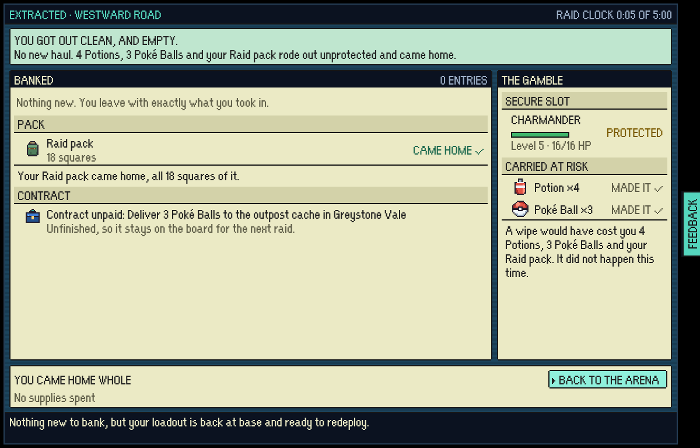
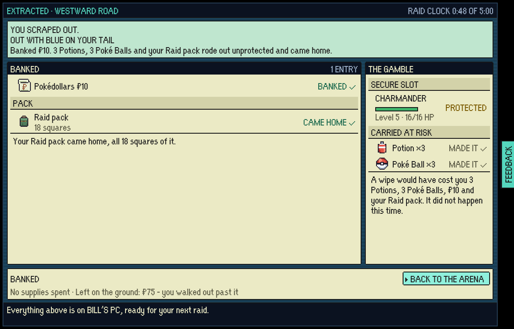

# A raid worth staying for

Six strangers played the game, and the best play they found was to leave inside a minute. These are
the same landings and the same rail, before and after.

| | Before | After |
|---|---|---|
| The landing |  |  |
| The rail |  |  |
| Walking straight out |  |  |

The rest of the after:

- `after-first-chase.png`: a new save's first raid, 40 seconds in, with the way out on the chip and a green chevron.
- `after-stake-taken.png`: the moment the stake is picked up.
- `after-result.png`: a raid that stayed for it.
- `after-rail-partner.png`: the rail with the partner out of the locker.
- `after-rim-job.png`: the rim's card saying what raid two's job asks and pays.

To play it again: build in test mode (`tools/playtest/README.md`) and run
`node tools/playtest/veteranLoop.mjs <url> <out> --policy=veteran|stay|potter --shots`, and
`npx vite-node tools/raids/veteranLoop.mts` for the same question over many seeds with no browser.
