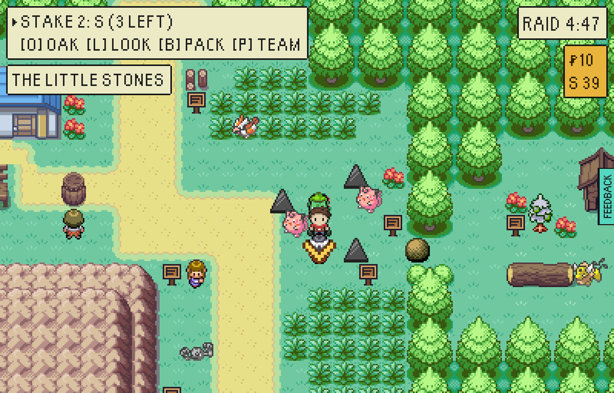
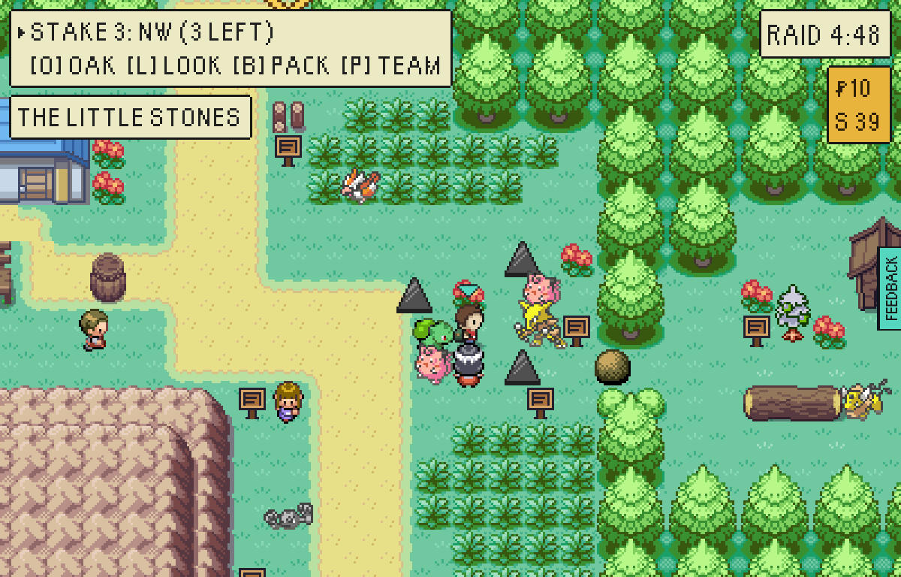
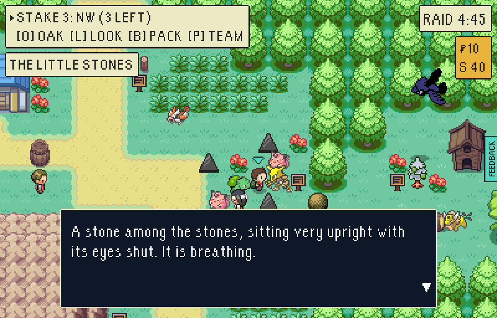
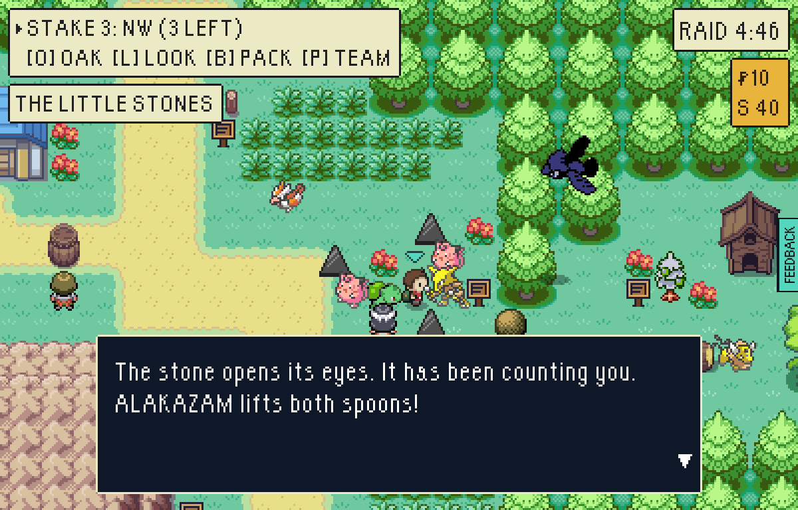
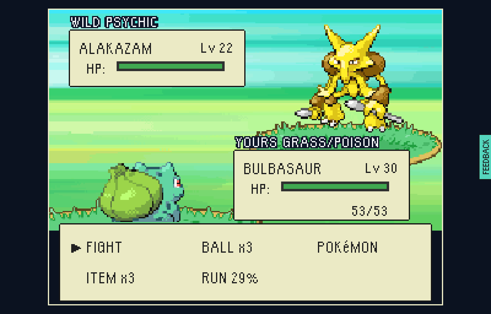
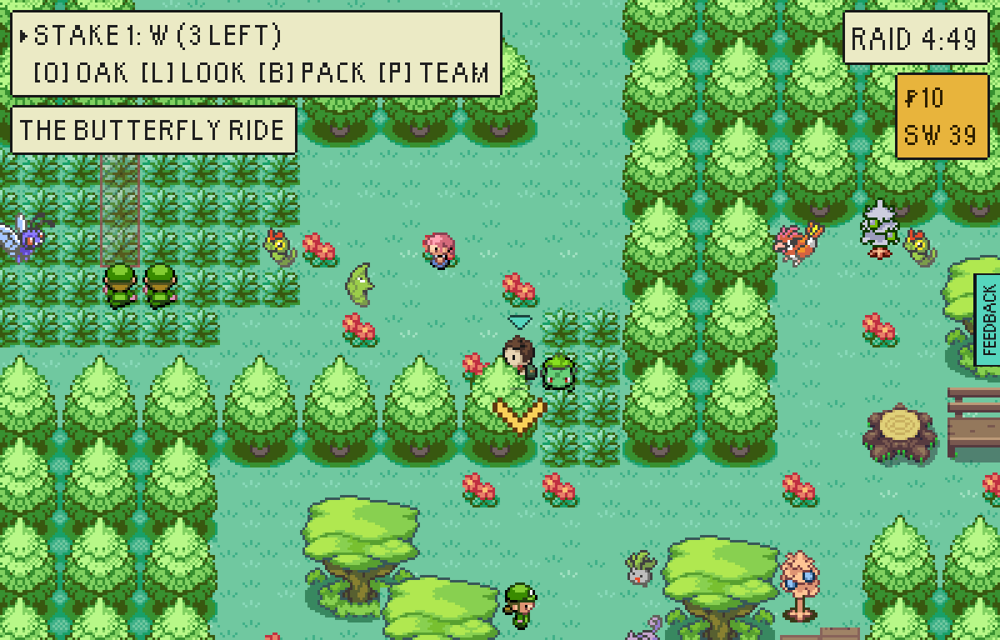
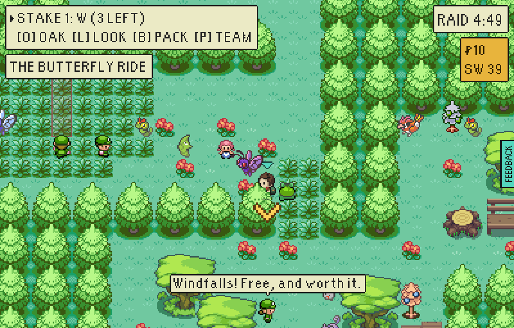
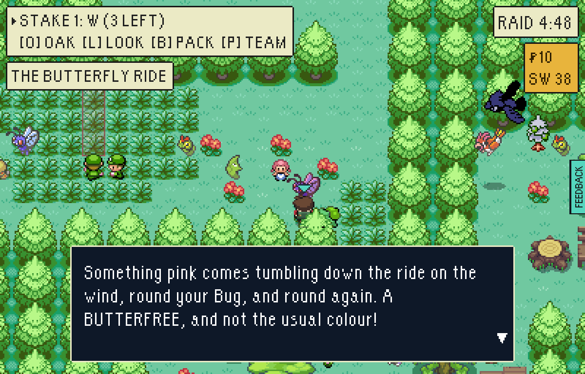
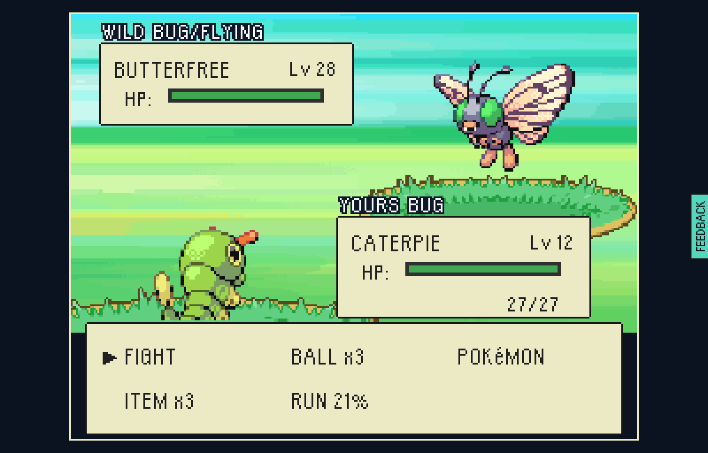

# Rare finds, wave 4: the pink one, and the eleventh stone

Two more of the vale's secrets (`src/game/world/secrets.ts`), each hung on
something somebody in the vale was already saying.

| Find | Where | What it waits for | Heard from |
| --- | --- | --- | --- |
| THE PINK ONE: Butterfree, Lv 28, shiny | THE BUTTERFLY RIDE in Tanglewood, at the ride's east end by Nell. Nearest landing: Farmhouse, north up the Pickers' way. | A Bug type leading the party. A Caterpie or a Weedle from the wood will do. | The harbour board |
| THE ELEVENTH STONE: Alakazam, Lv 22 | THE LITTLE STONES on High Moor, north of the Moor Top landing. It sits among the stones every raid. | A raid gone on alone: one Pokémon in the party and no more. | The S.S. Anne's captain, through his glass |

Each is fought as a wild Pokémon and is only yours once it is carried home.
Three starters at Misty's level lose to each more often than not
(`secrets.test.ts`).

The pink one is the vale's second Pokémon that is always in its other colours,
after the red Gyarados in the tarn. Going alone is a new kind of condition: it
is a risk taken rather than a thing brought, with nobody to switch to.

Played in a test-mode build (`VITE_EPTW_TEST_MODE=pixels`) by
`tools/playtest/raid.mjs --pixels --stepped --window=pixel --seed=7
--skip-contract --clock=day`. The "before" picture is the same walk on a build
of the commit before.

## THE ELEVENTH STONE

`--insertion=greystone-vale-moor-top --level=12 --team=pidgey:8 --steps=walk:101:76,shot:stones,read:100:75:up`,
then with the starter alone: `--level=30 --steps=read:100:75:up`.

| | |
| --- | --- |
|  | Before: the Little Stones. The notice says there are nine and there were seven; Mother Stone has counted nine and eleven in one night. |
|  | After: one of them is not a stone. An Alakazam sits in the middle of the ring every raid until it is had. Mother Stone's new third line is the clue: "One of them is no stone. It only opens its eyes for somebody who comes up here ALONE: one POKéMON, no more." |
|  | Spoken to with two Pokémon in the party: "A stone among the stones, sitting very upright with its eyes shut. It is breathing." |
|  | With the starter alone: "The stone opens its eyes. It has been counting you." |
|  | A wild Alakazam, Lv 22. |

## THE PINK ONE

`--insertion=greystone-vale-farmhouse --level=30 --avoid-watch --steps=walk:227:181,shot:ride`,
then again with `--team=caterpie:12 --lead=Caterpie --steps=walk:227:181,shot:ride,read:226:181:up`.

| | |
| --- | --- |
|  | With a Bulbasaur in front: the east end of the ride as it always was, which is also how it looked before. Nell is the clue. She has always said hers "was a Butterfree and it left"; her new third line is "Ned says a pink one comes down the ride sometimes, to see its own kind. Walk in with a BUG in front and it might." |
|  | With a Caterpie leading: a Butterfree stands at the end of the ride. |
|  | "Something pink comes tumbling down the ride on the wind, round your Bug, and round again." |
|  | A wild Butterfree, Lv 28, in its other colours. |
