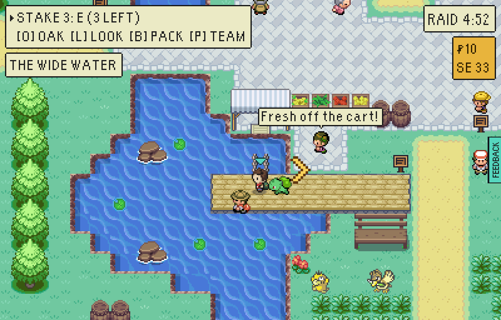
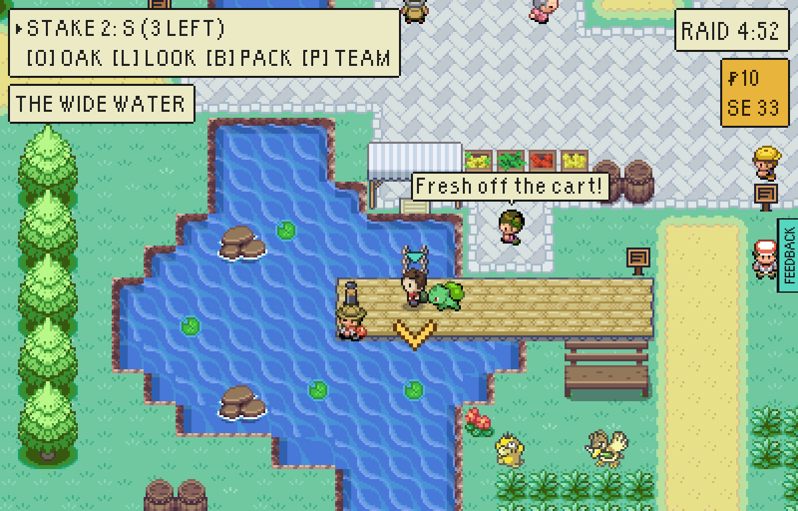
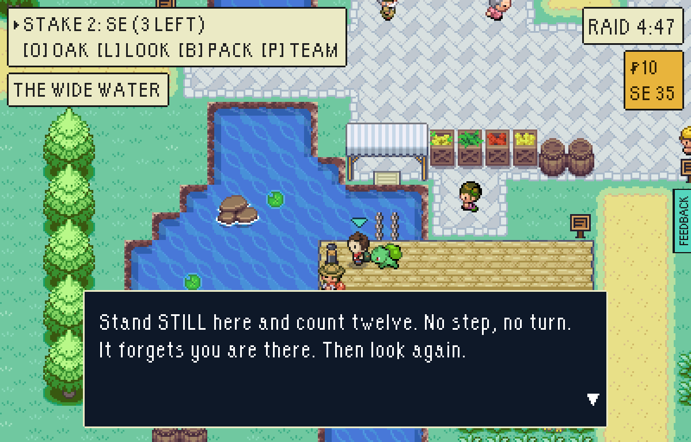
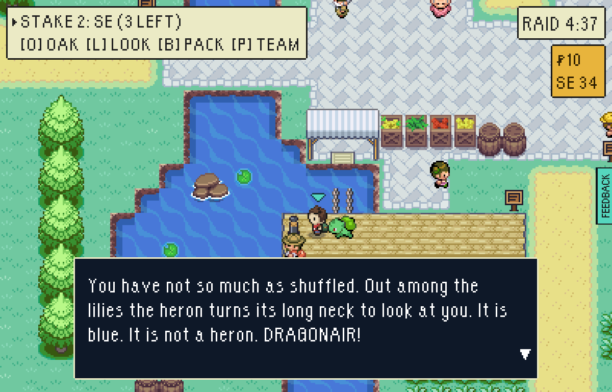
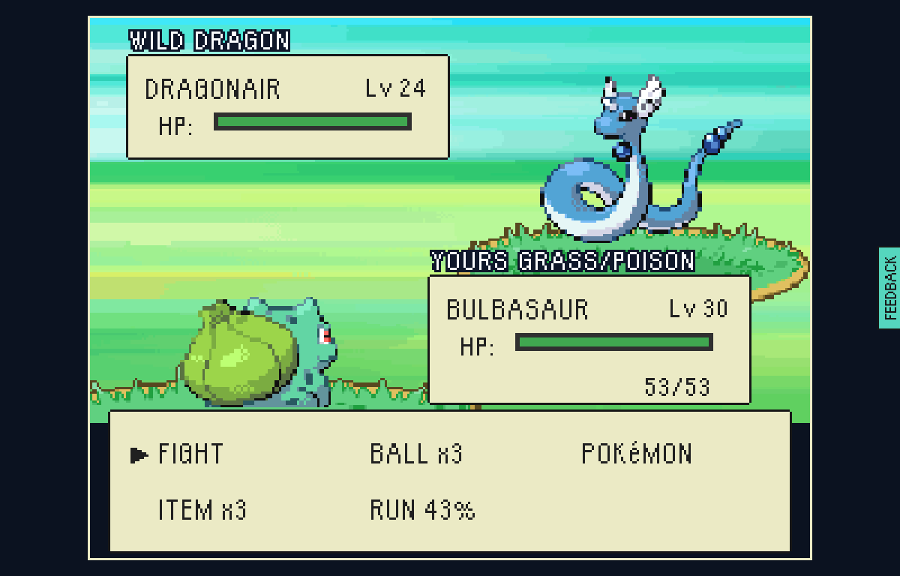
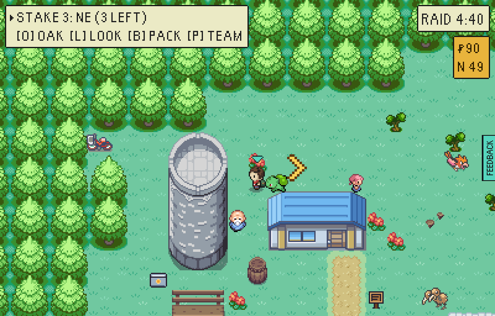
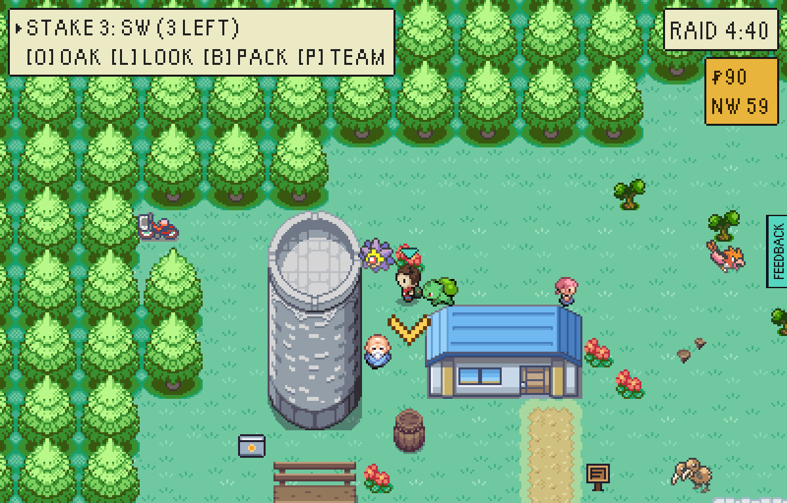
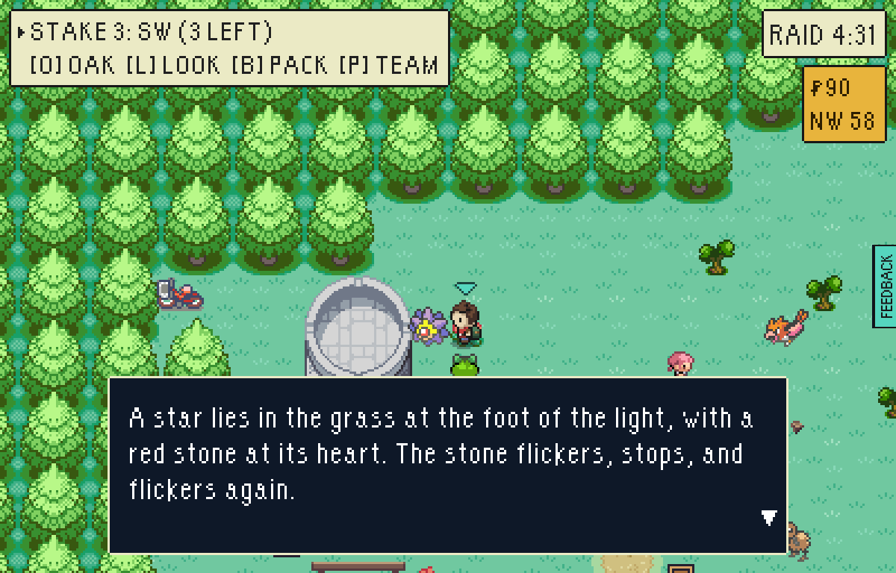
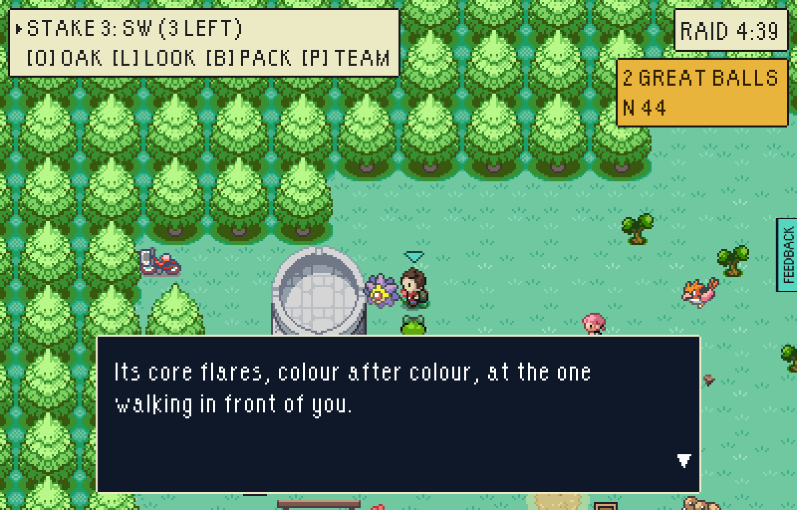
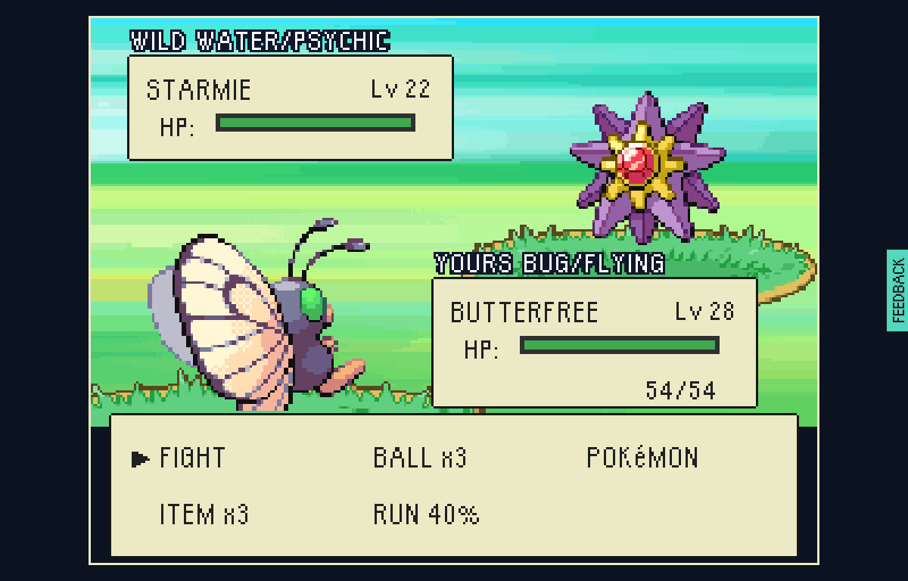

# Rare finds, wave 5: the coast and The Crossing

The first two rare finds outside the vale's inland places, each hung on
something somebody there was already saying, and each a new kind of thing to
do for it. `src/game/world/secrets.ts` is the rule.

| Find | Where | What it waits for |
| --- | --- | --- |
| **THE HERON THAT IS NOT**: Dragonair, Lv 24 | THE WIDE WATER in The Crossing, at the end of the heron walk's boards | Standing still for twelve seconds: no step, no turn |
| **THE LIGHT THAT ANSWERS**: Starmie, Lv 22 | THE OLD LIGHT on Gull Strand. It lies under the light every raid | A shiny Pokémon leading the party |

## The heron that is not

The Heron Man on the heron walk has always said "A heron can stand still for
six hours. I have timed it." The Watcher in the hide says they stand just out
of the slot. There is a notice at the end of the boards now, and the Heron Man
stands beside it with a third thing to say.

| Before | After |
| --- | --- |
|  |  |

Read the notice and it is a notice. Stand in front of it without a step or a
turn until the game has counted twelve seconds, read it again, and what has
been standing out among the lilies looks round.

| The notice | Stood still, and read again | What it was |
| --- | --- | --- |
|  |  |  |

Standing still is paid for. The raid's clock runs, and a hunter takes a step
towards anybody who stands for six seconds, so twelve is two of its steps.
Reading the notice counts as standing: the box is charged for like any other.
It is met once a raid; run from it and the notice is a notice again until the
next raid.

## The light that answers

Old Bertie has lit the Old Light every night for forty years and nobody has
told him to stop. Something lies in the grass under it now, every raid, with a
red stone at its heart that flickers, stops, and flickers again.

| Before | After |
| --- | --- |
|  |  |

Speak to it with an ordinary Pokémon in front and it goes on signalling. Walk
a shiny up to it and it answers.

| An ordinary lead | A shiny lead | What it was |
| --- | --- | --- |
|  |  |  |

A raid can go and get a shiny to walk up to it: THE RED ONE in THE TARN and
THE PINK ONE on THE BUTTERFLY RIDE are each always in their other colours, so
this is the second link of a chain. Any shiny will do.

## How to find them

- **The heron**: drop in at Stepping Stones, or walk east out of Millbrook
  over the bridge. Take the road along the Wide Water and turn west onto the
  boards by the HERON WALK sign. At their end, face the notice and do nothing.
- **The light**: drop in at The Strand and go west along the top of the beach
  to the round grey tower on the headland, with a shiny first on the bench.
- In THE HARBOUR the angler talks about the heron and Bill about the light,
  and Oak's cork board keeps what they said.

## How these were made

`tools/playtest/raid.mjs` against a test-mode build of this branch and, for
the before pictures, of `main`:

```sh
# the heron: read, stand, read again
node tools/playtest/raid.mjs <url> --pixels --stepped --window=pixel --seed=7 --fresh --skip-contract --clock=day --shot-battles --said \
  --insertion=greystone-vale-stepping-stones --level=30 --avoid-watch \
  --steps=walk:158:166,shot:boards,read:157:166:left,still:13,shot:stood,read:157:166:left
# the light: an ordinary lead, then a shiny one
node tools/playtest/raid.mjs <url> ...same... --insertion=greystone-vale-the-strand --level=30 --avoid-watch \
  --steps=walk:140:202,shot:light,read:140:204:left,read:140:201:left
node tools/playtest/raid.mjs <url> ...same... --insertion=greystone-vale-the-strand --level=30 --avoid-watch \
  --team=butterfree:28::shiny --lead=Butterfree --steps=walk:140:202,shot:light,read:140:201:left
```

`still:S` is new: it stands, pressing nothing, until the game has counted S
seconds of it. `--team=...::shiny` is new too: a team member caught in its
other colours.
