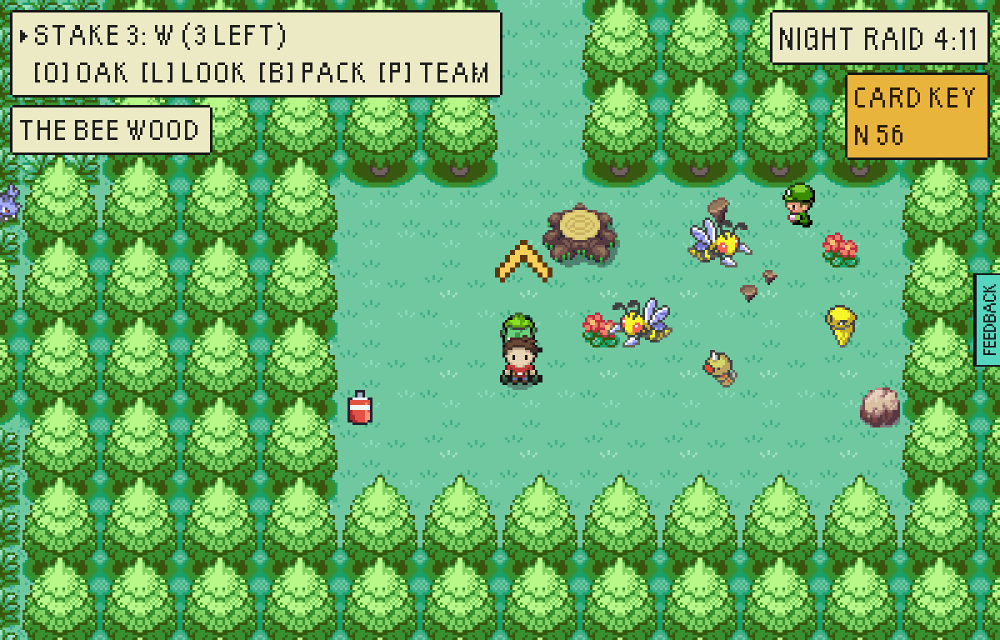
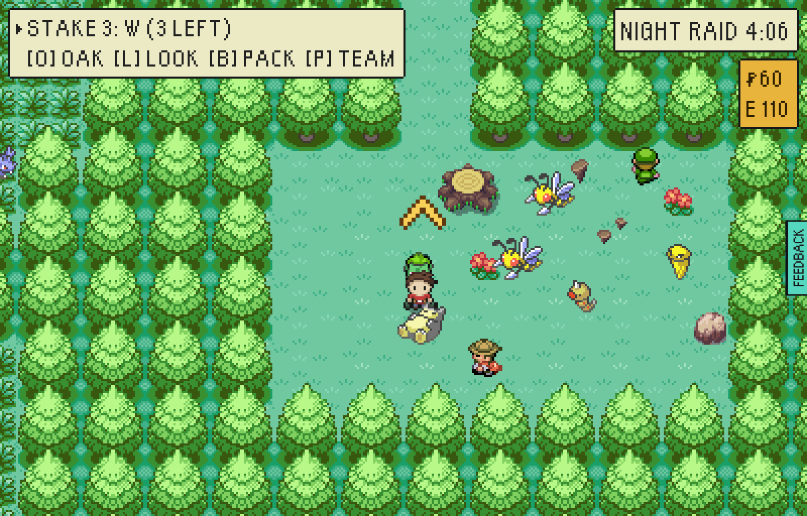
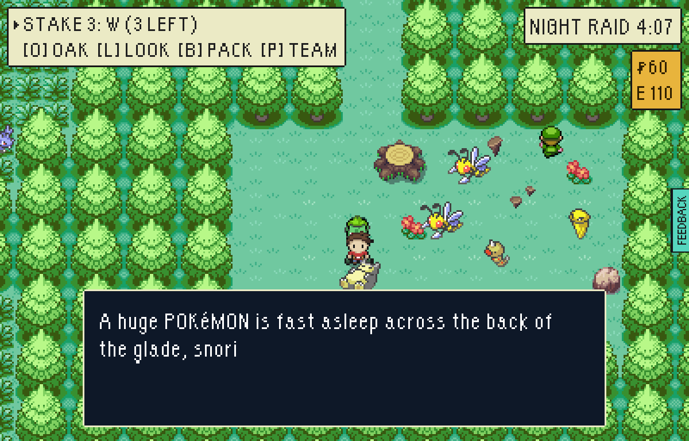
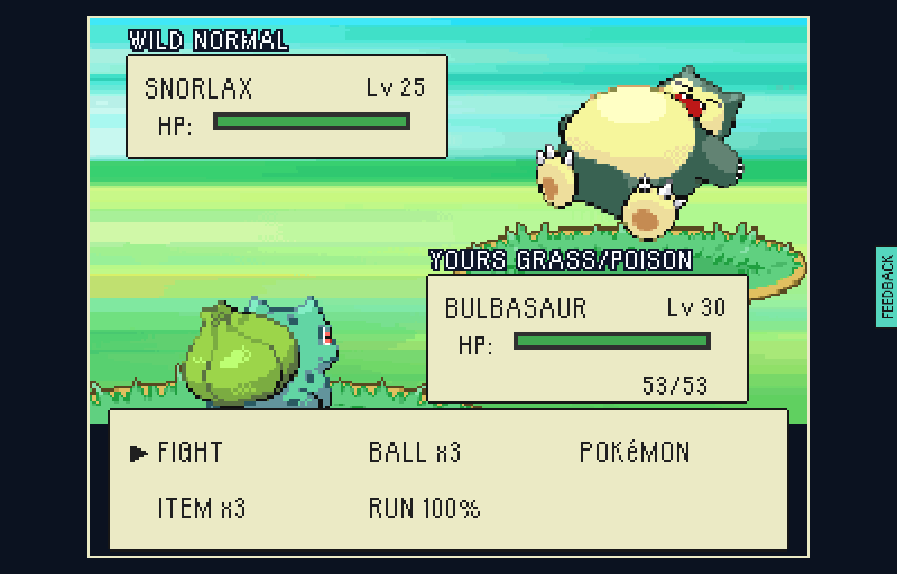
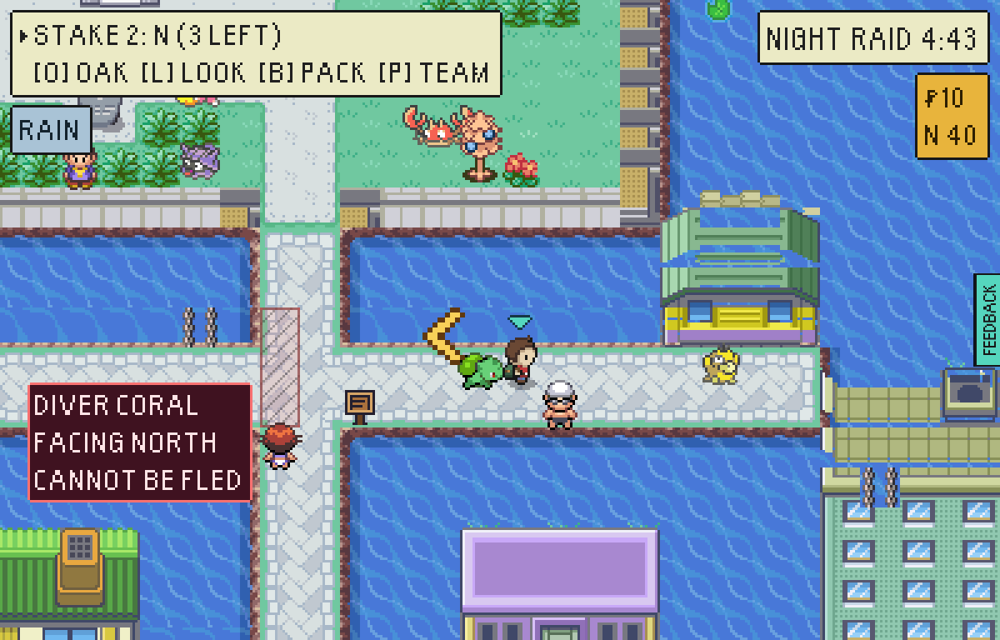
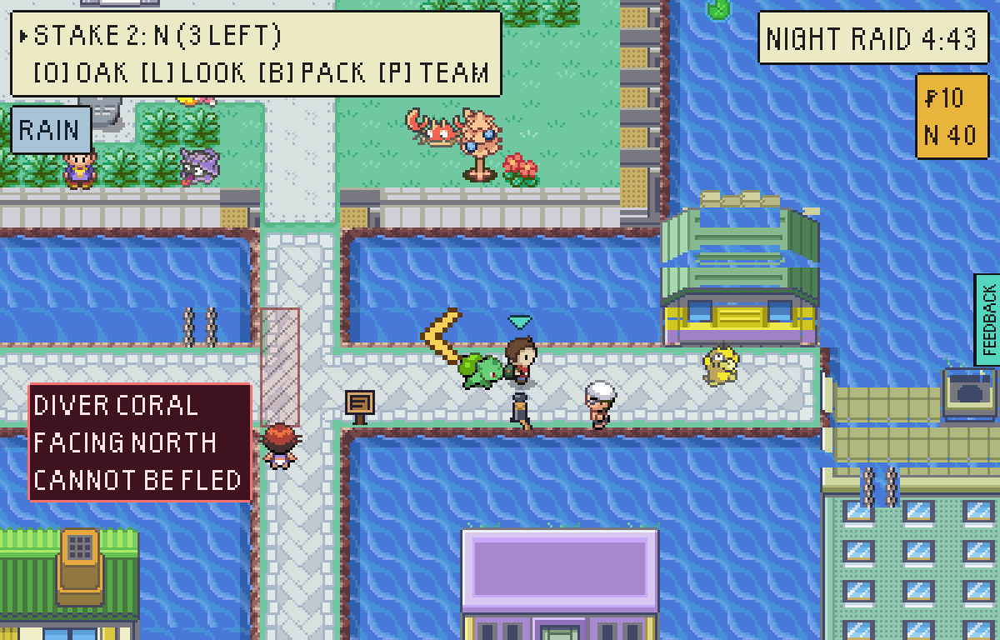
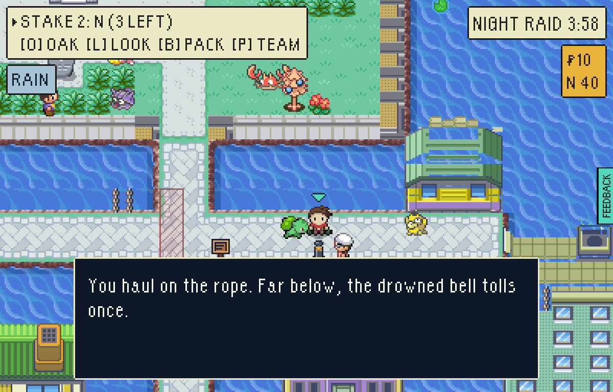
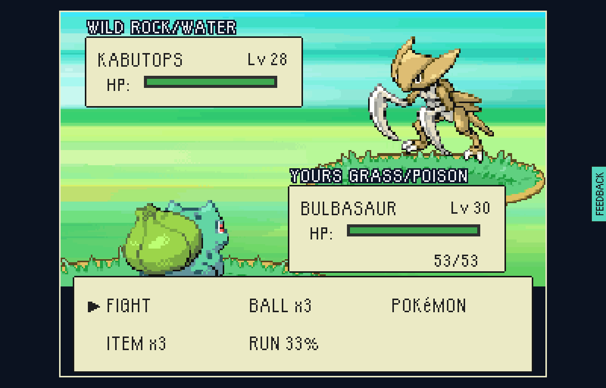

# Rare Pokémon secrets: the sleeper in the pines and the drowned bell

Step S3 of the harbour arenas plan, the part whose gates are open: THE SLEEPER
IN THE PINES (the POKé FLUTE is on sale at THE GAME CORNER's prize window) and
THE DROWNED BELL in THE COAST (MISTY's quarter). Played end to end in a
test-mode build (`VITE_EPTW_TEST_MODE=1`, served as the playtest README says)
by `tools/playtest/raid.mjs --pixels --window=pixel --seed=7`, with one plain
pass at real speed afterwards. The "before" pictures are the same raids on a
test-mode build of `main`.

## THE SLEEPER IN THE PINES

`--insertion=greystone-vale-the-quarry --steps=read:224:118:down`, then again
with `--stash=poke-flute --pack=poke-flute --fight`.

| | |
| --- | --- |
|  | Before: THE BEE WOOD, the dead-end glade at the foot of the lane down from the hollow. |
|  | After: a Snorlax lies at the foot of the lane every raid until he is had, still on his first frame (the bob is what says a Pokémon is awake). The woodsman below him is the clue: "DO NOT WAKE HIM. ... nothing but a FLUTE ever woke one of those." |
|  | Spoken to with no flute packed: he snores, and does not cry or fight. |
|  | With a POKé FLUTE in the pack: FireRed's own words, the flute's tune, then "SNORLAX woke up! It attacked in a grumpy rage!" |
|  | A wild Snorlax, Lv 25: an earned fight before MISTY (starters at her level win 6% of the time). The driver's Bulbasaur lost, and the flute went with the pack. |

## THE DROWNED BELL

`--insertion=greystone-vale-old-quay --beaten=vale-gym-misty,vale-quay-keeper --steps=read:164:302:down,tide:62,read:164:302:down`.

| | |
| --- | --- |
|  | Before: Market Street in THE DROWNED TOWN, in the Coast's rain. |
|  | After: an iron bollard on the street's edge, the drowned church's bell rope wound on it and running down into the sea (`bell-rope.png`, drawn by `scripts/draw-bell-rope-icon.mjs`). A sign may not stand in deep water, so the rope is tied off where people can reach it. |
|  | Read before low water (0:19 in), it is its own clue: "...it only rings at LOW WATER: a minute in, until two." |
|  | At 1:02, with MISTY's CASCADE BADGE won before the raid left, the bell tolls (a new `bellToll` sound) "...and something with scythes climbs up out of the belfry!" |
|  | A wild Kabutops, Lv 28, fought in the rain: an earned fight at KOGA's level, the gym it comes before. |
