# The stage a raid that got out opens on

The dark redesign of the moment in `../result-moment/`.

Olly, 26 Nov 2026, on the screen after extracting: "It's so white after you
come out of the game and you're all immersed in it, that oh, this splashes up,
it's just ugly and not in theme. ... I have no idea what the image means, and
then the sentence 'in your things, B at base'. 'Next job, sealed dispatch' ...
is okay, but this is just terribly formatted, and it should be way more
exciting." And the day before: "way too much words ... I always just skip past it."

`before/captains-raid.png` is his screenshot.

## What changed

- A **dark stage** under the menus' own title strip, with a burst of the ink's two
  shades behind the deed, as THE BATTLE ARENA's red burst stands behind its hero.
- The deed in **a few big gold words**: YOU GOT OUT!, PIDGEY CAUGHT!, JOB DONE!,
  HOME SAFE, or the badge.
- The **money counts up** with a plink, beside **the clock left**. The clock turns red
  when the raid got out close to 0:00. Any other close call, such as a hunter on
  your tail, is a red sticker.
- Each thing brought home **drops into HOME**, one after another with a thud each,
  and its count shows as it lands. HOME is the pane in YOUR THINGS that holds what
  is safe, with the same green strip and house. It replaces the blue sack nobody
  could read.
- Oak's next thing is **a card**: a gold strip says what kind (NEXT JOB, NEXT GYM,
  NEW LANDING), then its name in big letters, then where it is.
- Nothing names a key, so "B at base" is gone, and nothing shown is said again in
  words. The bar under it no longer says "₽10 BANKED", and the help line keeps only
  what the stage cannot show.
- It waits for its pictures before it plays, so nothing drops in as a blank box
  (`ui/menuPictures.ts` holds them from boot, #983). On a short window it closes
  its gaps a step at a time until it fits.

## Pictures

`before/` is `main` at d4842b8f and `after/` is this branch, both made with
`node tools/playtest/resultMoment.mjs <test-mode build dir> <dir> [--window=800x600] [--clip]`:
the same four raids (the captain's haul at Deer Gap, a catch, a job with six
kinds of thing and a hunter on its tail, and an empty raid) on a save one raid in.

| Raid | Before | After 1280x800 | After 800x600 |
|---|---|---|---|
| The captain's haul | 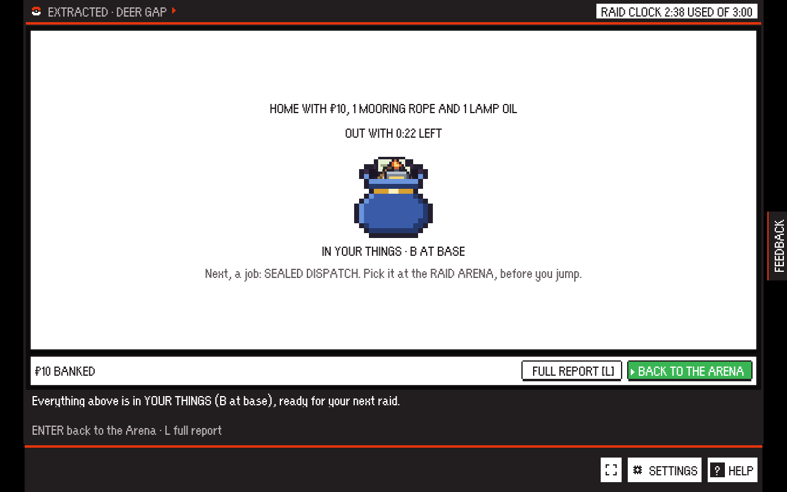 | 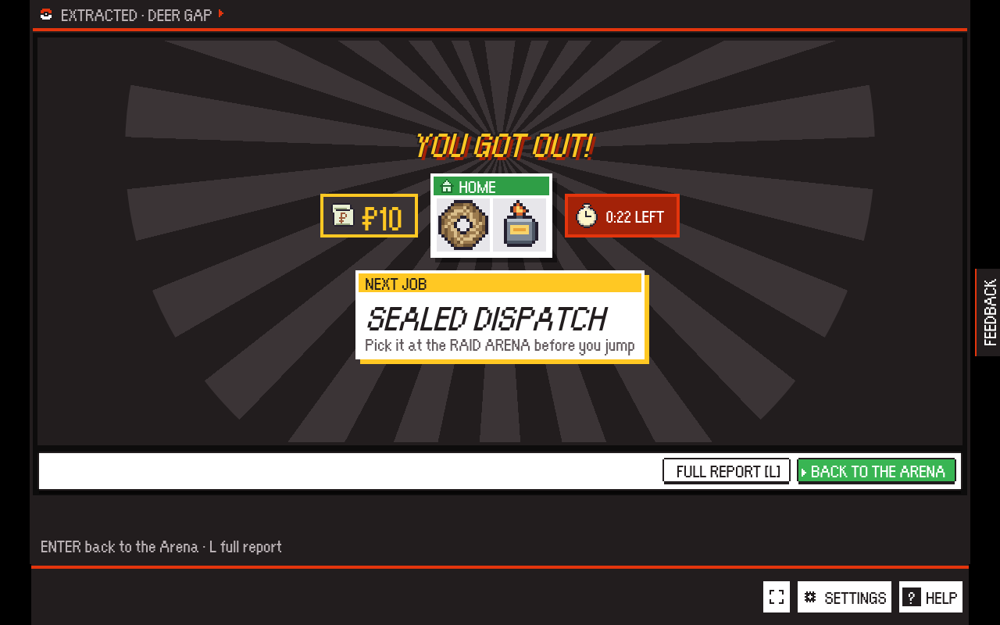 | 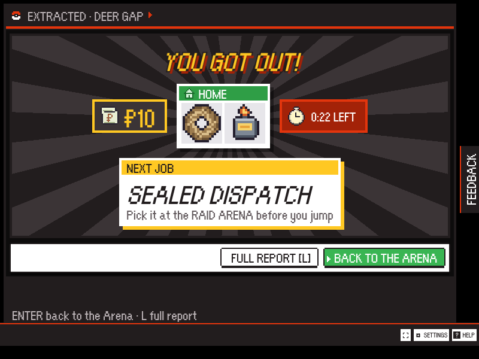 |
| A catch | 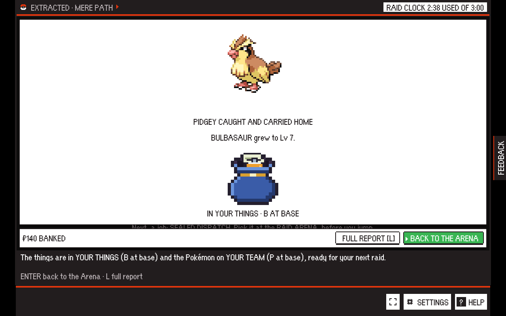 | 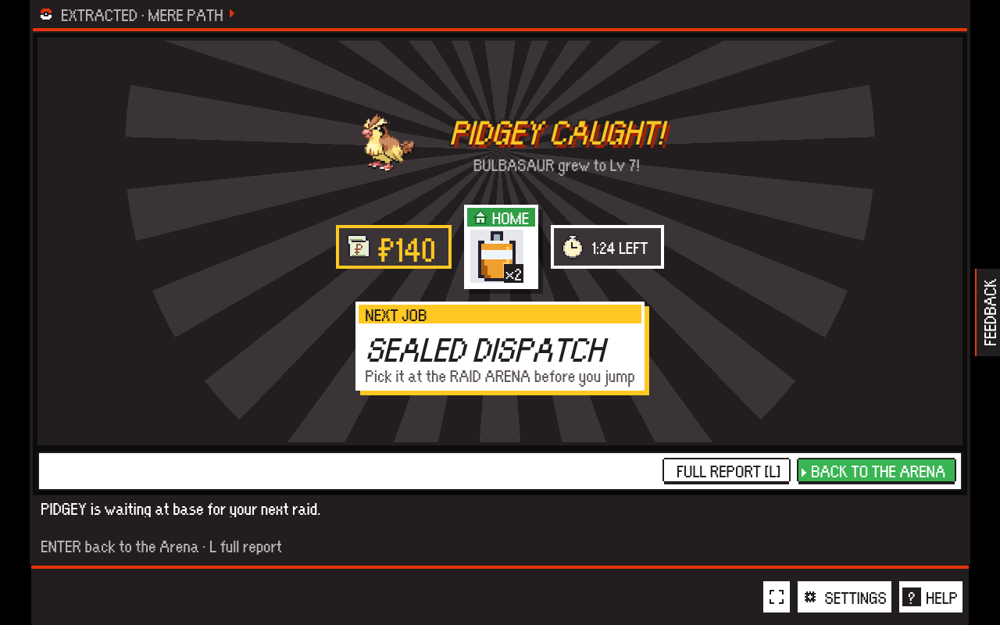 | 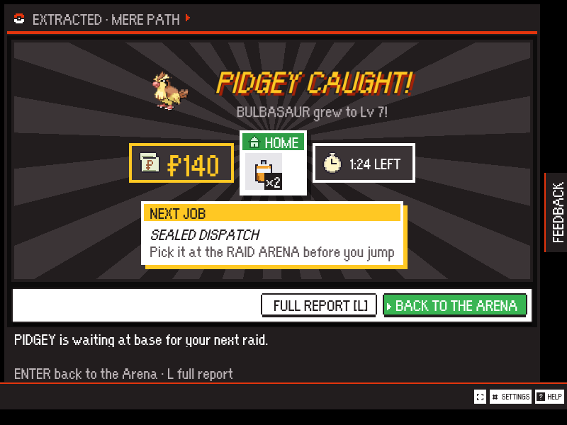 |
| A job done | 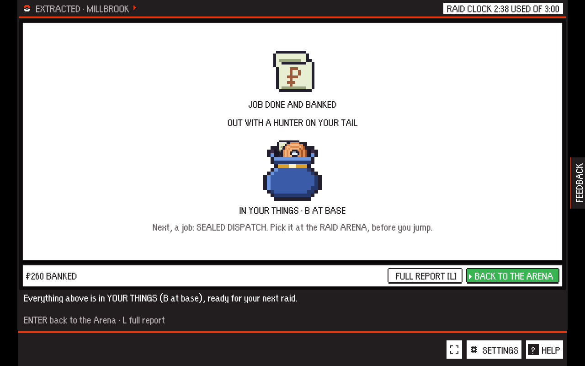 | 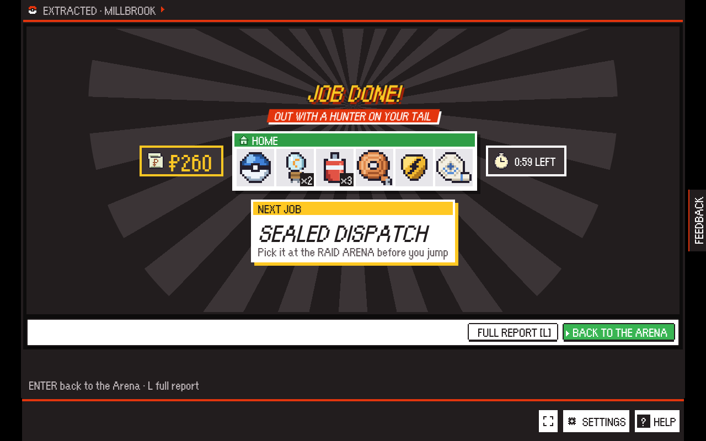 | 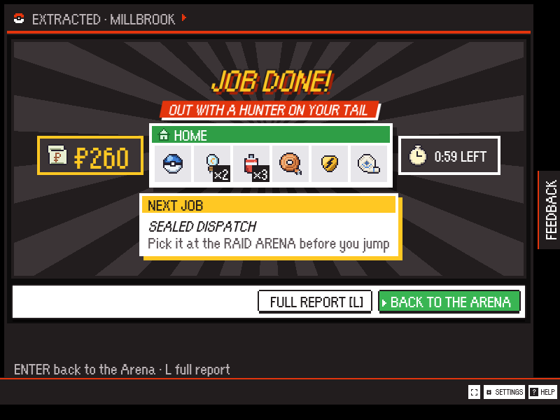 |
| Empty | 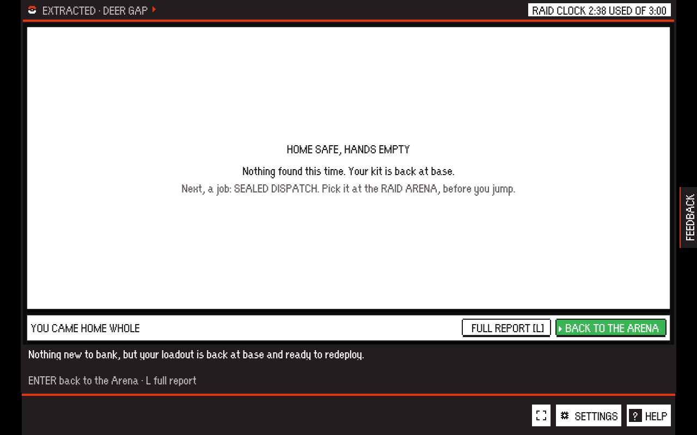 | 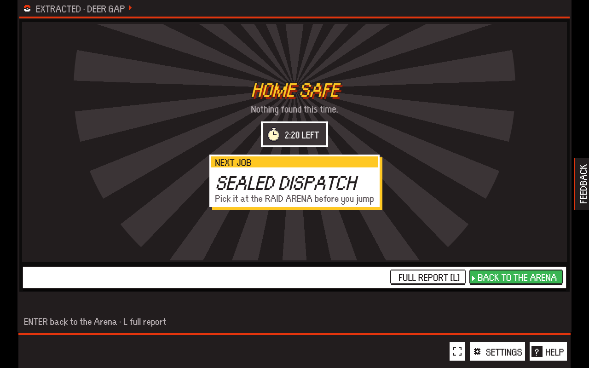 | 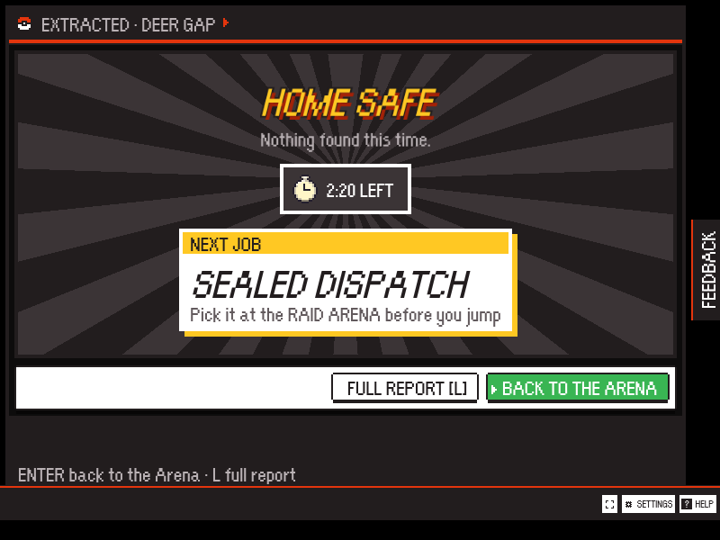 |

`after/haul-clip.png` is the haul playing in: an animated PNG, a frame about
every 100ms, at half size. `after/haul-frame-0000ms.png` and
`haul-frame-0400ms.png` are two of its frames: the headline landing, then the
money counting and the rope dropping in.

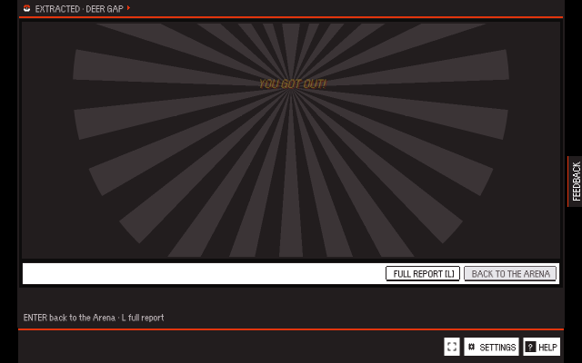
