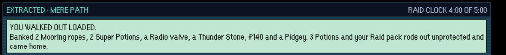
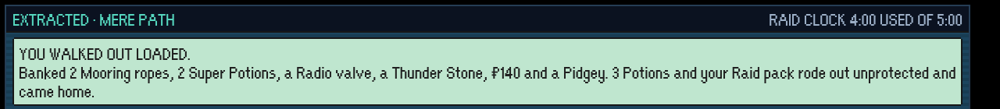

# The result screen says what its numbers mean

Three lines the 22 Nov AI playtest read wrong, a dozen times between them:

- `RAID CLOCK 1:32 OF 5:00` was read as time left as often as time taken. It
  is time taken, and now says so: `RAID CLOCK 4:00 USED OF 5:00`.
- `YOU CAME BACK STRONGER, IF EMPTY-HANDED.` stood over `Nobody levelled.` on
  a raid that banked nothing and levelled nobody. 'Stronger' is now said only
  when somebody levelled; otherwise `Nothing banked, but the experience came
  home.`
- A wipe's first beat said `CHARMANDER FAINTED. The last of 3 still standing.`,
  which read as though it still stood. It is now `The last of your 3 to fall.`

| before (main) | after |
|---|---|
|  |  |

The clock line, from `tools/playtest/resultShots.mjs` against a test-mode build
(its report is made by the tool, so the main run used the old label), 22 Nov
2026. The headline and the wipe beat are pinned in `extractionReport.test.ts`
and `defeatSequence.test.ts`.
