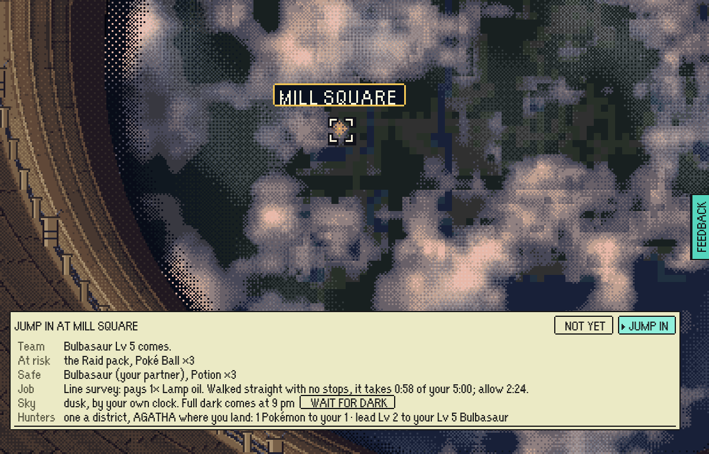
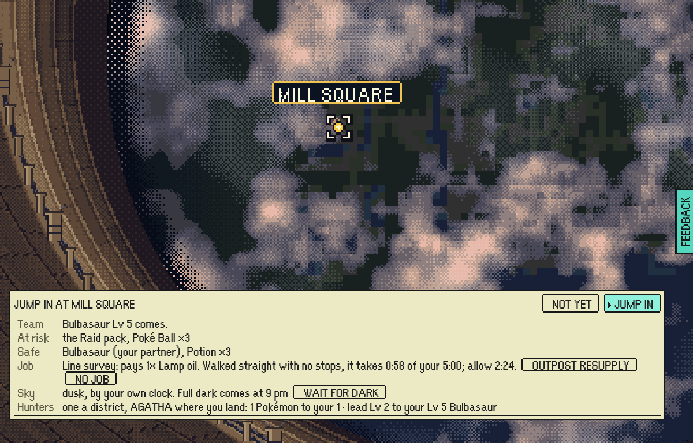
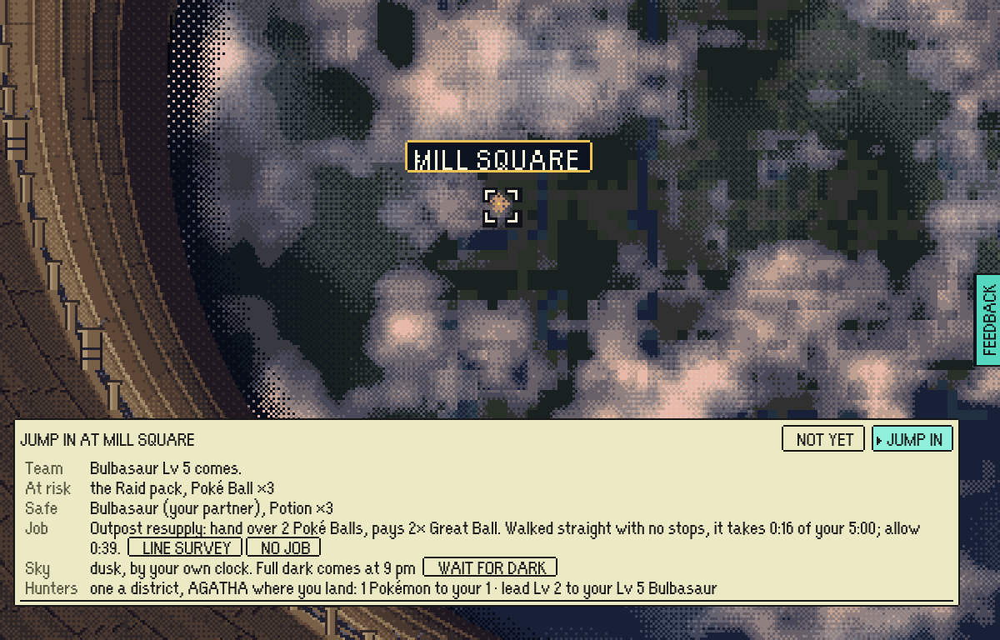
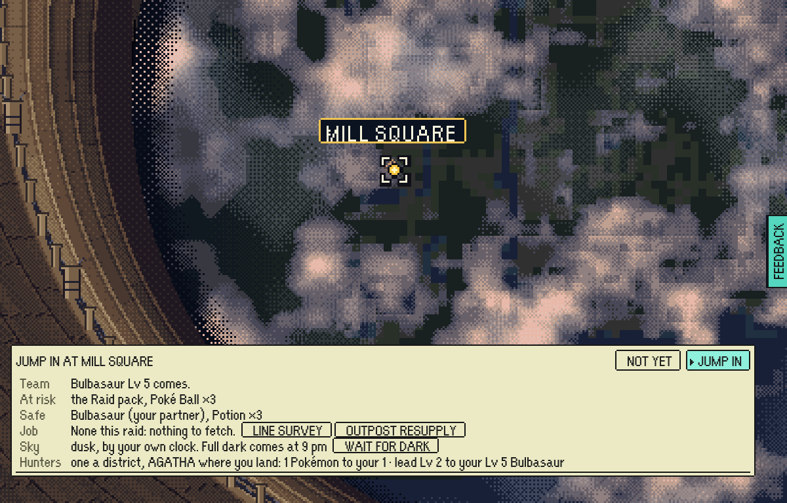

# The raid's job, chosen at the rim

A save one job into the standing board, at THE RAID ARENA's rim over Mill Square.

| before | after |
|---|---|
|  |  |
| |  |
| |  |

Before, the Job line held the board's one job, and the raid carried it whether the player wanted it or not, so LINE SURVEY was every raid's job until it was banked. Now a second job of another kind stands beside it as a button on the Job line, along with NO JOB, and the raid carries whichever was chosen.

Made against test-mode builds (`VITE_EPTW_TEST_MODE=1 npx vite build`, served under its Pages subpath) at `?testmode=pixels`, 1200x768, by a one-off driver on `tools/playtest/deploy.mjs`'s `walkIntoBase` and `openHallPanel`: a fresh save with three raids and one job banked, into the Raid Arena and up to the rim, then the Job line's buttons clicked in turn.
