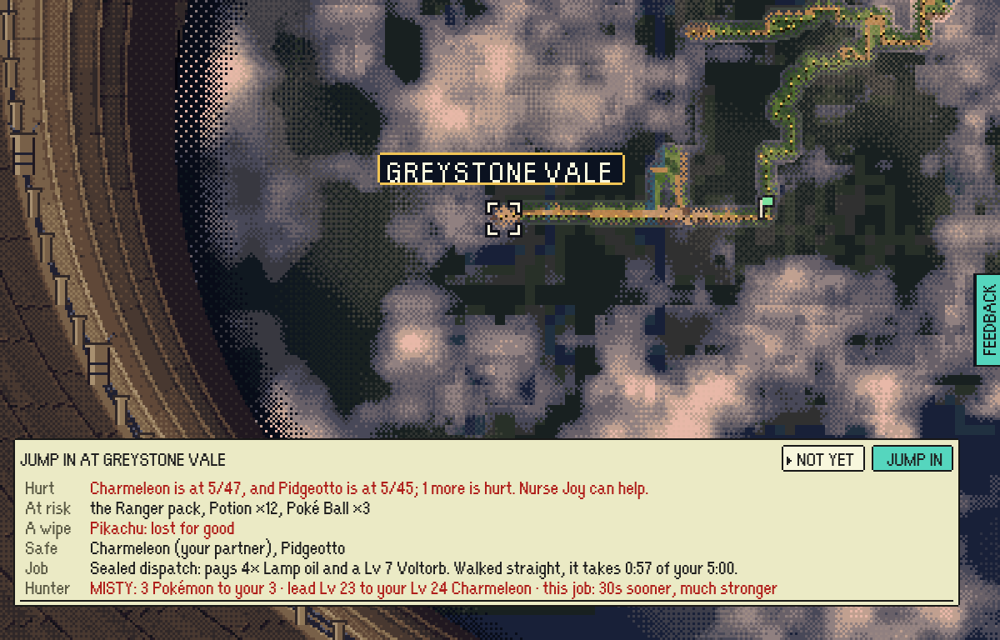
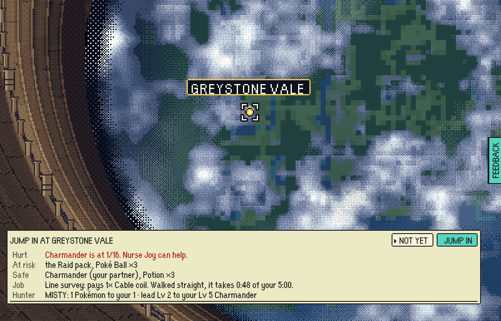
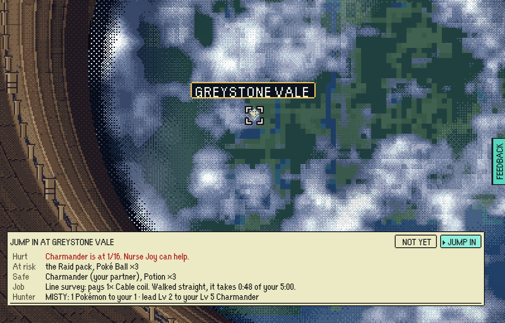
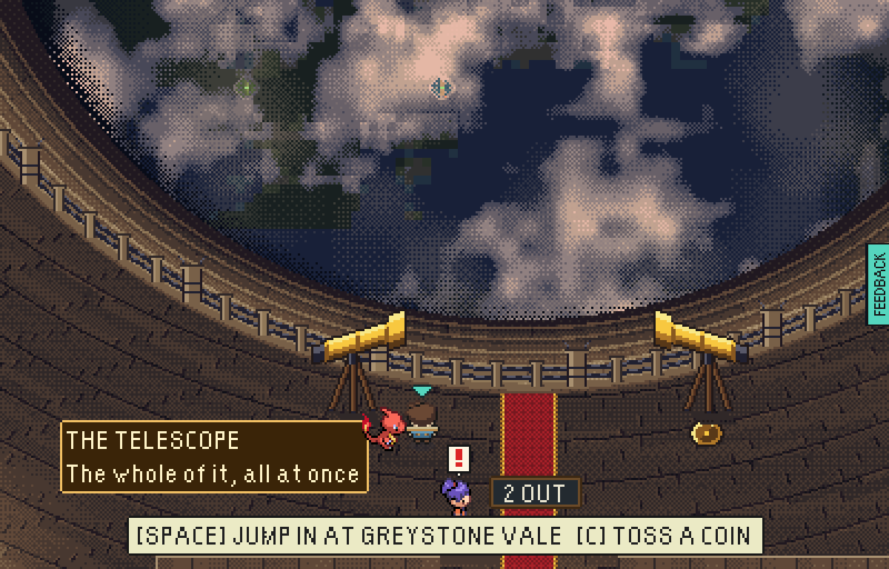
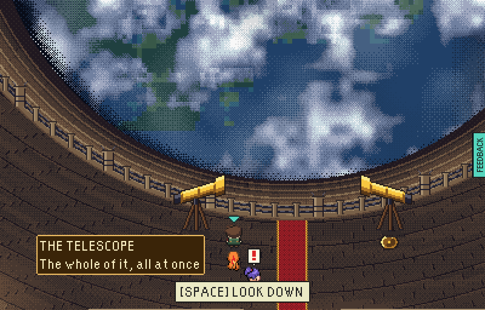

# The rim card's keys

The second player-characters hunt (11 Nov 2026) found that a card opened on
NOT YET - a team under a third of its HP, or a player just home from a raid -
could not reach JUMP IN by any key but TAB, which nothing on screen mentions:
every arrow went to the map, found no other way in and bumped. The floor under
the player said `[SPACE] JUMP IN AT GREYSTONE VALE` all the while.

Now Right from NOT YET is always JUMP IN, an arrow that points at no other way
in moves the cursor between the two buttons, and the floor says
`[SPACE] LOOK DOWN` whenever the card would open on NOT YET.

| Before | After |
|---|---|
|  The hurt card after Right, Left, Down and Up: still on NOT YET. |  It still opens on NOT YET, so SPACE mashed through does not jump... |
| |  ...and Right reaches JUMP IN. |
|  Just home, the floor promised SPACE jumps. |  It says LOOK DOWN while the card would open on NOT YET. |

The before pictures are the hunt's own. The after pictures were made by
`rimKeys.mjs` beside this file, against a `VITE_EPTW_TEST_MODE=pixels` build
served under the Pages subpath (`tools/playtest/README.md`, "Memory"), at
1200x768, in one headless Chromium:

    node docs/screens/rim-keyboard/rimKeys.mjs http://127.0.0.1:<port>/escape-from-pallet-town-web/ <out> <CDP port>

It starts a new game, gives the save one raid behind it (a first raid goes
straight over with no card), checks a fit team's card and hint, then writes the
team at 1 HP into the save and plays the hurt card's keys through to the jump.
