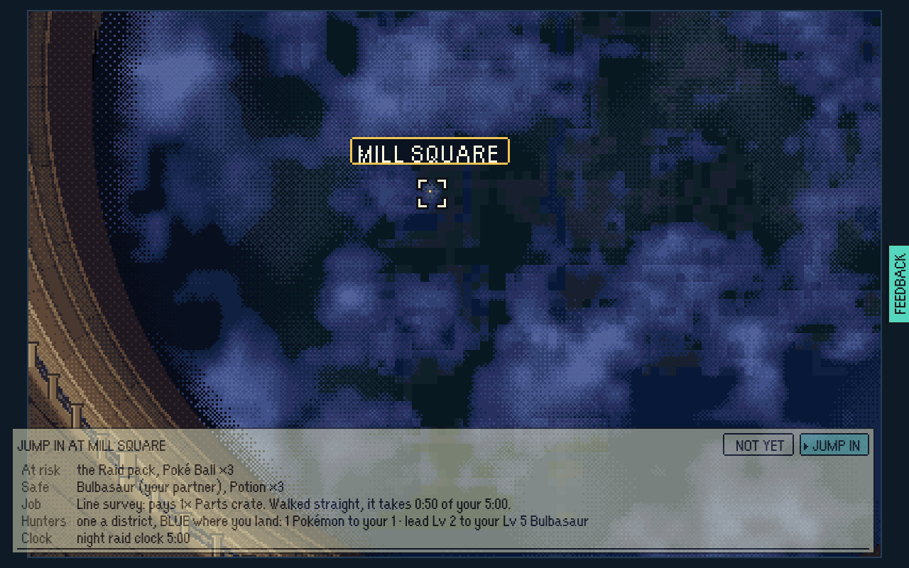
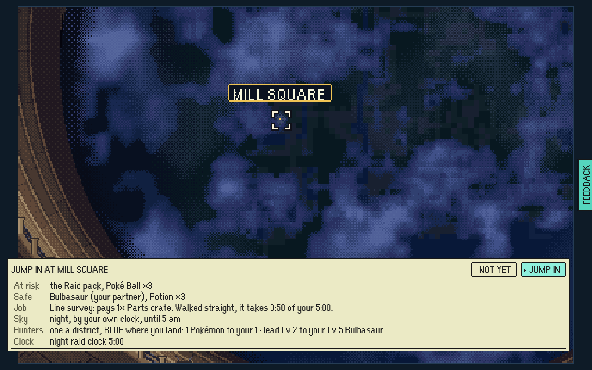

# The rim says what sky a raid will have

The Raid Arena's rim on a save one job in, at about 3 am. Before, the card said only
`night raid clock 5:00` at night, and nothing at all about the sky by day or at dusk.
After, a `Sky` line says what the raid will be, that it follows the player's own clock,
and when it next turns: `night, by your own clock, until 5 am`. By day it says
`Dusk comes at 6 pm, full dark at 9 pm`, at dusk `Full dark comes at 9 pm`, and at
dawn `Day comes at 7 am` (`skyNote()` in `src/game/base/homeClock.ts`).

| before | after |
|---|---|
|  |  |

Made on 22 Nov 2026 against the dev server in `?testmode=pixels`, with a driver that
deploys through `tools/playtest/deploy.mjs` (`banked: 1`, so the first raid's
card-less jump is past) and photographs the card before JUMP IN is pressed.
