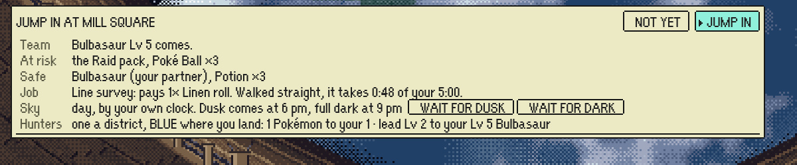

# The jump screen names who comes

Tester 3's release blocker 3 (22 Nov 2026): only the Pokémon on THE BENCH go
on a raid, and the jump screen said only '1 Pokémon to your 1', so a new catch
stayed home and a healed partner was left behind with nothing said, and a
Squirtle at 16/21 HP jumped in unremarked. The card now opens with a TEAM line
(`hub/rimTeam.ts`): who comes, with their HP when they are hurt, and who stays
home and where to change that - `Squirtle Lv 12 at 16/21 HP comes. Psyduck
and Pidgey stay home: pick who comes at THE BENCH.` (pinned in `rimTeam.test.ts`;
it said "THE BENCH chooses" until 23 Nov 2026).

A new save with only its starter, from `tools/playtest/headingShots.mjs`
against a test-mode build (no heading cut), 22 Nov 2026.

`bench-words-before.png` and `bench-words-after.png` (23 Nov 2026): the same card on a 15-Pokémon save, saying "THE BENCH chooses" and then "pick who comes at THE BENCH". The line keeps its three rows.
