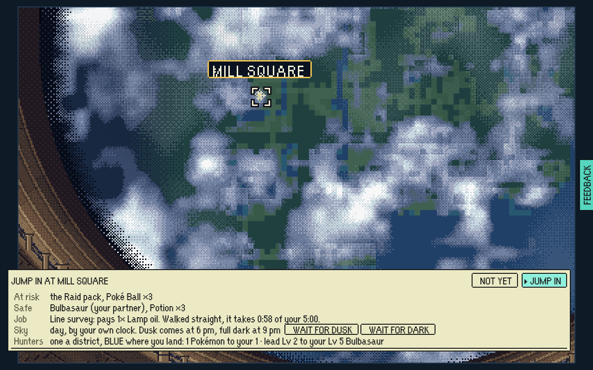
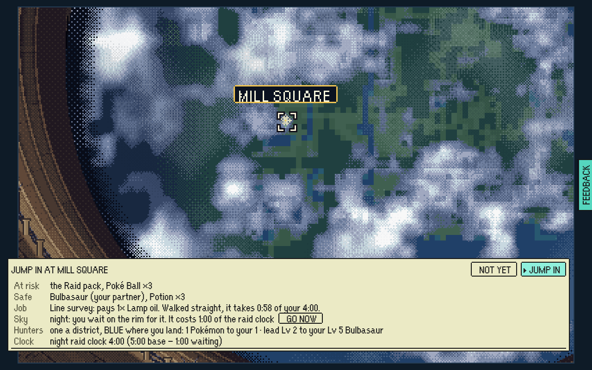

# Waiting on the rim for a darker sky

The Raid Arena's rim at 2 pm on a save one job in. The Sky line offers the
skies still to come this evening, WAIT FOR DUSK and WAIT FOR DARK
(`base/raidSky.ts`). Waiting for dark turns the line into what it costs, with
GO NOW beside it, and the Clock line says the minute it took:
`night raid clock 4:00 (5:00 base − 1:00 waiting)`. Jumped, the raid is a night
raid, and the secrets read its hour as night.

| before waiting | waiting for dark |
|---|---|
|  |  |

Made on 22 Nov 2026 against the dev server in `?testmode=pixels`, with a driver
that deploys through `tools/playtest/deploy.mjs` (`banked: 1`, so the first
raid's card-less jump is past), photographs the card just before JUMP IN is
pressed, clicks WAIT FOR DARK, photographs it again, and jumps. The clouds over
the pit drift between the two frames.
