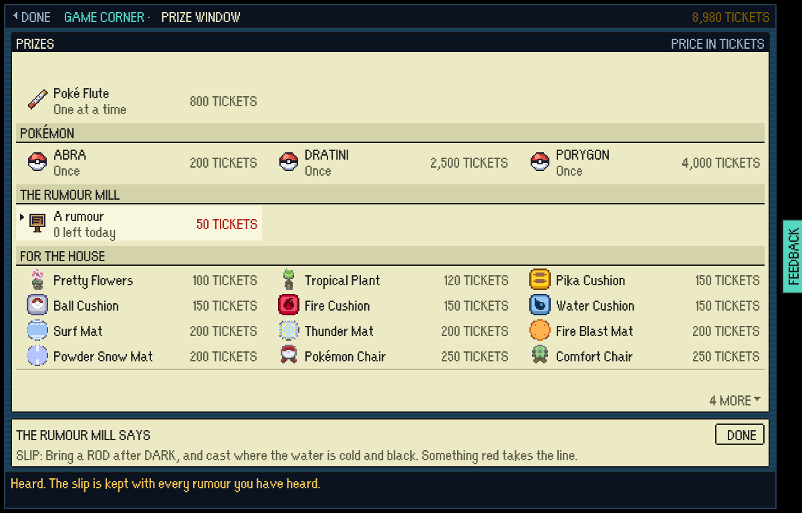
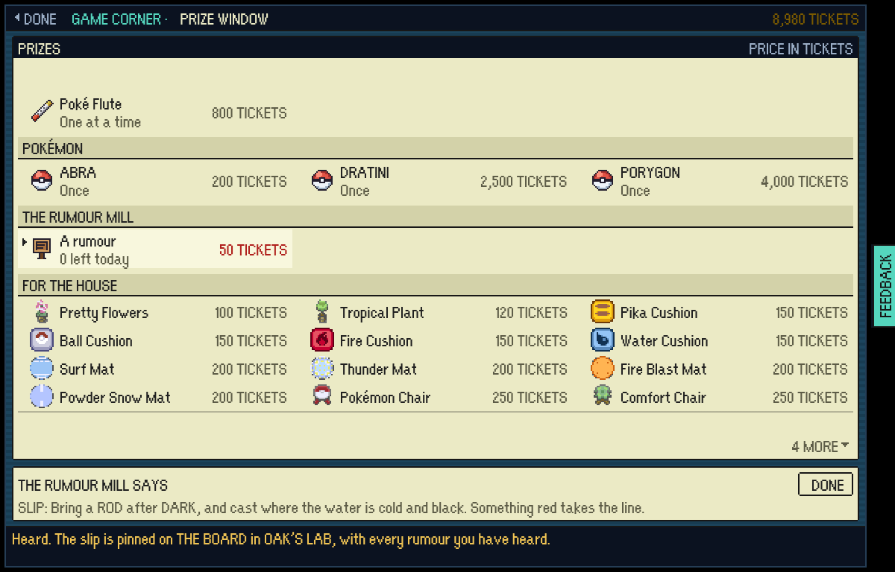

# The prize window says where a bought rumour went

THE PRIZE WINDOW straight after buying a rumour from THE RUMOUR MILL. Before, the help
line said `Heard. The slip is kept with every rumour you have heard.`, which did not say
where. After, it says `Heard. The slip is pinned on THE BOARD in OAK'S LAB, with every
rumour you have heard.`

| before | after |
|---|---|
|  |  |

Made on 22 Nov 2026 with `tools/playtest/prizeWindow.mjs` against the dev server in
`?testmode=pixels` (with a longer wait for the title on a loaded machine).
