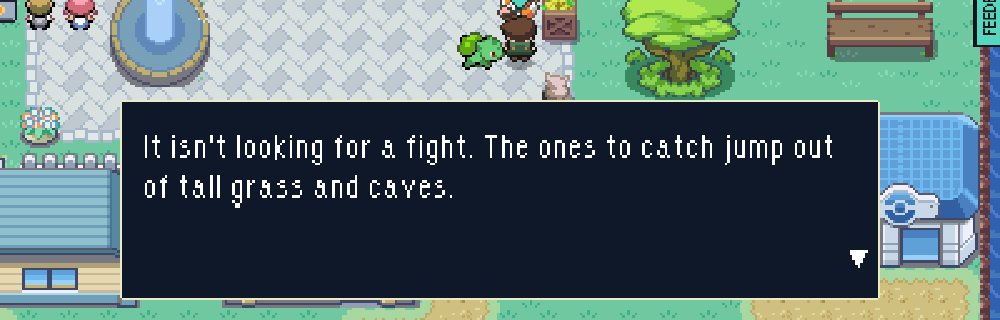

# A Pokémon that will not fight says so

A Pokémon stood on a map with no level is scenery: faced, it said its cry
(`PIDGEY: Pidg pidg!`) and nothing else. Four 22 Nov AI playtest findings had
emptied their packs to catch the Oddish on the path, or could not tell which
Pokémon they could fight. It now says `It isn't looking for a fight. The ones
to catch jump out of tall grass and caves.` after its cry. One with a level
(which fights), a secret's or a legend's still says only its cry.

(Before, on main, the box ended at the cry.) A test-mode build, a Pidgey by
Millbrook's landing walked up to and faced, 22 Nov 2026.
