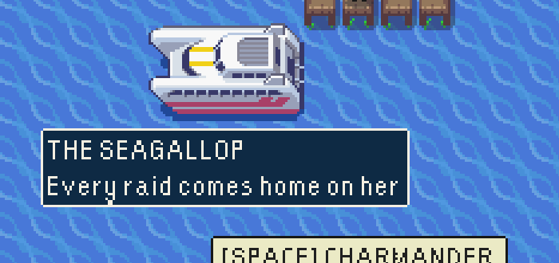

# THE SEAGALLOP brings raids home

Her caption said `Every raid sails on her` while the arena's door says `Every
raid starts here`, and every raid starts by jumping off the arena's rim, so
three 22 Nov AI playtesters could not tell which was the way to raid. In the
harbour's story she brings raids home (`floats.bringsRaidsHome`), which is
true and contradicts nothing: her caption is now `Every raid comes home on
her`, and the notice board's welcome puts the arena first.

From `tools/playtest/harbourTour.mjs --at=quay:12:20` against a test-mode
build, 22 Nov 2026.
