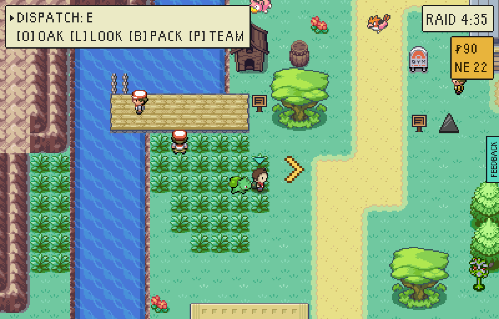
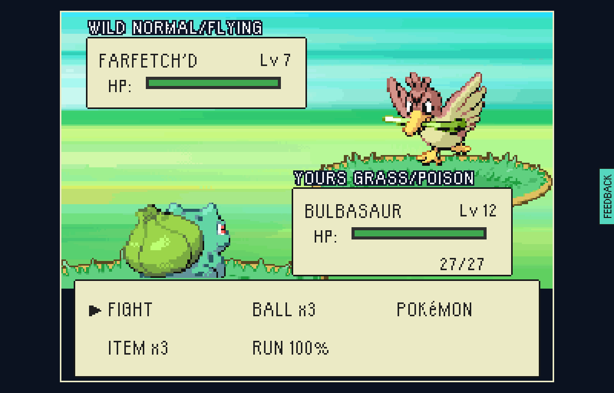
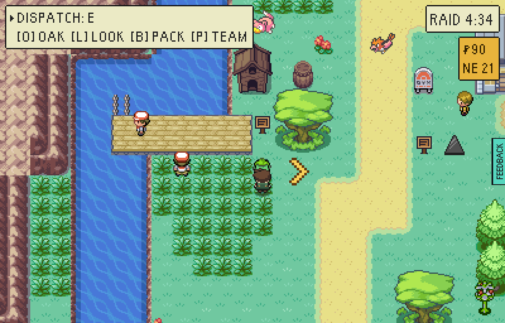

# Shimmering grass

One patch of tall grass a raid glitters, a little off the walk to the stake.
Step into it and it is that place's rare Pokémon at once, a level over the best
the place rolls, and the one wild meeting with better than the wild's odds of a
shiny: one in fifty, against one in 500. `src/game/world/shimmer.ts` is the rule.

## What glitters where

| Ground | What the patch holds |
| --- | --- |
| The woods (Tanglewood, Pine Hollow) | Pikachu or Bulbasaur |
| The moor's meadows (High Moor) | Ponyta or Doduo |
| The fields (Greystone Peaks, Orchard Terraces) | Mankey or Growlithe |
| The reeds (The Crossing, Reedmere) | Squirtle or Farfetch'd |
| KOGA's marsh (Safari Marsh, The Wreck) | Chansey, Kangaskhan, Pinsir, Scyther or Ekans |
| Anywhere else with tall grass | The least common thing its own table holds: a Charmander in Millbrook, an Electabuzz at the Power Station, a Shellder on the strand |

## How to find it

Follow the gold arrow towards the raid's stake: the patch lies a couple of
tiles off that walk, inside a small screen of it. It is three white glints over
one tile of tall grass. Oak's full list (O, then O again) says the place and
the way, in these words: "Something rare is moving in the tall grass in
<PLACE>, to the <way>. Look for the glitter." It never says what is in it.

It is met once. Run from what is in it, or lose to it, and the grass stops
glittering for that raid. There is none on a new save's first raid, and none
from the Old Quay or Cove Steps landings, which stand on stone and sand.

## Played

A test-mode build (`VITE_EPTW_TEST_MODE=pixels`), `tools/playtest/raid.mjs
--pixels --stepped --window=pixel --seed=7 --clock=day
--insertion=greystone-vale --banked=2 --level=12
--steps=shimmer,shot:glitter,shimmer:shiny,shot:after --shot-battles`: from
Mill Square to open ground beside the patch, a picture, into it, and a picture
of the grass afterwards. The "before" picture is the same raid, walked to the
same tile, on a build of the commit before.

| | |
| --- | --- |
|  | Before: the reeds below THE ANGLERS' STAGE in The Crossing, on the way from Mill Square to this raid's stake. Tall grass, and nothing to say one tile of it is worth going to. |
|  | After: the same raid, the same tile. The grass just above the player glitters. Three glints with a dark rim, each brightening in its turn, so the patch is never still. No caption: a prize is a thing lying there, and this is something moving in the grass. |
|  | Stepping in is the Pokémon at once, with no roll about whether: here a Farfetch'd, Lv 7, where the reeds' own table tops out at 6. One raid in fifty it is shiny. The driver answered that roll yes for this picture (`shimmer:shiny`); nothing else about the raid was touched. |
|  | Afterwards the grass has stopped glittering, and holds nothing more this raid. |

## Two things the pictures found

- The glints were first five-pixel crosses in pale yellow, then white ones. Neither could be found on the vale's pale grass in a picture by somebody who knew which tile to look at, so each has a dark rim now and all three show in any still frame.
- The first patch a raid laid was under a mason's "Up she goes!". A patch now keeps two tiles clear of anybody standing, walking a beat or signed (`SHIMMER_CLEAR_OF_FIGURES`, held by `shimmer.test.ts`).
