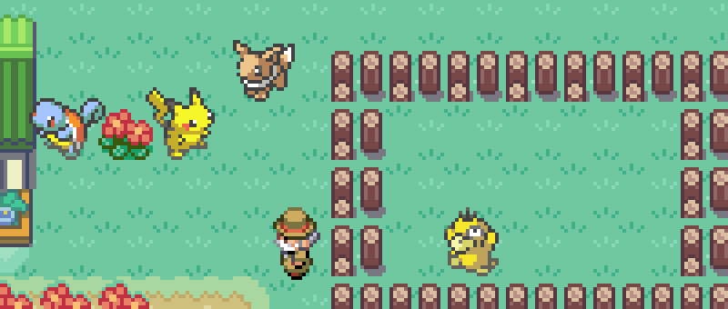
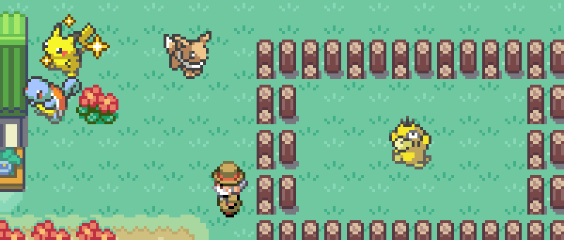
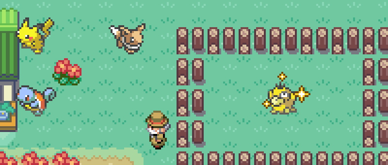
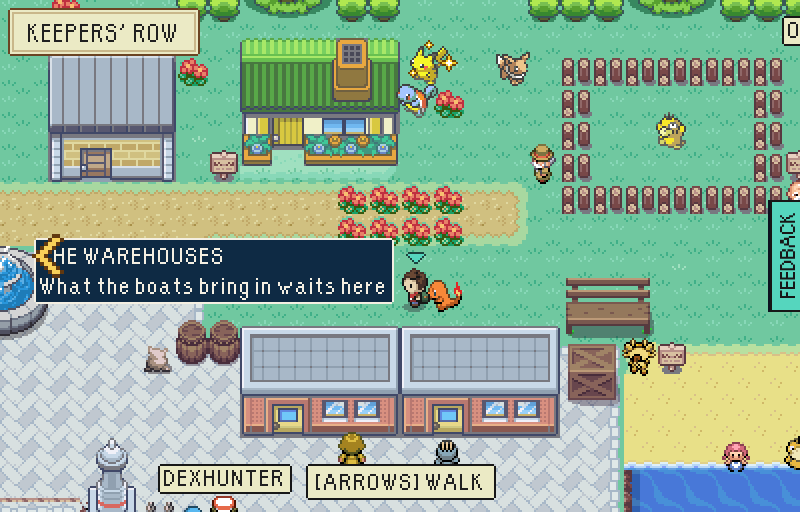
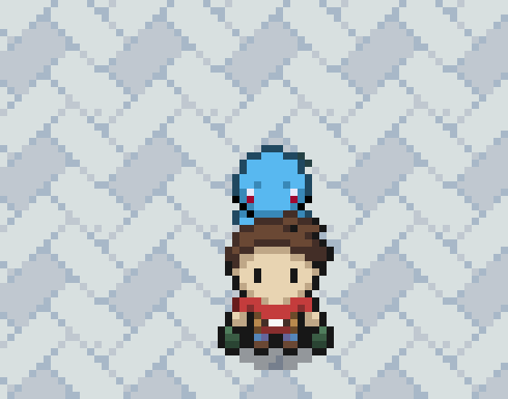
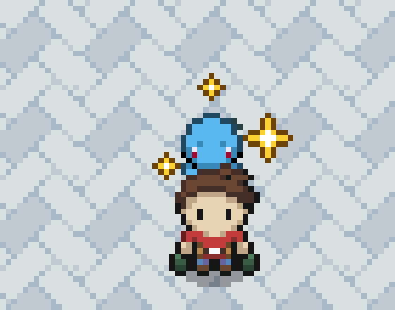
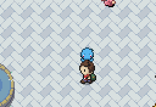

# A shiny Pokémon looks like one wherever it walks

A shiny was shiny in a fight and on every list, and nowhere else. Out in THE
BOLTHOLE's garden, in the Day-Care pen and at the player's heel it was drawn
in its ordinary colours, because the walking sprites and party icons have no
second set. Now it gives off what FireRed gives a shiny as it lands in a
fight: gold stars. Three small ones round its head, every few seconds, each a
spark that opens into a four-pointed star and closes again.
`src/game/base/shinyGlint.ts` is the rule and the art.

An ordinary Pokémon gives off nothing: the Eevee in the garden and the
Charmander at heel below are the same before and after.

## In the garden and the Day-Care pen

A shiny Pikachu, a shiny Squirtle and an ordinary Eevee in the box, so all
three are out in the garden; a shiny Psyduck left with the Day-Care Man.

| Before | After: the Pikachu's turn | After: the Psyduck's turn |
| --- | --- | --- |
|  |  |  |

No two of them begin together: the pen's and each of the garden's start their
round at a moment of their own, so a yard of shiny ones twinkles here and
there rather than all at once.



## At the player's heel, on a raid

The one walking behind the player on a raid is the Pokémon that leads the
party, when it is of a line there is walking art for: Bulbasaur's,
Charmander's and Squirtle's. Here the shiny Squirtle leads.

| Before | After |
| --- | --- |
|  |  |

And walking, the stars go with it step for step:



## How to see it

Own a shiny: one wild meeting in 500 is one. Catch it, bring it home, and then
any of:

- Leave it in a box at MY PC, upstairs in THE BOLTHOLE. The six strongest
  boxed Pokémon potter about the garden outside, and the shiny one glints.
- Leave it with the Day-Care Man on the lawn past THE BOLTHOLE: it glints in
  his pen.
- If it is a Bulbasaur, a Charmander, a Squirtle or anything they grow into,
  put it first on the bench in THE RAID ARENA: it walks at heel on the raid.

The one at heel round THE HARBOUR is the Pokémon picked on Oak's table, and a
starter is never shiny, so that one never glints.

## How these were made

`tools/playtest/shinyAtBase.mjs` against a test-mode build of this branch, and
with `--before` against a build of `main`:

```sh
VITE_EPTW_TEST_MODE=pixels npx vite build --outDir <dir>
node tools/playtest/shinyAtBase.mjs "http://127.0.0.1:<port>/escape-from-pallet-town-web/?testmode=pixels" <out>
```

It starts a new game, boxes a shiny Pikachu, a shiny Squirtle and an ordinary
Eevee saved the way caught ones are, leaves a shiny Psyduck at the Day-Care,
watches the yard, and then leads a raid with the Squirtle. It fails if a shiny
one gives off no stars, an ordinary one any, a star is drawn anywhere but
round its own figure, or two figures begin to twinkle together. The pictures
here are crops of its 800x512 screenshots, enlarged.
