# The small-window pass

Every menu, opened in an 800x600 window. That window is the smallest the game is laid
out for: a screen's body is about 400x210 game pixels in it.

Four screens were broken there, and are whole now:

| 800x600 | Before | After |
|---|---|---|
| YOUR THINGS: ROOM FOR A FIND stood out of the locker's card, over the bar under it, and the chest showed three and a half of its eight squares across | 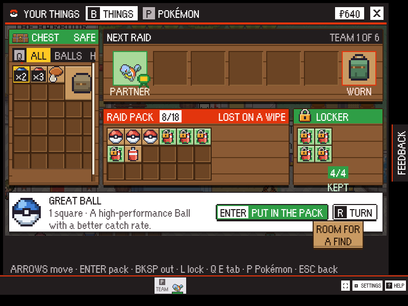 | 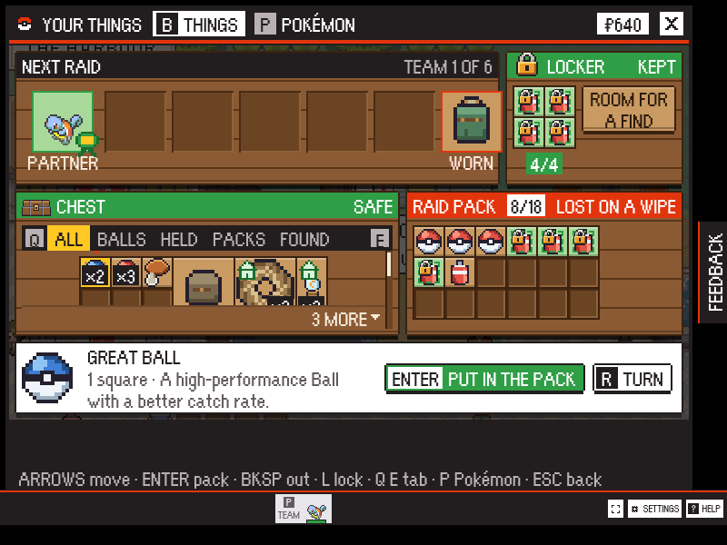 |
| BILL'S COTTAGE: the shelf for parts was pushed off the screen, and Bill's standing cut through | 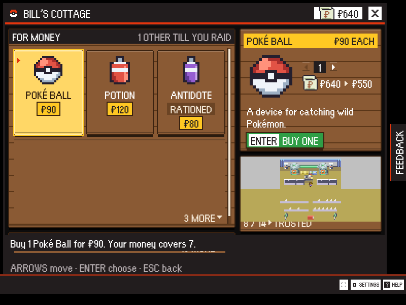 | 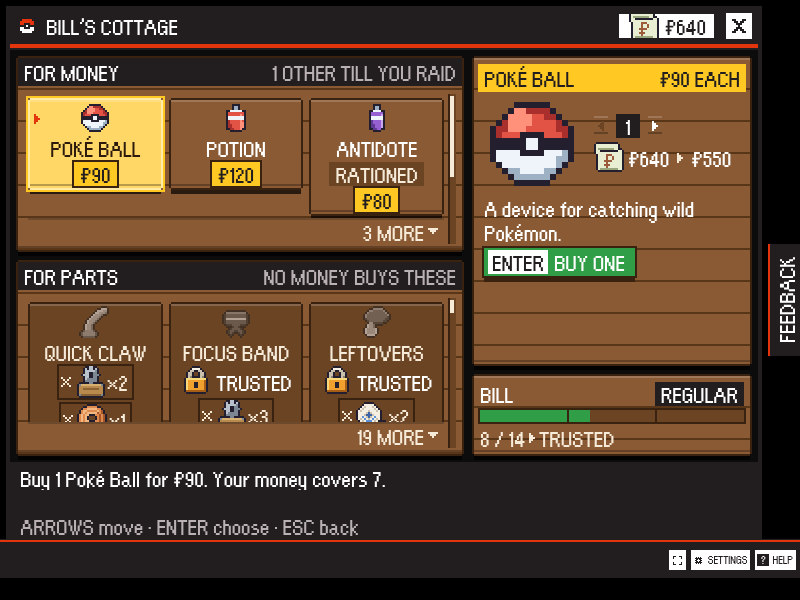 |
| BROCK'S WORKSHOP: the builds wrapped to two rows and left his room a sliver | 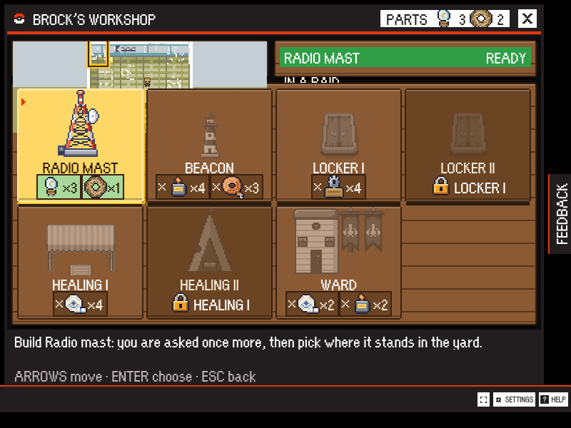 | 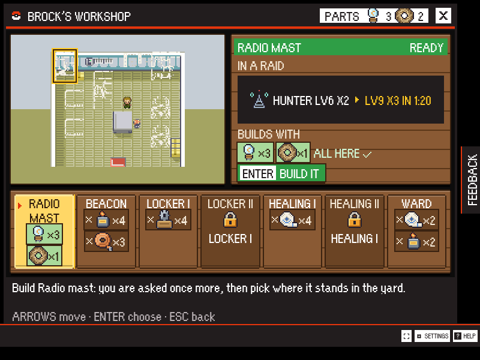 |
| HELP: four cards cut through their rows, the last keys of each out of reach | 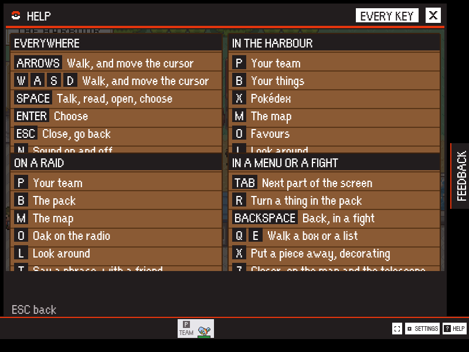 | 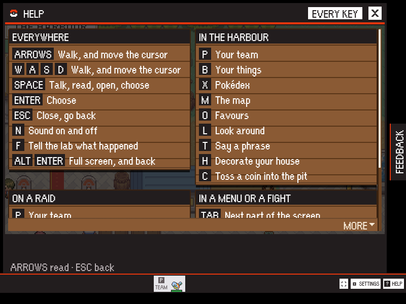 |

THE CHEST and the Raid Arena's rack and locker are YOUR THINGS' own screen, and were
fixed with it.

## What a small window gets

- **YOUR THINGS**: the locker stands beside the team, over the pack, so the chest has
  the width for all eight of its squares across. It does not scroll sideways, so
  whatever was kept past the third could not be seen at all; `yourThings.mjs` failed on
  it at this size, on main too, and passes now. It shows fewer rows, and scrolls down.
  The locker's heading says KEPT, as the chest's says SAFE and the pack's LOST ON A
  WIPE; its count is under its squares, and ROOM FOR A FIND stands beside them.
- **Bill's Cottage**: each shelf has half the height and scrolls under its own MORE; a
  card draws its thing at the icon's own size, so a card for money is whole; Bill's
  standing is his name, his rank and his bar, without the picture of his room.
- **Brock's Workshop**: the builds stand in one row, each its name and what it is built
  with, without its picture (it is chalked in the room above); the card beside the room
  gives up its tally of how many are built.
- **HELP**: one pane, read on with the arrows, with a MORE strip.

## Found on the way

A pane of words that is read with the arrows could be read down and never back up, in
any window: HELP here, and the raid's full report. The pane holds the keyboard's focus
while it is read, and was taken for a row standing under its own MORE strip, so every
scroll pushed it on again (`standsOnARowOf` in `ui/MenuOverlay.ts`).

## How it is checked

`node tools/playtest/menusAudit.mjs <test-mode build url> <dir> --window=800x600 --fit`
opens all thirty menus and names anything not inside its screen: a card, a row or a line
of words drawn past the body's edge, or cut through from above or below by a card that
is not a list. On the commit before this change it named twelve things; on this one,
five.

It does not see everything. It named neither Brock's Workshop, whose cards were all
inside the screen and merely squeezed to slivers, nor the Day-Care, below; both were
found by looking.

## The second pass: the Day-Care, the Trader, THE CHEST's Pokémon

The same day. A save with fifteen Pokémon, six of them on the team, each with four
moves with long names, and seven kinds of thing to give: the first pass looked at a
new save's two Pokémon, and a screen that is whole for two is not whole for fifteen.

| 800x600 | Before | After |
|---|---|---|
| THE DAY-CARE: the tiles under WHO STAYS? stood out of their pane, over the help line | 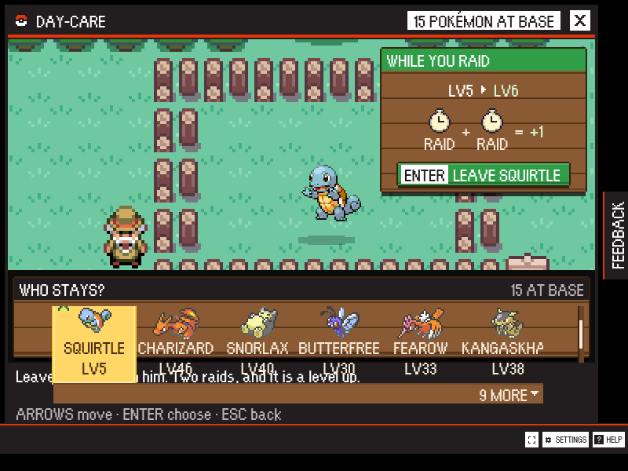 | 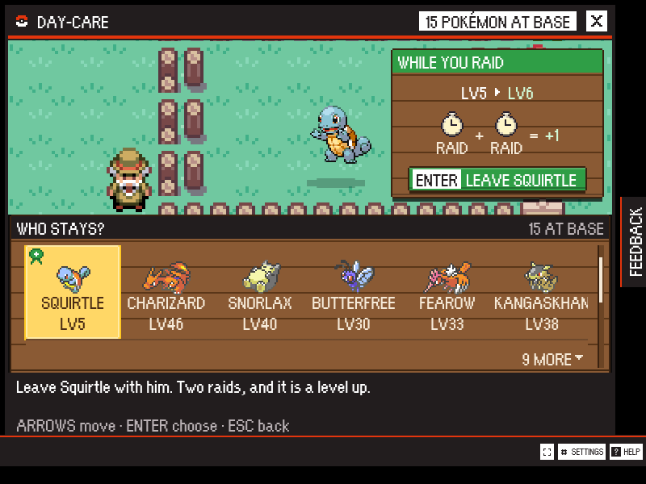 |
| THE TRADER: the same, and KANGASKHAN lost its N | 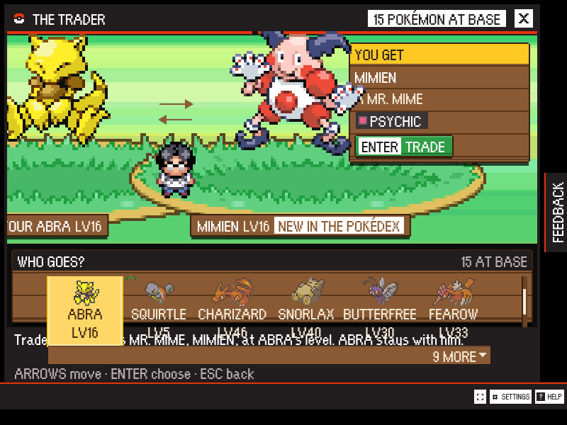 | 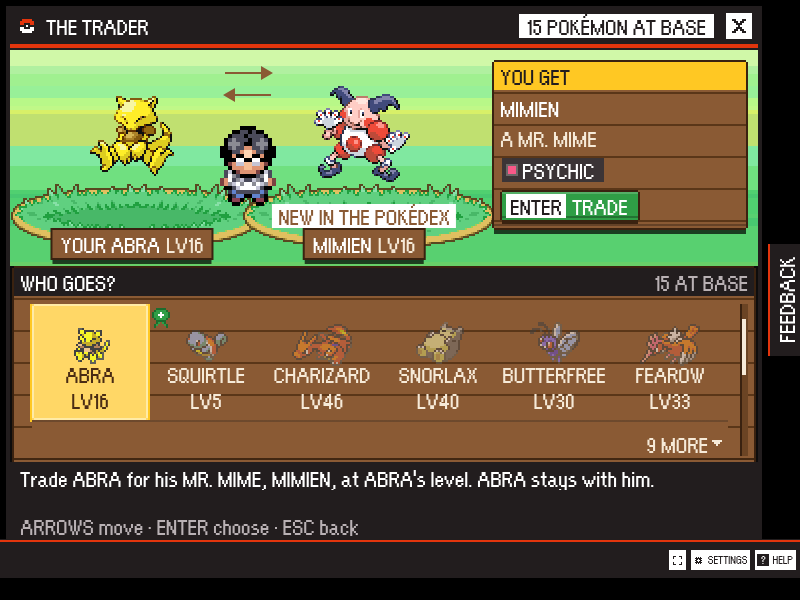 |
| THE CHEST's POKéMON: the card too narrow for its own numbers, its keys under the screen's foot, the garden's six places squeezed to slivers | 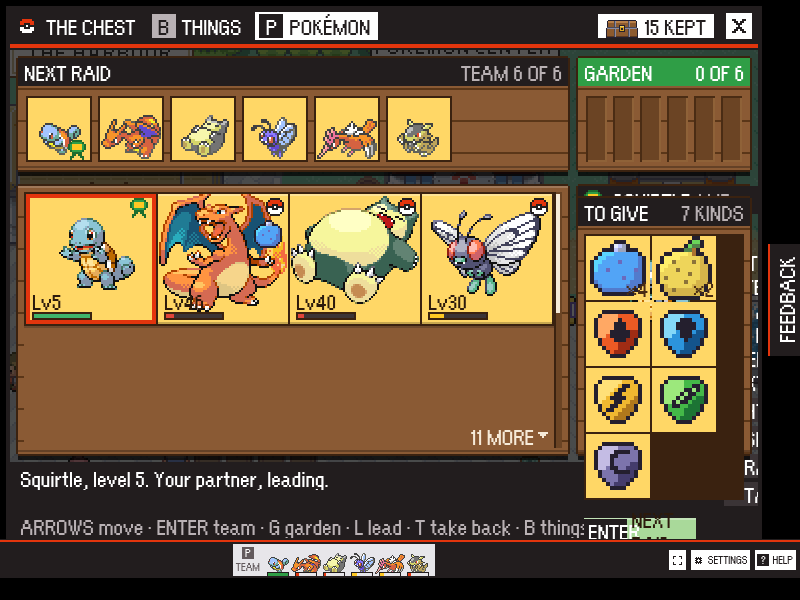 | 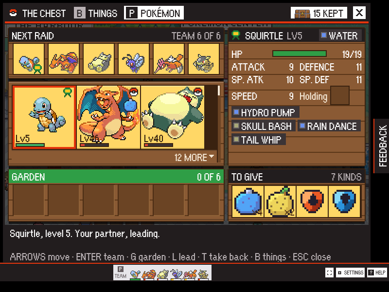 |

What a small window gets:

- **The Day-Care and the Trader**: the list has the height it asks for and the stage
  the rest. The paddock is drawn twenty higher, so the Day-Care Man's feet are on it.
  Who the Trader shows stands at the art's own size, not twice it, and NEW IN THE
  POKéDEX stands on top of its plate rather than making it too wide to stand beside
  the other.
- **THE CHEST's Pokémon**: the grid is three across, the garden goes under it, and the
  card has the height of the next raid and the grid together. The card keeps what
  choosing needs: HP and its bar, the five numbers two abreast, what it holds, its
  moves. Its picture is the square the cursor is on. Its keys are on the keys line and
  where it is on the line above. The way to the next level is not shown. What there is
  to give is one row, and the rest is scrolled to.

And in any window:

- **A list of Pokémon tiles is as tall as its bar and one row.** The bar is SORT and
  FIND. At the old height a list of one row scrolled, for nothing, and rested with a
  sliver of its bar showing; in a longer one the MORE strip took the foot of the row
  under the cursor, which was pushed up out of the top of the pane to clear it,
  cutting the partner's rosette. Before and after at 1280x800:
  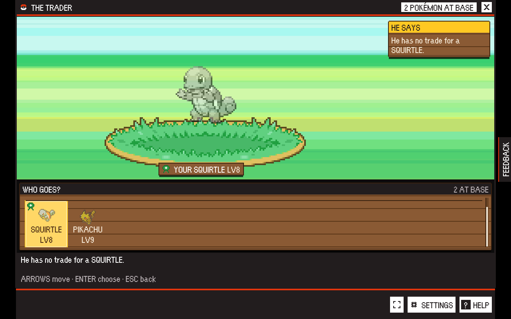 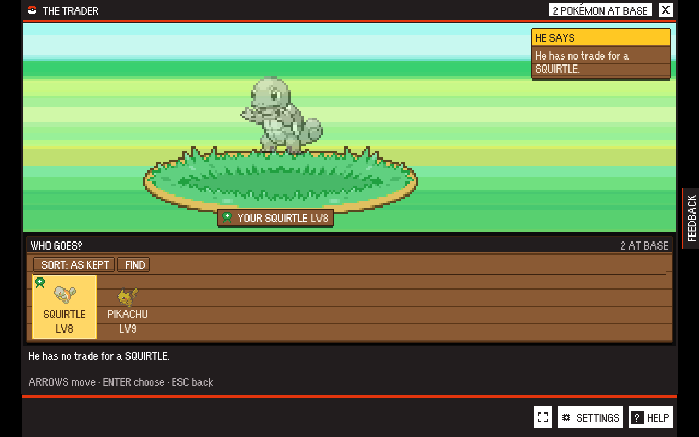
- **A tile is wide enough for KANGASKHAN.** It was called wide enough for ten letters
  and was not, for the widest ten.
- **THE CHEST's empty places come in twelves**, so the last row is whole at four
  across and at three.

After it the check names two things at 800x600, both YOUR TEAM's, and none at
1280x800. It was run on a new save, as before: the fifteen were looked at.

## The third pass: YOUR TEAM, and the bench in the Raid Arena

The last of the screens broken at 800x600, and the one that was also wrong at
1280x800 once six were on the team.

| | Before | After |
|---|---|---|
| 800x600, six on the team | 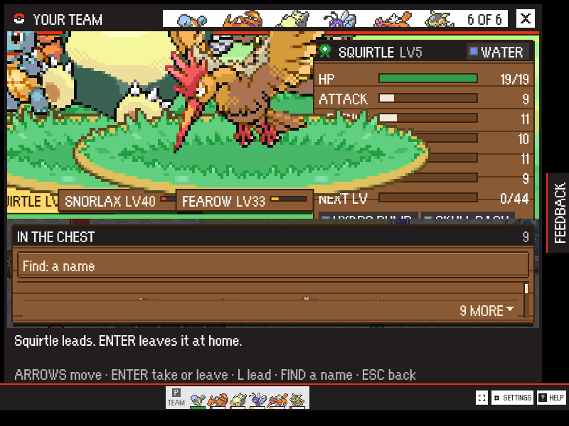 | 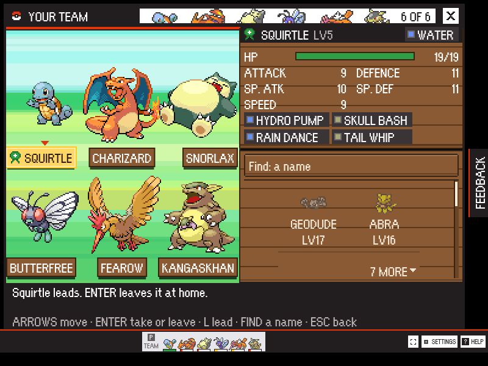 |
| 1280x800, six on the team, the cursor on the second | 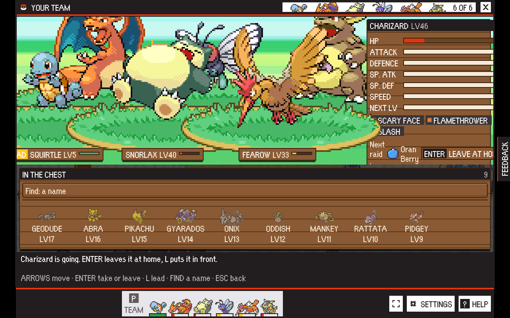 | 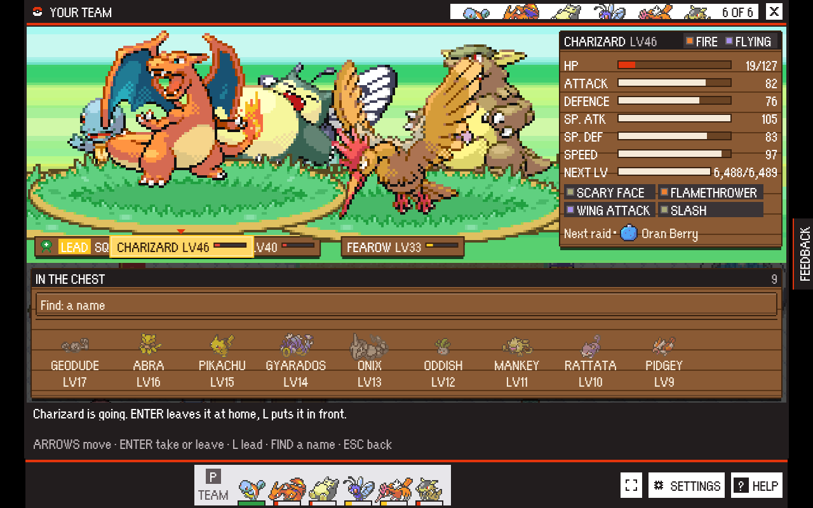 |

At 800x600 a stage over a list had about a hundred game pixels for a card that needs
more, and for six Pokémon at twice their size. There the team stands down the left,
three abreast at the art's own size with a name under each, and the card stands over
the chest's list on the right. One alone has the whole field and stands as big as in a
fight. The card keeps HP and its bar, the five numbers two abreast, what it holds
beside its speed, and its moves; the list is FIND and a row of tiles, without its
heading.

In any window, with four or more:

- **The two rows are made on the mound.** The back row's places were lifted thirty,
  which put heads out of the top of the stage and plates behind the front row's feet.
  One at the back stands further up its mound, inside its place.
- **The six stand inside the stage.** A place narrower than its picture let the first
  hang out of the left edge and the last stand under the card.
- **A plate at the back shows under the cursor.** Six plates do not fit under six
  places; the front row's show, and one at the back shows its own, in front, when the
  cursor is on it.
- **The card stands over the mounds.** A mound is wider than its place, and the last
  one's ran in over the card's edge: the first letters of NEXT LV and of a move were
  grass.

And the card, in any window:

- **It is wide enough for two long moves side by side**, so four moves are two rows.
- **It no longer says what ENTER and L do.** The help line under the screen says it;
  said again on the card, in keys too wide for it, two of them made the card wider
  than its frame and taller than the stage.
- **A number has the room it needs.** A way to the next level in the thousands ran out
  of the card's side.

After it `menusAudit.mjs --fit` names nothing at 800x600 and nothing at 1280x800.

## Still broken

The map maker at 800x600: its zoom chips wrap down their column and the map is left a
sliver (`docs/screens/wood-floor/README.md`).
