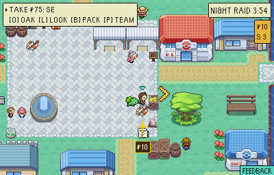
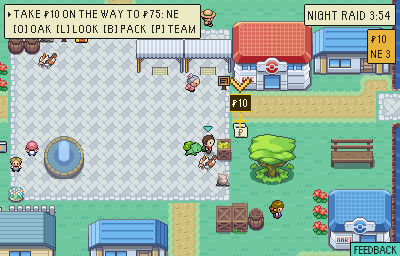

# The chip names the money the arrow is leading to

A new save's first raid at Mill Square. Before, the chip read `TAKE ₽75` while the
gold arrow led to a ₽10 pile on the way, and picking it up said "Found ₽10!" under
a chip that still said ₽75. After, the chip says `TAKE ₽10 ON THE WAY TO ₽75`, and
`TAKE ₽75` once nothing is left on the way.

| before (`?testmode=1`) | after (`?testmode=pixels`) |
|---|---|
|  |  |

Made on 22 Nov 2026 with a driver that deploys a fresh save through
`tools/playtest/deploy.mjs` and reads `describe().scene.world.raid.way`.
