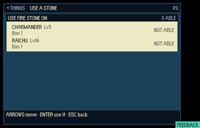
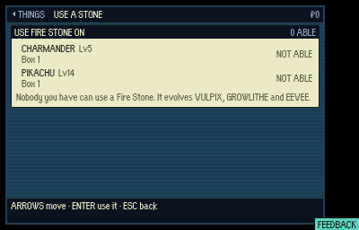

# A stone nobody can use says who it is for

Using a Fire Stone from YOUR THINGS with only a Charmander and a Raichu (or a Pikachu) listed every row as NOT ABLE and gave no reason. Each row does carry "it won't have any effect" as its help, but with nobody able the cursor has no row to stand on, so that help is never shown. The list now says, under the rows: "Nobody you have can use a Fire Stone. It evolves VULPIX, GROWLITHE and EEVEE."

| Before | After |
|---|---|
|  |  |

Made on a test-mode build (`?testmode=1`, 400x256) with `tools/playtest/ai-player/act`, from a save holding a Thunder Stone and a Fire Stone: B for YOUR THINGS, down to FIRE STONE, ENTER.
