# The story after the Raid Arena: raids jump in from the rim, and the Seagallop is the islands ferry

Every raid starts at THE RAID ARENA and rides home to its rim, so nothing in the
harbour says a boat runs raiders out or brings them home any more. The SEAGALLOP
is the islands ferry (crates, fish and visitors), and her sailor still keeps count
of the player's raids. The Marshal says one line about the pit.

Made with `node tools/playtest/storyLines.mjs <url> <dir>` against a test-mode
build (`VITE_EPTW_TEST_MODE=1 npx vite build`, served under the Pages subpath,
`?testmode=pixels`, 1200 by 768). The before pictures are from `main` at
`f144d062`, taken for the story report the same way.

## The sailor

Before: 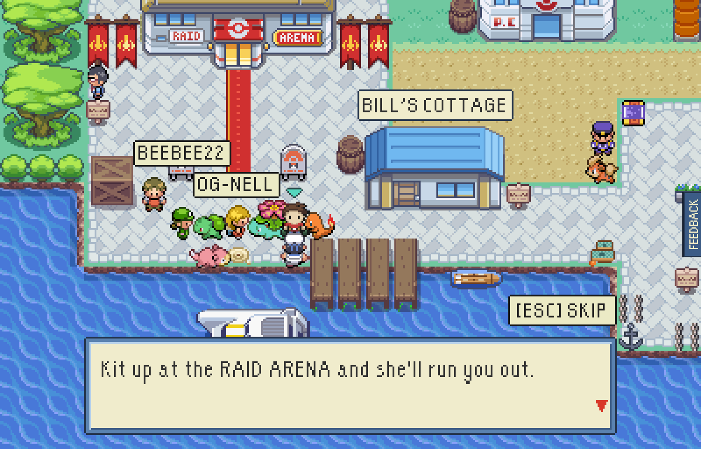

After, a new save:  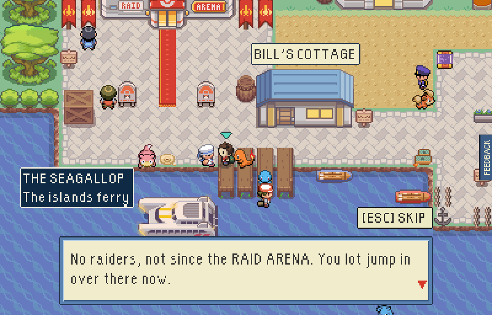 

After, five raids and three home: 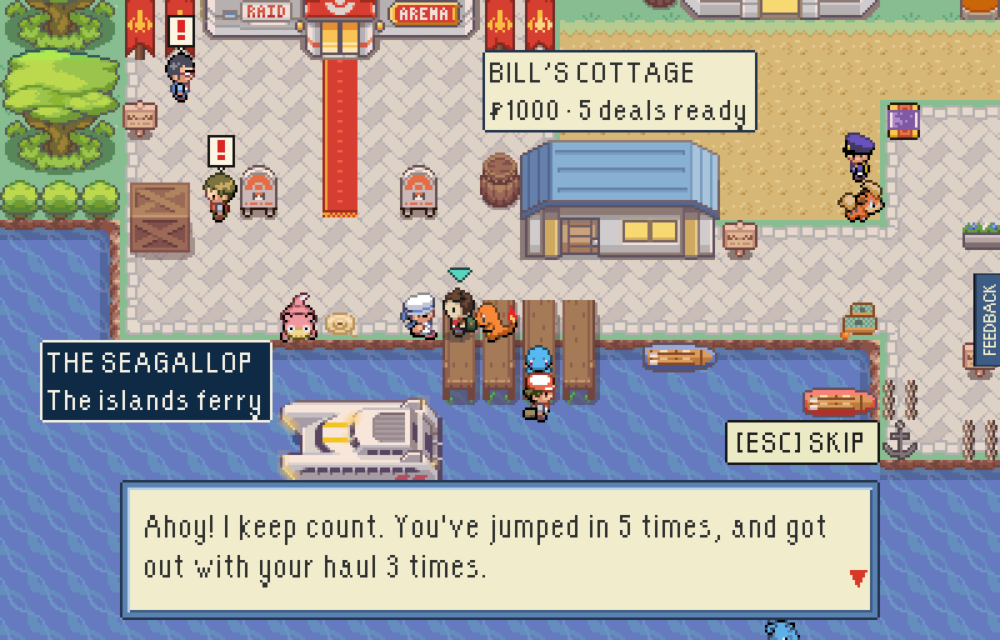 

## The ferry's plate

Before: 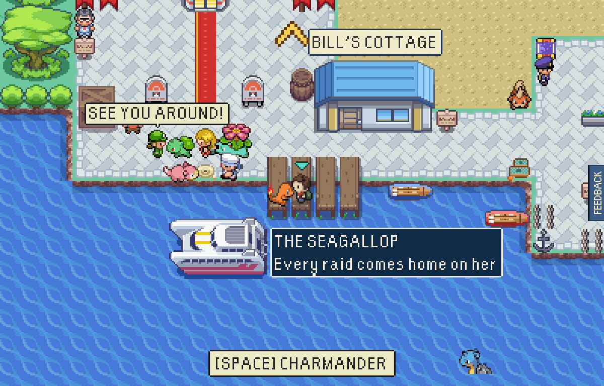 After: 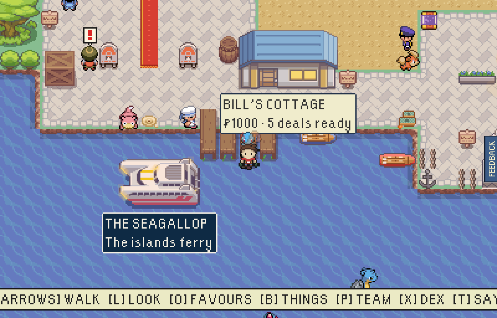

## The notice board

Before: 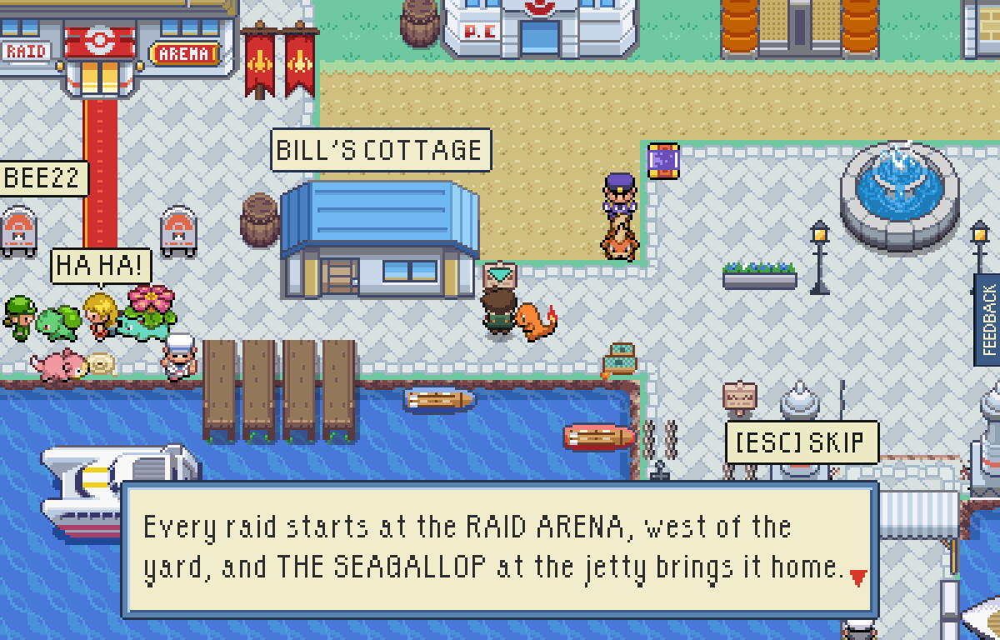 After: 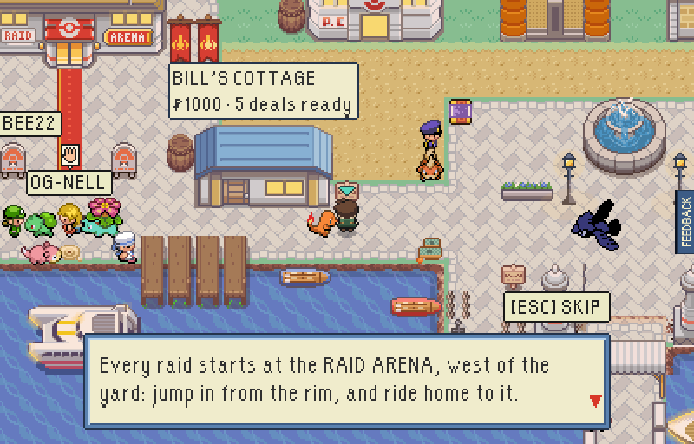

## The Arena's sign

Before: 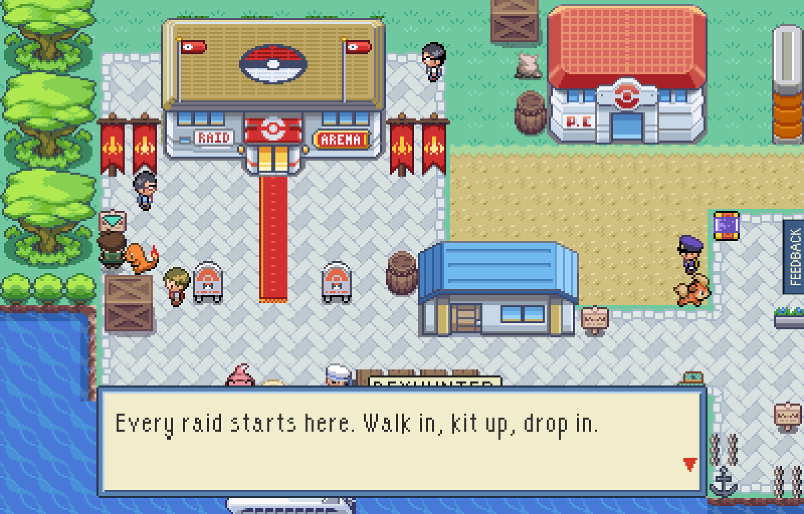 After: 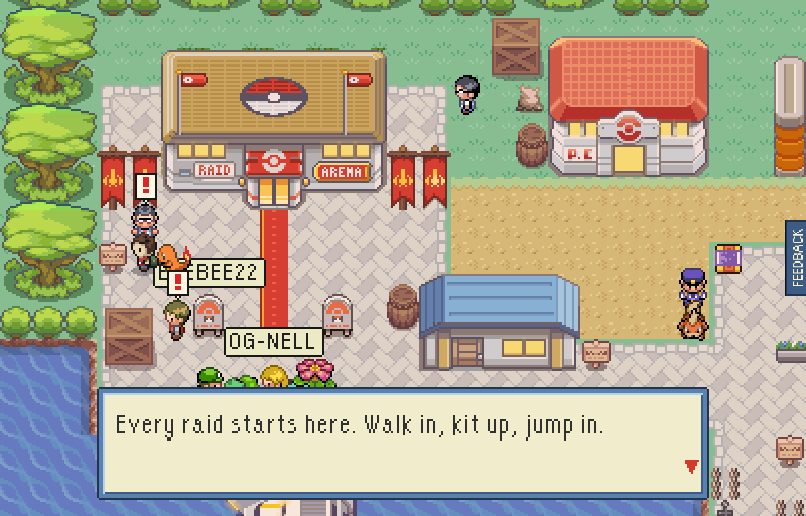

## Oak's door, the old man, the trailer card, the Marshal and Bill

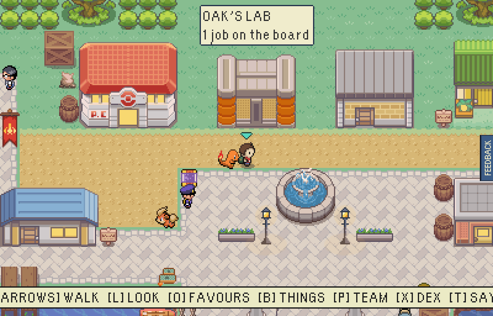 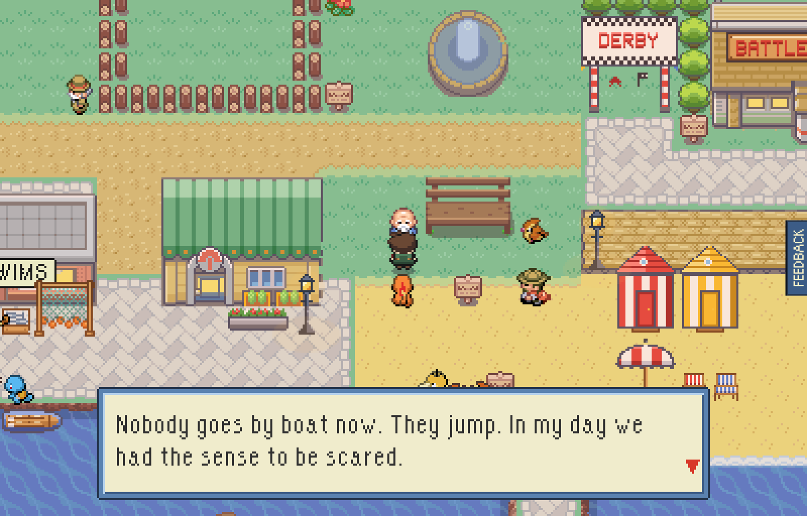 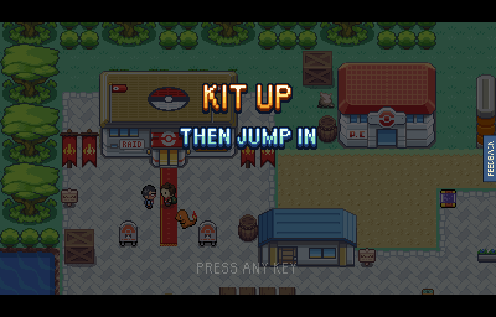
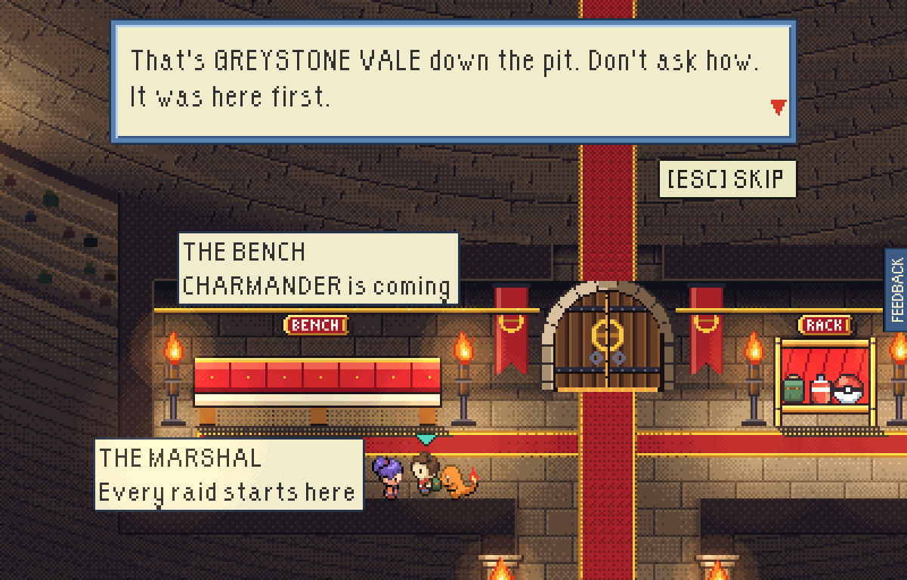 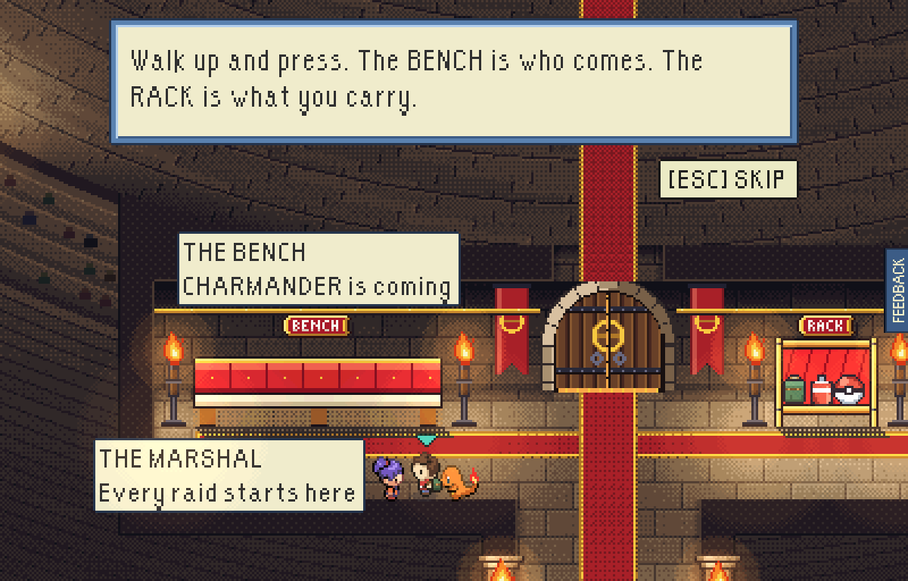 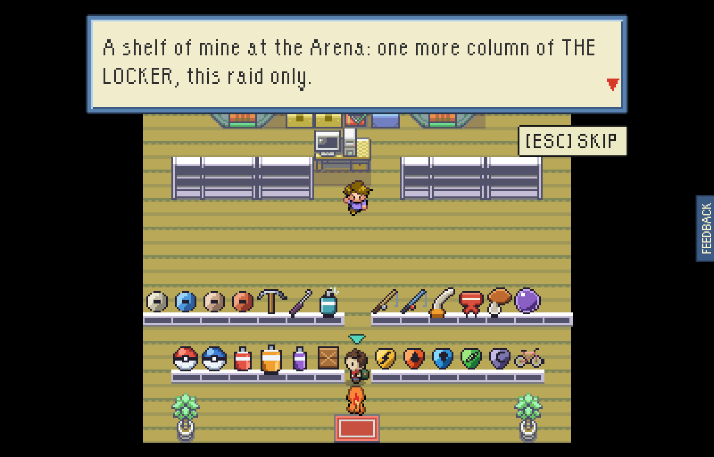
