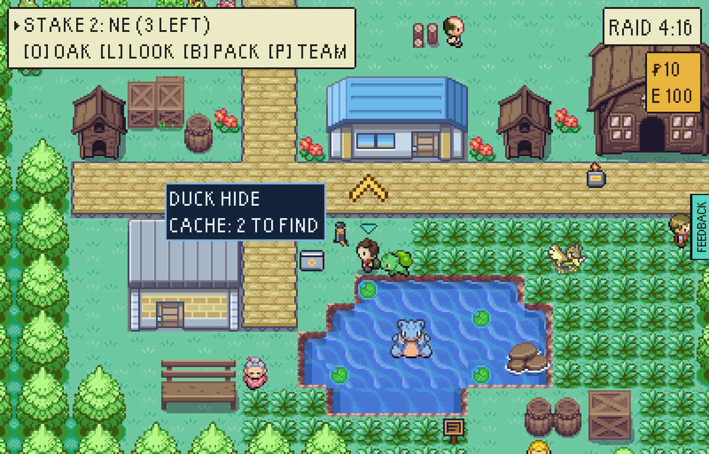
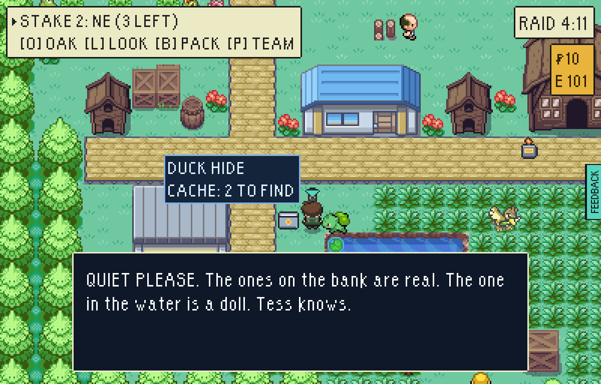
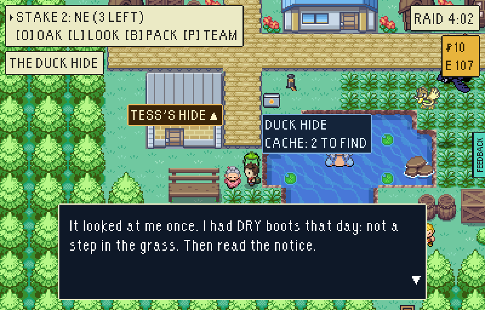
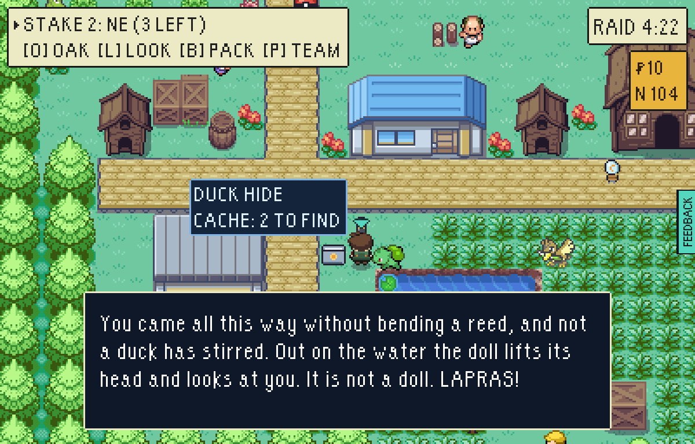
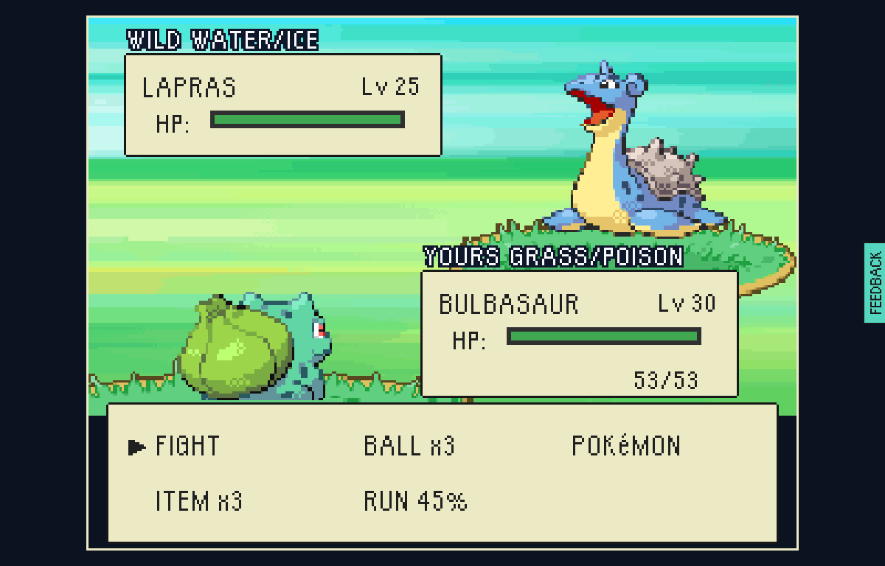

# The Lapras doll

There has always been a Lapras doll floating on the pond by THE DUCK HIDE in
Reedmere, and a notice saying so: "The ones on the bank are real. The one in
the water is a doll. Tess knows." Birder Tess, beside it, says it has not
moved in a week.

It is a Lapras. It lifts its head for somebody the ducks did not hear coming:
**dry boots**, which is not one step in tall grass the whole raid.
`src/game/world/secrets.ts` is the rule.

| Find | Where | What it waits for |
| --- | --- | --- |
| **THE LAPRAS DOLL**: Lapras, Lv 25 | THE DUCK HIDE in Reedmere, read at its notice | Dry boots: no step in tall grass all raid |



## Boots wet, boots dry

| Having waded: the notice is a notice | What Tess says now | Dry boots: it looks up | What it was |
| --- | --- | --- | --- |
|  |  |  |  |

Reedmere is tall grass everywhere, and the dry way is the long way: the
boards. From Mill Square, where a new game lands, the dry walk to the hide is
ten steps longer than the short one. And a raid that keeps its boots dry has
caught nothing in the grass on the way, which is the real price.

One step is enough to wet them, and they stay wet for the raid: a fight in the
grass does not dry them. The doll is met once a raid. It is the map's own
furniture and goes on floating there afterwards, so once the Lapras is had the
notice is true.

## How to find it

Walk to Reedmere without stepping in tall grass: out of Millbrook by the lane
south, and keep to the boardwalks. THE DUCK HIDE is in the south-west corner,
past the Withy Beds. Face the notice by the pond and read it. On the board in
Oak's lab a rumour says where and what it wants.

## How these were made

`tools/playtest/raid.mjs` against a test-mode build of this branch:

```sh
# having waded: into the grass by the pond, then the notice, then Tess
node tools/playtest/raid.mjs <url> --pixels --stepped --window=pixel --seed=7 --fresh --skip-contract --clock=day --shot-battles --said \
  --insertion=greystone-vale-the-strand --level=30 --avoid-watch \
  --steps=walk:82:241,walk:80:241,shot:hide,read:79:241:up:2,read:77:245:left:3
# dry: from where a new game lands, never stepping in tall grass
node tools/playtest/raid.mjs <url> ...same... --insertion=greystone-vale --level=30 --avoid-watch --dry \
  --steps=walk:80:241,read:79:241:up
```

`--dry` is new: the driver never steps into tall grass, whatever the shorter
way is, and says so if a place cannot be reached without.
