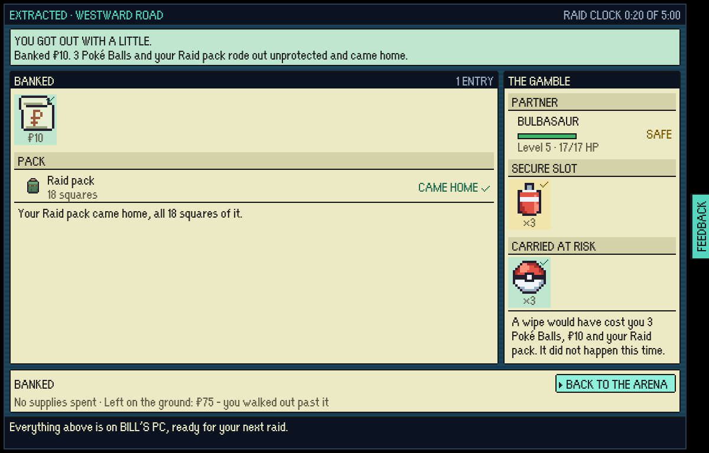

# A small haul's headline says it was small

A new save's first raid: the first ₽10 on the stake's trail picked up, then straight out
of WESTWARD ROAD with 4:40 still on the clock. Before, the result said `YOU SCRAPED OUT.`,
which reads as a narrow escape. After, it says `YOU GOT OUT WITH A LITTLE.`

| before | after |
|---|---|
|  |  |

Made on 22 Nov 2026 against the dev server in `?testmode=pixels`, with a driver that
deploys through `tools/playtest/deploy.mjs`, walks to the trail's first money and then to
the nearest open exit with `tools/playtest/route.mjs`, and lets the screen's entrance finish.
