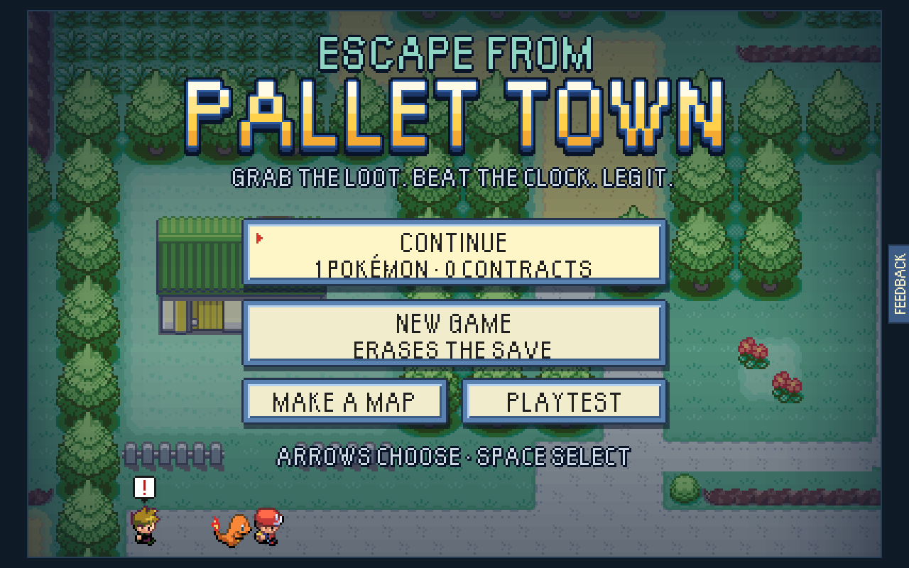
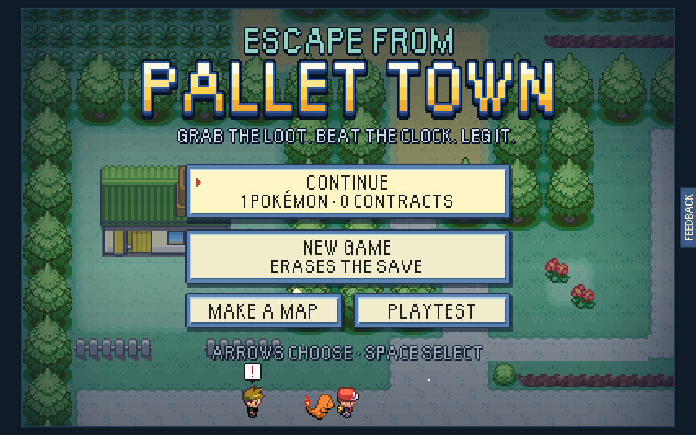
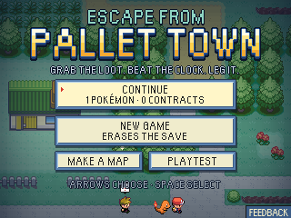

# Title buttons: the detail line off the frame

CONTINUE and NEW GAME over a save carry a second line (`1 POKÉMON · 0 CONTRACTS`,
`ERASES THE SAVE`). In a 32-high window that line was centred four pixels off the
bottom, so it sat on the frame's shaded edge while the one-line buttons under it
looked right (the captain, 25 Nov 2026).

The two-line window is 34 high now (`TITLE_ROW_HEIGHT_WITH_DETAIL` in
`src/game/ui/titleMenu.ts`), and the label and detail are centred at 11 and 23
(`DETAIL_LABEL_Y`, `DETAIL_LINE_Y` in `TitleScene.ts`), which leaves three game
pixels of paper over the label and three under the detail. 34 is the most the
320x240 stage has room for under the name and above the chase.

| before | after |
| --- | --- |
|  |  |

The smallest stage, 320x240: 

Made with `node tools/playtest/titleShots.mjs <pixels test-mode build url> <dir> --windows=1280x800,320x240`
against `VITE_EPTW_TEST_MODE=pixels` builds of `main` and of this change.
