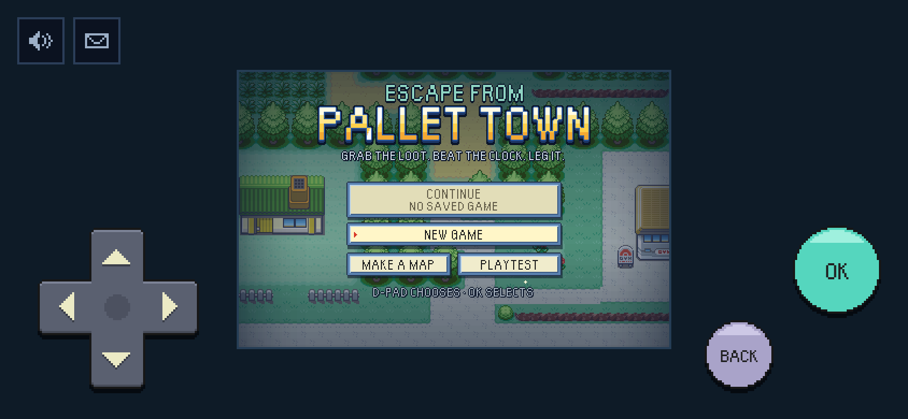
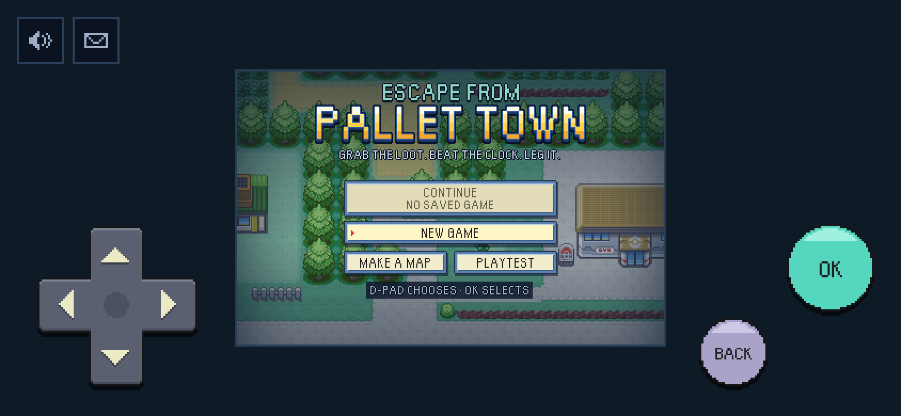
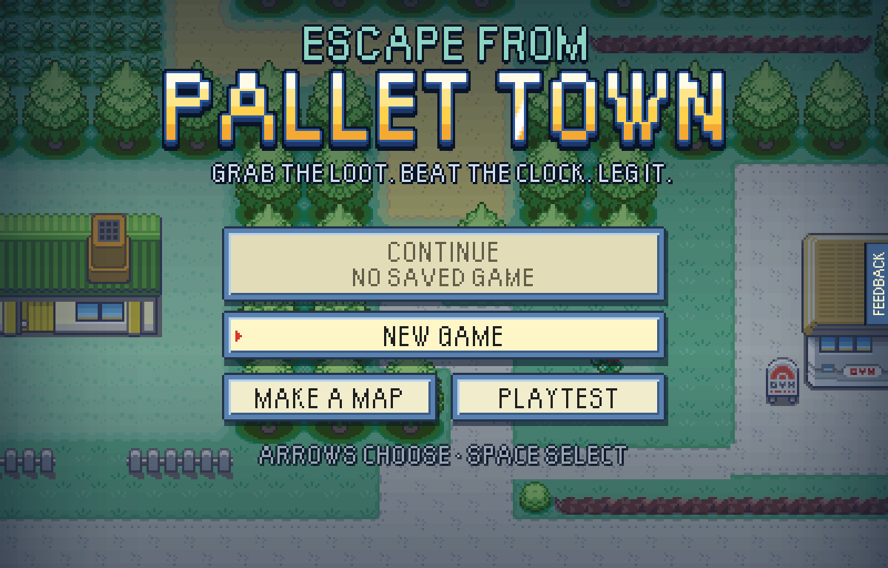
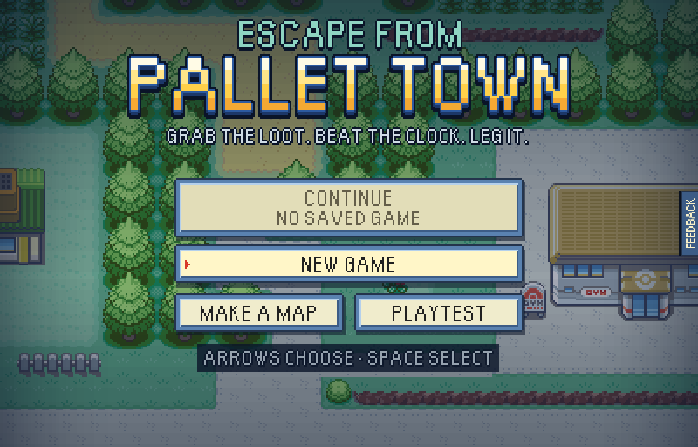

# The title's key hint on a band

The line under the title's menu (ARROWS CHOOSE · SPACE SELECT, and on a touch
screen D-PAD CHOOSES · OK SELECTS) was pale words with a one-pixel edge over the
drifting town, and over the town's pale roofs and paths it was lost. It now sits
on a band of the title's dusk, as wide as its words and four pixels more each
side, with no rim, so it reads as a caption and never as a fifth button
(`TitleScene.drawPromptPlate`).

| | before | after |
|---|---|---|
| phone, played by touch (844x390) |  |  |
| desktop (1200x768) |  |  |

Made on 25 Nov 2026 in `?testmode=pixels`: the before shots against a test-mode
build of `main`, the after shots against this branch. The phone is Chromium's
device emulation at 844x390 with touch on and a coarse pointer, which is what
turns touch play on (`input/touchPlay.ts`).
