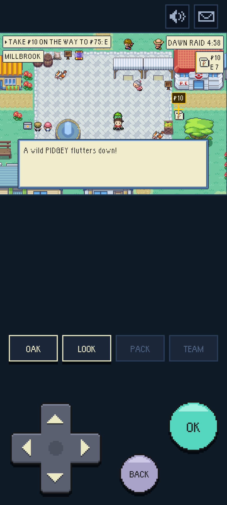

# A line waiting in the world names OK on the touch pad

A fight's box ends its waiting line in "SPACE ▼", which the touch pad says "OK ▼"; the world's dialogue box ended its line in a bare ▼. A fresh critic of the phone game found that the first raid opens on just such a line, PACK and TEAM dimmed beneath it, and nothing saying which of the pad's keys moves it on. On the pad the dialogue box's own prompt is "OK ▼" now (a box given a prompt of its own keeps it; the keyboard's box keeps the bare ▼).

| before | after |
|---|---|
|  |  |

Made with `node tools/playtest/phoneTour.mjs <test-mode build url> <dir> --device=portrait`, which photographs the line while its blinking prompt is up.
